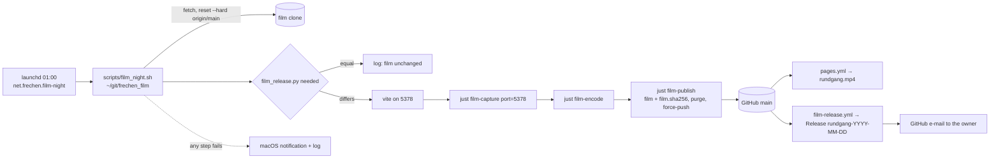

# Architecture: nightly Rundgang film when the model changed

## Approach

The existing `just film` pipeline (`film-capture` → `film-encode` → `film-publish`) stays the one
way a film is made; the change wraps it in an unattended run and adds a fingerprint so the run can
say "nothing to do".

- **Fingerprint (pure Python, `code/film_release.py`).** `fingerprint(repo)` hashes, in sorted path
  order, the generated `web/public/frechenlehen.glb` and the git-tracked viewer files
  (`web/src/**`, `web/public/**` except `*.glb`, `web/index.html`, `web/film.mjs`,
  `web/vite.config.js`, `web/package.json`, `web/package-lock.json`): path and content, so a rename
  counts too. CLI: `film_release.py fingerprint <repo>` prints it; `film_release.py needed <repo>`
  exits 0 when it differs from `<repo>/film.sha256` (or the file is missing), 1 when equal. It
  relies on the `.glb` export being byte-for-byte deterministic, which gets its own test.
- **Recipes (`justfile`).** `film-capture` gets a `port` parameter (default 5377, today's
  behaviour); with a port other than 5377 it starts and stops its own `npx vite --port <port>
  --strictPort` and refuses when that port is taken. `film-publish` writes `film.sha256`
  (computed after `npm run blueprint`) and commits it with the film; everything else (prune,
  `purge`, `--force-with-lease`, gc) as today.
- **Nightly script (`scripts/film_night.sh`).** In the film clone (`FILM_CLONE`, default
  `~/git/frechen_film`, cloned on first use): `git fetch`, `git reset --hard origin/main`,
  `git clean -fd` (keeps ignored `node_modules/`, `tmp/`), `npm ci`, `npm run blueprint`;
  `film_release.py needed .` → 1: log "film unchanged", exit 0. Else `just film-capture port=5378`,
  `just film-encode`, `just film-publish`. Everything is teed to `tmp/film-night-<ts>.log` in the
  film clone. Any failing step: `osascript -e 'display notification …'` with the log path, exit 1;
  a trap stops the server it started.
- **launchd (`scripts/launchd/film-night.plist.in`, `just film-night-install`).** A user
  LaunchAgent (`net.frechen.film-night`), `StartCalendarInterval` 01:00 daily (launchd runs a missed
  slot after wake), `ProgramArguments` the script. The recipe fills in absolute paths and the
  install-time `PATH` (node from nvm, python3 from pyenv, Homebrew `just`/`ffmpeg`/`gh` are not on
  launchd's minimal PATH), copies it to `~/Library/LaunchAgents/` and (re)loads it with `launchctl
  bootout` / `bootstrap gui/$UID`. `just film-night-uninstall` removes it. Waking the Mac
  (`sudo pmset repeat wakeorpoweron MTWRFSU 00:55:00`) is a documented one-time manual step.
- **Release workflow (`.github/workflows/film-release.yml`).** On push to `main` with
  `film.sha256` among the changed paths, and on `workflow_dispatch`: if the newest release
  `rundgang-*` already carries this fingerprint, stop; else create `rundgang-YYYY-MM-DD` (date of
  the film file) with the fingerprint and the links (Pages `rundgang.mp4`, the file on `main`) as
  body, no asset, then delete all older `rundgang-*` releases with their tags (`gh release delete
  --cleanup-tag`), so no tag keeps a pruned film blob alive. Permissions: `contents: write` only.

## Impact

- **Build scripts:** none in the model; `code/film_release.py` gains `fingerprint()` / `needed`;
  `justfile` recipes `film-capture` (port), `film-publish` (fingerprint), new `film-night-install` /
  `film-night-uninstall`; new `scripts/film_night.sh`, `scripts/launchd/film-night.plist.in`.
- **Materials:** none.
- **Garden / film:** no `ROUTE` or light change; the three.js film is now made nightly when its
  fingerprint changed; new committed file `film.sha256` beside the films.
- **Web viewer:** none (`film.mjs` unchanged; it already takes the URL).
- **Render / output:** film re-captured automatically; `.github/workflows/film-release.yml` new;
  `pages.yml` unchanged (still serves the newest film from the repo).

## Key decisions

| Decision | Alternatives considered | Why |
|---|---|---|
| Render on the owner's Mac at night | GitHub-hosted Ubuntu with software WebGL, split into parallel jobs; self-hosted Actions runner on the Mac | Real GPU: 25 min and the same look as the manual film; a self-hosted runner on a public repo would run others' code. |
| Publish by force-push as today (user's choice) | Release asset with the mp4 | Keeps one way of publishing and `pages.yml` as is; the owner prefers it. |
| Notify by a Release created by a workflow, no asset | ntfy push; iMessage; Release created from the Mac | User's choice of GitHub's e-mail; GitHub does not notify about one's own actions, so `github-actions[bot]` must create it; no asset keeps the repo's storage to the one film. |
| Delete older film releases with their tags | Keep all releases | A tag on a pre-purge commit would keep the pruned film blobs alive on GitHub. |
| Own clone `~/git/frechen_film` | A worktree in `.worktrees/` | `film-publish` rewrites and gc's the repository; a worktree shares `.git` with the working clone. |
| Nightly dev server on **5378** (user's choice) — an exception to "one dev server, always 5377" | Skip the night when 5377 is taken; stop the foreign server | The night run must not depend on or disturb the server of a working clone; the exception is limited to the film clone and written into CLAUDE.md. |
| Fingerprint = `.glb` bytes + tracked viewer files | Hash of `code/` and `web/`; last film commit vs `HEAD` diff | Renders only when a frame can change; the `.glb` already contains route, lights and fires. |
| launchd LaunchAgent, not cron | cron | launchd runs a missed slot after sleep and has the user's GUI session (GPU). |

No ADR: the choices are cheap to reverse (a recipe, a script, a workflow) and are recorded here.

## Integration points

- `justfile` › `film`, `film-capture`, `film-encode`, `film-publish`; `code/film_release.py`
  (`to_delete`, `latest`, `video_kbps`, `purge_history`) and `tests/test_film_release.py`.
- `web/film.mjs` (URL argument, `hires=on`), `web/package.json` (`blueprint`), `web/vite.config.js`.
- `.github/workflows/pages.yml` (unchanged; runs on the same push).
- CLAUDE.md › Working rules (one dev server; long-running processes; ETAs) — gets the 5378
  exception for the film clone.
- Live ADRs: ADR-001-XEWL (the film is still made from the core's Blueprint via the glTF backend;
  the fingerprint reads the backend's output, it does not restate model facts), ADR-002-MLQS (the
  `.glb` stays generated and uncommitted; only its hash is committed), ADR-003-SKGB (capture in the
  viewer as today).
