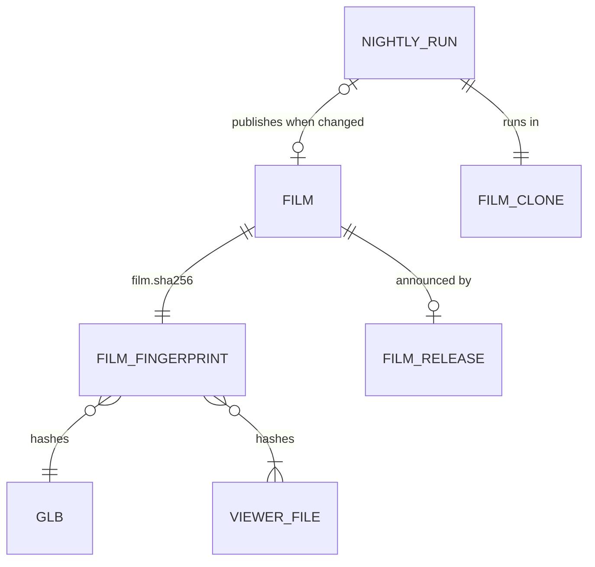

# Domain: nightly Rundgang film when the model changed

## Concepts

**Film fingerprint.** One SHA-256 over the inputs that decide what the three.js Rundgang film
shows: the bytes of the generated `web/public/frechenlehen.glb` (house, materials, room lights,
garden, fires and the baked tour keys all live in it) and the tracked viewer files that render it
(`web/src/`, `web/public/` without generated `.glb`, `web/index.html`, `web/film.mjs`,
`web/package-lock.json`, the Vite config). Edits that cannot change a frame (README, specs, Blender
scripts, tests) leave it unchanged. Stored in `film.sha256` beside the films; a film and its
fingerprint are always committed together.

**Nightly film run.** The unattended run on the owner's Mac at 01:00: bring the film clone to
`origin/main`, compute the fingerprint, compare it with `film.sha256`; render and publish only when
they differ. Outcome is one of *unchanged*, *published* or *failed* (with a notification).

**Film clone.** A separate clone of the repository (`~/git/frechen_film`) used only by the nightly
run. It never holds work of its own: every run starts with a hard reset to `origin/main`, so only
pushed work goes into a film and the history rewrite of `film-publish` happens away from the
working clones.

**Film release.** A GitHub Release `rundgang-YYYY-MM-DD` published by a workflow after a new film
reached `main`; it carries the fingerprint and links, no files. Its only job is the notification
(GitHub's release e-mail to watchers). Only the newest one exists.

## Vocabulary

| Term | Meaning |
|---|---|
| **Film fingerprint** / `film.sha256` | Hash over the `.glb` and the viewer files; equal → the film is current. |
| **Nightly film run** | The 01:00 launchd job on the Mac (`scripts/film_night.sh`). |
| **Film clone** | `~/git/frechen_film`, reset to `origin/main` on every run; dev server on port 5378. |
| **Film release** | `rundgang-YYYY-MM-DD` on GitHub, no asset, exists for the e-mail; older ones are deleted. |
