# Architecture: quick checks and a browser view of every change

## Approach

**Environment.** `requirements-dev.txt` pins pytest; `python3 -m venv .venv &&
.venv/bin/pip install -r requirements-dev.txt` (`.venv/` git-ignored). Tests run as
`.venv/bin/python -m pytest`; `npm run blueprint` and the Pages build keep the stdlib `python3`.

**Tiers.** `pytest.ini` registers the marker `slow` (`--strict-markers`); both tests in
`tests/test_blender_parity.py` carry it. Quick = `.venv/bin/python -m pytest -q -m "not slow"` +
`cd web && npx vitest run` + the step's own new test run alone (`npx playwright test <file> -g
"<case>"` for a `[web]` step). Full = `.venv/bin/python -m pytest -q` + `npm test` + `npx
playwright test` (`@eye` excluded by `grepInvert`). `scripts/check.sh quick|full` runs a tier,
times each part (`date +%s` around each), prints a table, tees to `tmp/check-<ts>.log`, warns when
quick > 60 s and exits non-zero on a failure.

**Show (`code/show.py`, pure Python, no bpy).** Reuses the Blueprint, so the view is computed
from the same geometry the viewer draws:

- `bbox(bp, names)` — min/max over the GEO vertices of the named objects (prefix match, e.g.
  `EG_Haustuer`, or `--at x,y,z` for a point).
- `view(bp, box, side=None)` → `(cam, at, p, cut)`: `at` = box centre; distance so the box's
  bounding sphere fits the 28° vertical field of view with margin; **outside objects** (box touches
  or leaves the footprint `W_OUT × D_OUT`) are seen from the facade side nearest to them, 20° from
  above, `cut=all`; **inside objects** from above at ~55° from the SE diagonal with the storeys
  above cut away (`cut=eg` in the EG, `noroof` in the OG); `p=4` (Eingerichtet) unless `--p`.
  `--from n|e|s|w|top` overrides the side.
- `url(page, cam, at, p, cut)` — the existing view-URL format (`main.js` / `submodel.js`),
  3 decimals; sub-models (`--page ofen|desk|bad`) use `build_ofen()` etc. and `look=` instead of
  `p`/`cut`.
- CLI: `.venv/bin/python code/show.py <object…> [--from …] [--p …] [--page …] [--print]` checks
  with `lsof` that the process listening on 5377 has its cwd in this repo's `web/` (else exit 2 with
  "the dev server on 5377 belongs to <path>"; switching is the user's call), then `open`s the URL
  and prints it.

**Claude's own look (`web/shot.js`).** Node + the existing `@playwright/test` dependency
(`chromium` with the config's GPU flags): load the URL, wait for the first rendered frame
(`__fl` / `__ofen` / `__desk` ready, as the e2e tests do), screenshot to the given path at 1×,
exit. Used instead of the full e2e run to see a change before the link goes to the user; works when
the Playwright MCP is down. Object hidden in the shot → retry with `--from`.

**Workflow.** Per plan step: Red → Green → Verify = step's test + quick check → Show (when the step
has a visible effect: `shot.js`, then a new browser tab) → tick. After the last tick: if the
Blender output changed, rebuild via MCP, save the `.blend`, render one still; then the full check;
then `status: applied`. `/spec:archive` runs the full check again. Blender-only steps (bpy
scripts, film) keep their per-step still. The spec plugin texts say "per-step check" / "final
check"; `project.md` defines them as quick / full.

```mermaid
flowchart LR
    S[plan step / tweak] --> T[step's own test]
    T --> Q["check.sh quick<br/>pytest -m 'not slow' · vitest<br/>≤ 60 s"]
    Q --> SH["show.py objects → view URL"]
    SH --> SHOT["shot.js URL → tmp/web/*.png<br/>(Claude reads it)"]
    SHOT -->|hidden| SH
    SHOT --> BR["open URL in a new browser tab"]
    BR --> TK[tick]
    TK -->|last step| BL["Blender output changed?<br/>rebuild · save · one still"]
    BL --> F["check.sh full<br/>all pytest · vitest · playwright ~7 min"]
    F --> A[applied → review → archive]
    A -->|archive| F
```

## Impact

- **Build scripts**: none changed; new `code/show.py` reads `house_core.build*()` (no registry
  changes).
- **Materials**: none.
- **Garden / film**: none.
- **Web viewer**: no change to `src/`; new `web/shot.js` and `web/e2e/shot.spec.js`;
  `e2e/tour.spec.js` "stills along the Rundgang" tagged `@eye`, excluded by `grepInvert` in
  `playwright.config.js` (user's OK 2026-11-09).
- **Render / output**: no re-render. New `requirements-dev.txt`, `pytest.ini`, `scripts/check.sh`,
  `.gitignore` (`.venv/`), `specs/bugs/tour-fps-below-15.md`; workflow docs: `CLAUDE.md`,
  `README.md` (Tests), `.claude/skills/spec/reference/{project,plan}.md`,
  `.claude/skills/spec/skills/{apply,tweak,archive}/SKILL.md`.

## Key decisions

| Decision | Alternatives considered | Why |
|---|---|---|
| **Two tiers**: quick per step, full once after the last step and at archive, never automatically per `[web]` step | Full suite per step (today); only quick, full in CI | The per-step full run is the measured bottleneck (≥ 7 min per `[web]` step); a final full run still catches regressions before review. No CI test job exists. |
| Quick = step's test (web: its spec alone, `-g`) + pytest `-m "not slow"` + Vitest, **no e2e suite** | Smoke subset of Playwright in quick | The e2e page load alone is ~15 s per test; the step's own test covers the change, the Show covers the look. |
| Blender parity marked **`slow`** | Keep in quick (8 s) | Starts Blender twice and needs the saved `.blend`, which is stale mid-change. |
| Core changes: **Show per step, Blender still only once at the end** (rebuild, save, still, then full check) when the Blender output changed; Blender-only steps keep per-step stills | Still per step (today); no Blender check | The browser shows the same core; the parity test needs a current `.blend`; bpy-only changes aren't visible in the browser. |
| **View computed in Python from the Blueprint** (`show.py`) | Viewer `?focus=<object>` param; hand-written URLs | No viewer change; bounding boxes come from the same core; testable with pytest; URLs stay the format already in the README. |
| Framing rule: outside → nearest facade, inside → from above with storeys cut away; `--from` override, retry after the shot | Named views per room; ray-cast for occlusion | Simple and predictable; covers door/window/facade and room changes. Named views later if a spot keeps coming up. |
| **Browser opened after every visible step** (new tab), links repeated in the summary | Once at the end; only on request | The user's request: "when a thing has been changed, open a browser". |
| **`show.py` refuses** when 5377 belongs to another clone; switching is the user's call | Stop and restart it here automatically; a second server on another port | "Exactly one dev server" (CLAUDE.md); another session may own it; showing another clone's code would be a false check. |
| **`web/shot.js`** for Claude's look | Playwright MCP only; full e2e | MCP can be down (was 2026-11-09); one shot is seconds. |
| `@eye` stills **out of the default e2e run** (user's OK 2026-11-09) | Keep (66 s every full run) | It asserts nothing a human doesn't check; the Show replaces it. |
| Repo-local **`.venv`** with `requirements-dev.txt` for pytest | pytest into Homebrew 3.15 (`--break-system-packages`); `.python-version` for pyenv | Reproducible, leaves the system Python alone, doesn't depend on shell functions (pyenv lazy load isn't active in non-interactive shells). |
| Spec plugin texts made **generic** ("per-step check" / "final check", defined in `project.md`); upstream to agents1 is a follow-up | Project commands in the plugin; `project.md` only | `apply` hard-codes "full relevant suite" per step, so `project.md` alone can't change it; generic texts stay upstreamable. |
| Flaky frame-rate test → **bug file**, baselines count "no new failures" | Fix now; loosen the threshold | Out of scope; a known red stays readable. |

No ADR: tiers and helpers are easy to reverse.

## Integration points

- `house_core.build()`, `build_ofen()`, `build_desk()`, `build_bad()`, `W_OUT`, `D_OUT`, `Z_OG`,
  `FURNITURE` (for `p`).
- `web/src/main.js` / `submodel.js` view-URL format and `HIDE` keys (`all`, `noroof`, `eg`);
  `__fl` / `__ofen` / `__desk` readiness used by e2e.
- `tests/test_blender_parity.py`, `web/playwright.config.js`, `web/e2e/tour.spec.js`.
- Spec plugin texts (`apply`, `tweak`, `archive`, `reference/plan.md`, `reference/project.md`).
- Live ADRs obeyed: ADR-001-XEWL (view computed from the core, not repeated in the viewer),
  ADR-002-MLQS, ADR-003-SKGB (untouched).
