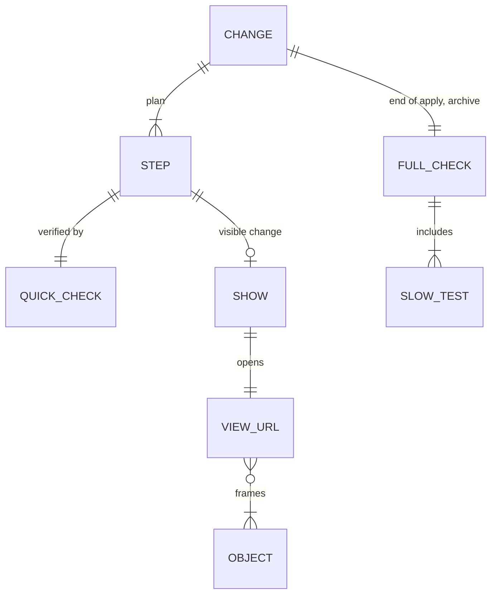

# Domain: quick checks and a browser view of every change

## Concepts

**Quick check** (the *per-step check* in the spec plugin's words). What runs after every change
(each `/spec:apply` step, each tweak): the step's own new test (a `[web]` step runs only its spec,
`npx playwright test <file> -g "<case>"`), `pytest -m "not slow"`, Vitest; then a Show when the
step has a visible effect. No e2e suite. Budget 60 s. Changes the system rule "a step is ticked when
its Verify and the full suite pass": a step is ticked when its Verify and the quick check pass.

**Full check** (the *final check*). Everything: all pytest incl. tests marked `slow` (Blender
parity), Vitest, all Playwright projects (`dev`, `build`, `preview`) except `@eye`. Runs once after
the last plan step is ticked (before `status: applied`), at `/spec:archive`, and on request; never
automatically after each step. When the change touches the Blender output, the end of apply first
rebuilds via MCP, saves the `.blend` and renders one still, so the parity test sees the current
build. Budget ~7 min for the Playwright part (measured 6.5–7.6 min without `@eye`). A baseline counts "no new failures" (known bugs in
`specs/bugs/`).

**Slow test.** A pytest test marked `slow` (starts Blender); excluded from the quick check.

**`@eye` test.** A Playwright test that only makes pictures for a human; not in the default run,
run on request with `--grep @eye`.

**Show.** Opening the user's browser on the dev server at a **view URL** that makes a change
clearly visible: the camera frames the changed objects' bounding box, the stage shows them, the
cutaway removes what hides them. Claude screenshots the same URL first (`web/shot.js`) and, if the
object is hidden, retries with `--from` before opening the browser. One new tab per visible step;
all links again in the final summary. Replaces the per-step Blender still for core changes.

**View URL.** The viewer's existing URL state: house `?cam=x,y,z&at=x,y,z&p=0…4&cut=all|noroof|eg`,
sub-models `?cam=&at=&look=`, model coordinates (z up).

## Vocabulary

| Term | Meaning |
|---|---|
| **Quick check** | = per-step check: step's test + `pytest -m "not slow"` + Vitest (+ Show), ≤ 60 s. |
| **Full check** | = final check: all pytest, Vitest, all Playwright projects; end of apply, archive, on request. |
| **Slow test** | pytest marker `slow` (Blender parity); excluded from the quick check. |
| **`@eye` test** | Playwright test that only makes pictures for a human; run on request. |
| **Show** | Browser opened at a view URL on the change (`code/show.py`), after Claude's `shot.js` look. |
| **View URL** | `?cam=&at=&p=&cut=` (house) / `?cam=&at=&look=` (sub-models). |
