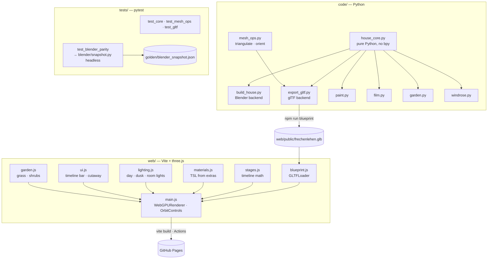
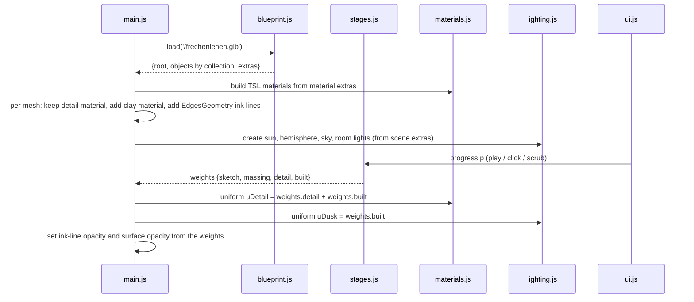

# Architecture: Frechenlehen in three.js — architect's model in the browser

## Overview



## Key decisions

| Decision | Alternatives considered | Why |
|---|---|---|
| Shared pure-Python core with two backends: Blender and glTF | Export `.blend` → glTF; port the builders to JS | One source of truth; the geometry code is already free of `bpy`. |
| The core's output is called **Blueprint** | "Model" | "Model" already means the whole 3D house in `specs/system`. |
| WebGPURenderer + TSL | WebGLRenderer + GLSL patches | Closest match to Blender's node trees; automatic WebGL2 fallback. (Details below.) |
| Stages change by **crossfade** | Construction build-up (parts appear in building order) | Smaller scope. Build-up is a candidate for a later change. |
| Host on **GitHub Pages** from the public repo | Local only; private hosting behind a password | Family and friends need a link. The film is already public, and the viewer shows no room names. |
| **Desktop browsers** only for now | Desktop + phones/tablets | Keeps the light count, shadow size and line count free of mobile limits. Mobile is a later change. |
| **German UI**, English code and specs | All English; all German | Matches the README (German) and the code base (English). |
| Look target: **same palette, recognisably the same house** as the Blender renders; Skizze, Massenmodell and Gebaut in the demo's style | Pixel parity with `docs/images/*`; a completely own look | A starting point. The look is tuned in later iterations, not to a pixel tolerance. |
| Garden: the core holds the **garden layout** (no-grass rectangles, density field, clump recipe, shrub placements); each backend scatters and grows plants itself | Core computes every instance and shrub mesh; web-only garden with copied parameters | Shared layout without forcing Geometry Nodes or `mathutils.noise` into pure Python. Blades and leaves differ in detail between Blender and browser, by design. |
| Browser grass at **25 %** of Blender's render density, only within ~30 m of the house | Full density; viewport density (10 %) | ~4 M triangles at full density is too heavy; 25 % still reads as a meadow. Tuned with the look later. |
| Pages deploys on push to **`main`** (plus manual dispatch); `three-js` is merged after `/spec:adversarial-code-review` and `/spec:archive` | Also deploy from the `three-js` branch | Keeps the Pages environment rule at its default. The branch is previewed locally with `npm run build && npm run preview`. |
| **Shutter cross boards** are computed in the core from the shutter Parts (same boxes, on both faces) | Keep them in `paint.py`, where they are found from Blender mesh islands | Both backends show them. The parity snapshot proves the Blender boards stay identical. Boards on the outer face only are a later tweak. |
| Windrose **position and size** (`CENTER`, `R`) move into the core; its rectangle is a no-grass area | Grass through the windrose; windrose in the viewer | Keeps the Blender garden free of grass on the windrose, as today. The windrose stays a viewer non-goal (bare patch of ground there). |
| Shrub placements use their **own random stream**, separate from the leaves; the Blender garden changes once, on purpose | Core replays Blender's exact draw sequence | Replaying the leaf draws would be brittle. Shrubs move by a few cm; the look stays the same, checked with a before/after render. |
| Garden per stage: **Skizze** one ink circle per shrub, no grass; **Massenmodell** shrubs as clay blobs, no grass; **Detailmodell/Gebaut** full grass and leaves, grass fading in with the detail blend | Edge lines of every leaf and blade | ~1400 leaves per shrub would turn into ink noise. |

## Python side

### `house_core.py` — the core

It takes these from `build_house.py`, unchanged in content:

- the constants
- `MAT_DEF`
- `GEO` / `SMOOTH` / `PIVOT` / `OPENINGS` / `LEAVES` / `GABLE_WIN`
- every primitive (`add` … `boards`, `wall`, `frame`)
- every `build_*` geometry builder
- `ROOM_NAMES`

New in the core:

- `PAINT`: material name → sRGB tuple, moved from the `RAL` table in `paint.py`.
- `ROOM_LIGHTS`, moved from `film.py`.
- `WINDROSE_CENTER`, `WINDROSE_R`, moved from `windrose.py`.
- `build_cross_boards()`, moved from `paint.py`. It reads the shutter Parts of
  `EG_Laeden`/`OG_Laeden` from `GEO` (one Part = one shutter box, the same island Blender
  finds today) and adds the same boxes as before to `("EG", "Laeden_Querbretter")`, material
  `Rahmen`.
- `garden_layout(bp)`, moved from `garden.py`, pure Python (see below).
- `build()`, which does what `main()` does without Blender:
  1. clear the registries
  2. `random.seed(22)`
  3. run the builders in today's order: `build_eg`, `build_og`, `build_slabs`,
     `build_roof`, `build_outside`, `build_sanitary`, `build_cladding`
  4. run `build_cross_boards()`. This doesn't call `random`, so the `rnd` values of
     everything before it stay the same. Each board gets the `rnd` of its shutter.
     Today's board mesh has no `rnd` attribute. `Rahmen` is a plain material that ignores
     `rnd`, so the parity check skips the `rnd` checksum for this one object and compares
     everything else.
  5. compute the garden layout and return a `Blueprint`

```python
@dataclass
class Blueprint:
    geo: dict          # (collection, object) -> {"v", "f", "m", "r"}  as today
    parts: dict        # (collection, object) -> [(first_face, n_faces), …]  one per add()
    smooth: set
    pivot: dict
    mat_def: dict
    paint: dict
    room_lights: list
    garden: GardenLayout
```

#### Garden layout

| Field | Content | Taken from |
|---|---|---|
| `ground` | x0, x1, y0, y1, top | `GROUND` |
| `no_grass` | rectangles (x0, x1, y0, y1): the bounding boxes of the `NO_GRASS` objects, computed from `GEO`, + 5 cm, plus the windrose square (`WINDROSE_CENTER ± WINDROSE_R`) | `exclusion_rects()`, which today reads Blender bounding boxes |
| `density(x, y)` | 1 near the house, falling to `FAR_DENS` between `NEAR` and `FAR`; `DENSITY` clumps/m² at 1 | `emitter()` |
| `clump` | vertices, quads and the `h` attribute of the grass clump (6 blades) | `grass_clump()` |
| `shrubs` | (x, y, r, h) per shrub, in both beds | `plant_bed()` |

The clump and the shrub placements each use their own `random.Random` stream (seeds
derived from 5). `garden.py` uses a third stream for the leaves. This is the one deliberate
change to the Blender output: shrubs move by a few cm.

`garden.py` keeps everything that needs Blender: the emitter mesh built from the layout,
the Geometry Nodes scatter, the shaders, and the shrub shape (`mathutils.noise`, leaves).
`windrose.py` reads its centre and size from the core.

`parts` is new. `add()` records the face range of each call so the exporter can orient
every closed solid on its own. It is extra bookkeeping only. Blender ignores it.

**Running inside Blender.** The scripts are still run with
`exec(open(".../code/build_house.py").read())`. `build_house.py`, `paint.py`, `film.py`,
`garden.py` and `windrose.py` start with:

```python
import importlib, sys
sys.path.insert(0, "/Users/tgartner/git/frechen_blender/code")
import house_core; importlib.reload(house_core)
```

`reload` makes a long-running Blender session pick up edits to the core. Without it,
Python's module cache would serve the old version silently.

### `build_house.py` — Blender backend

It keeps only the parts that need Blender: `make_materials`, `reset_collections`,
`flush_geometry`, `build_room_names`, `build_references` and `setup_scene`. Its `main()`
becomes:

```python
bp = house_core.build()
make_materials(bp.mat_def); reset_collections()
flush_geometry(bp); build_room_names(); build_references(); setup_scene()
```

### `mesh_ops.py` — what bmesh does for us today

Blender quietly does two jobs the glTF backend has to do itself:

| Job | Approach | Why this one |
|---|---|---|
| **Triangulate** n-gons, which can be concave (notched boards, baluster cut-outs, arches) | Newell normal of the polygon → project onto its dominant plane → **ear clipping**. | Simple and exact for simple polygons, and that is all `add()` produces (no holes; holes are built from separate boards). |
| **Orient** faces outward | Per Part: build edge adjacency, flood-fill a consistent winding, compute the signed volume, and flip the whole Part if it is negative. | Each `add()` call is a closed solid (box, prism, sweep, column), so its signed volume is well defined. This matches what `bmesh.ops.recalc_face_normals` produces. |
| **Normals** | Flat, one normal per face, with vertices duplicated per face. Objects in `SMOOTH` average the normals of shared positions within a Part. | Matches Blender's flat or smooth shading per object. |

### `export_gltf.py` — glTF backend

It uses only the standard library (`struct`, `json`) and runs with the system `python3`:
`python3 code/export_gltf.py web/public/frechenlehen.glb`.

- **One node per GEO object.** The node name is the object name, `translation` is the
  pivot, and `extras.collection` holds the collection name (`EG`, `OG`, `Dach`, …).
- **One primitive per material within an object.** Attributes: `POSITION`, `NORMAL`, and
  `_RND` (float, the part's `rnd` copied to its vertices).
  - GLTFLoader turns custom attributes into lower-case geometry attributes, so `_RND`
    becomes `_rnd`.
  - A test in the web suite pins that naming against the real loader, so a three.js update
    can't break it silently.
- **Materials.** A glTF `pbrMetallicRoughness` material per `MAT_DEF` entry, named
  `FL_<name>`, so other viewers show plausible colours. The full definition goes in
  `extras`: `kind` (wood / speck / plain), the parameters, and the paint override if any.
  The viewer builds its own TSL material from those extras.
- **`scene.extras`:**
  - `room_lights` and the key constants (`Z_OG`, `W_OUT`, `D_OUT`, `RIDGE_Z`), so the
    camera framing and lights can be computed in the viewer.
  - `garden`: `ground`, `no_grass`, the density parameters (`DENSITY`, `NEAR`, `FAR`,
    `FAR_DENS`, `HOUSE_C`, `CELL`) and `shrubs`.
- **Grass clump:** a hidden node `GA_Grasbuschel` with `POSITION`, `NORMAL` and `_H`.
- **Generated, not committed.** `web/public/frechenlehen.glb` is git-ignored and rebuilt by
  `npm run blueprint`, which runs automatically before `dev`, `build` and the tests.

## Web side (`web/`)

### Stack

| Part | Choice | Note |
|---|---|---|
| Bundler | **Vite** (vanilla JS, no framework) | Matches how small the app is. Versions are pinned at setup with `npm view`, not from memory. |
| Renderer | **`WebGPURenderer` + TSL** (`three/webgpu`, `three/tsl`) | See the tradeoff below. |
| Controls | `OrbitControls` | Drag to orbit, scroll to zoom, as in the demo. |
| Unit tests | **Vitest** | Pure logic: stage weights, material parameter mapping, light list, GLB attribute naming. |
| E2E | **@playwright/test** (Chromium) | Page loads, no console errors, stage switching, cutaway, screenshots of each stage to `tmp/web/`. |

### Tradeoff: WebGPU + TSL vs WebGL + GLSL

| | WebGPURenderer + TSL | WebGLRenderer + GLSL `onBeforeCompile` |
|---|---|---|
| Procedural wood/speck/bump | Node graph in JS. `mx_noise_float` and friends map almost 1:1 to Blender's Noise → ColorRamp → Bump. | Hand-written GLSL injected into standard materials, which is brittle across three.js releases. |
| Stage blending | `mix()` on uniforms inside the node graph. | Custom uniforms in every patched shader. |
| Maturity | Still evolving; it falls back to WebGL2 automatically when WebGPU is missing. | Rock solid. |
| Inspiration | The demo and the author's later repos use TSL. | The author's older `home-sweet-home` uses it. |

**Decision: WebGPURenderer + TSL.** The materials are the hardest part to carry over, and
TSL is the closest match to Blender's node trees. The automatic WebGL2 fallback covers
browsers without WebGPU, including headless Chromium in Playwright, so tests still run.
If a TSL feature we need breaks, the fallback plan is the WebGL path for the affected
material only.

### Modules



- **`stages.js`.** Pure functions: `weights(p)` gives four non-negative weights that sum to
  1. Only the two neighbouring stages are non-zero, with a smoothstep blend between
  integers. `stageAt(p)` returns the nearest stage, used for the label highlight. There is
  no three.js dependency, so it is easy to test.
- **`materials.js`.** `detailMaterial(extras)` returns a `MeshStandardNodeMaterial`:
  - **plain:** colour, roughness and metalness from extras, with the paint override
    applied.
  - **wood:** `positionLocal` scaled 1.5 along the grain axis and 60 across it →
    `mx_noise` → colour ramp at 0.35–0.68 between the two colours → value and hue varied
    by `attribute('_rnd')` exactly as the Blender node tree does → small bump.
  - **speck:** isotropic noise at the given scale.
  - **bump:** noise-driven normal perturbation.
  - **alpha:** transparent, with `depthWrite` off.
  - **emit:** emissive.
  The final colour is `mix(clay, detail, uDetail)`, so one material per mesh covers both
  the Massenmodell and Detailmodell stages.
- **Skizze.** Each mesh gets a `LineSegments` of `EdgesGeometry` (threshold 30°), drawn in
  ink on a paper background. In the Skizze stage the surfaces are fully transparent and
  only the lines show. The lines fade out across Massenmodell.
- **`lighting.js`:**
  - **Day:** sun from today's Blender angle (50° elevation, 35° azimuth) with soft shadows,
    hemisphere light, light sky.
  - **Dusk** (`uDusk`): low sun, deep-blue sky, and `PointLight`s at `ROOM_LIGHTS` (z =
    floor + 2.0 m) with warm colour. Their intensity scales with `uDusk`.
  - The sun toggle forces `uDusk` 0 or 1 in the Detailmodell and Gebaut stages.
- **`ui.js`:**
  - Title "Frechenlehen" in a serif face with the subtitle "Vom Strich zum Haus".
  - A bottom bar with play/pause, a scrubber (`input type=range`, 0–3, step 0.001) and the
    four stage names.
  - Top right: cutaway buttons "Ganzes Haus / Ohne Dach / Nur EG" and the sun toggle.
  - `document.body.dataset.stage` and `dataset.cutaway` reflect the state, for tests.
- **`garden.js`:**
  - **Grass.** It scatters clump positions over the ground: per 25 cm cell outside the
    `no_grass` rectangles, a Poisson count with mean `density(x, y) · DENSITY · CELL² · 0.25`
    (the 25 % browser density), only within ~30 m of the house. Each clump gets a random
    rotation (z, plus a ±0.15 tilt) and a scale of 0.6–1.3, as the Geometry Nodes scatter
    does.
  - One `InstancedMesh` of the `GA_Grasbuschel` geometry, with a TSL colour ramp on `_h`
    (root → tip). It is shown only with `uDetail` > 0 and fades in.
  - **Shrubs**, one per `shrubs` entry:
    - in Detailmodell/Gebaut, a leaf cloud: dark core ellipsoid plus instanced leaf quads
      on its surface, shaded with the leaf ramp;
    - in Massenmodell, a smooth clay ellipsoid;
    - in Skizze, an ink circle of radius `r`.
  - A fixed seed keeps the scatter the same on every load.
- **Test hook.** `window.__fl = {objectCount, grassCount, setProgress(p), setCutaway(c),
  visible(name)}` is exposed only in dev and test builds
  (`import.meta.env.MODE !== 'production'`).

### Hosting: GitHub Pages

- `.github/workflows/pages.yml` runs on push to `main` and on manual dispatch:
  1. set up Python 3 and Node
  2. `npm ci` in `web/`
  3. `npm run build`, which regenerates the `.glb` through `prebuild`
  4. upload `web/dist` with `actions/upload-pages-artifact`
  5. deploy with `actions/deploy-pages`
- `vite.config.js` sets `base: '/frechen_blender/'` for production builds. The `.glb` is
  loaded via `import.meta.env.BASE_URL`.
- One-time repo setting: Pages source "GitHub Actions"
  (`gh api -X POST repos/tillg/frechen_blender/pages -f build_type=workflow`). It is done
  when the branch is merged, not before.
- The page goes live with the merge of `three-js` into `main`. Until then, preview the
  production build locally with `npm run build && npm run preview`.

### Camera and framing

The camera starts at the south-east, as in the README view (`setup_scene`: (33, -24, 13)
looking at (7.4, 6.4, 3.2)). Blender has +Z up and glTF has +Y up. The Blender exporter
convention applies: the exporter writes `(x, z, -y)`, so north is −Z in three.js. Our
own writer does the same, which keeps the `.glb` correct in any glTF viewer.

## Integration points and risks

| Risk | Mitigation |
|---|---|
| Moving 1300 lines changes the Blender output by accident | The parity snapshot (plan step 1) runs before and after every Python step. |
| `exec` + `import` in long Blender sessions picks up stale code | `importlib.reload(house_core)` at the top of every Blender script. |
| Concave polygons triangulated wrongly | Dedicated tests with a notched prism and a baluster cut-out profile; the sum of triangle areas must equal the polygon area. |
| Many objects and lines make the page slow | Lines are merged per collection (one `LineSegments` per collection). Measure draw calls in the e2e test and report them. |
| Headless Chromium has no WebGPU | The renderer falls back to WebGL2 automatically. The e2e test asserts a non-blank canvas, not WebGPU itself. |
| TSL API differences between three.js releases | Pin the exact version in `package.json`. The GLB attribute and material tests run against the installed three. |
| Garden move changes Blender output beyond the intended shrub shift | The garden step regenerates the golden snapshot on purpose. The diff may only touch `Garten` objects, which the test checks. A README-camera render before and after is compared by eye. |
| Grass instance count too heavy on desktop | 25 % density and a 30 m radius. The e2e test reports `grassCount` and the frame time. |
| Pages base path breaks asset URLs | The e2e test also runs against `vite preview` of the production build under `/frechen_blender/`. |
