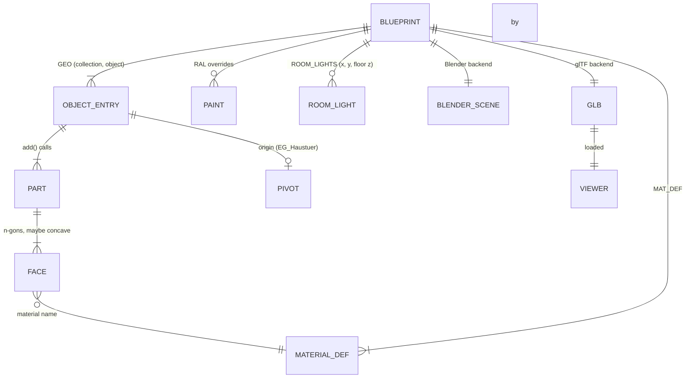
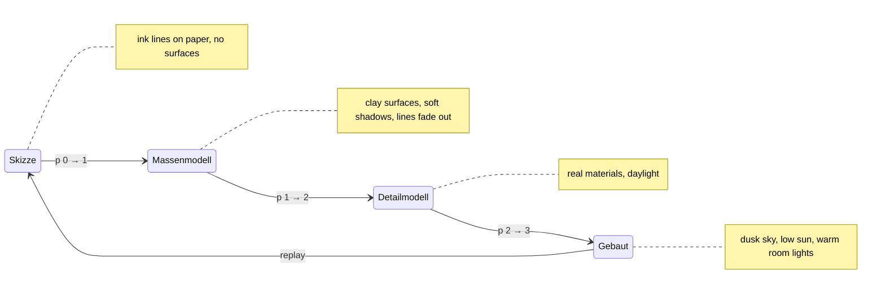

# Domain: Frechenlehen in three.js — architect's model in the browser

New and changed concepts. Everything in `specs/system/domain.md` still holds.

## New vocabulary

| Term | Meaning |
|---|---|
| **Core** (`house_core`) | The pure-Python description of the house: constants, materials as data, primitives, builders. It knows nothing about Blender or three.js. |
| **Blueprint** | What one core build returns: the `GEO` parts per object plus `SMOOTH`, `PIVOT`, `MAT_DEF`, paint colours, room-light positions and the garden layout. A plain data structure. Not to be confused with "model", which in `specs/system` means the whole 3D house (scene, `.blend`). |
| **Backend** | Turns a Blueprint into an output. **Blender backend** (`build_house.py`): `.blend` scene. **glTF backend** (`export_gltf.py`): `.glb` file. |
| **Part** | The geometry of one `add()` call: a closed solid (box, prism, sweep, …) with one `rnd` value. The unit for normal orientation. |
| **Parity snapshot** | Per-object fingerprint of the Blender build: vertex count, face count, bounding box, material names. It proves the refactor changed nothing. |
| **Viewer** | The three.js web page in `web/`. |
| **Stage** | One of four looks in the viewer: **Skizze** (sketch), **Massenmodell** (massing model), **Detailmodell** (detailed model), **Gebaut** (built reality). |
| **Timeline** | The bar that moves between stages. Its progress `p` runs from 0 to 3; integer values are the pure stages, values in between blend two neighbouring stages. |
| **Cutaway** | Viewer setting that hides the roof (`Dach`) or the roof and the OG, to see inside. |
| **Clay** | The single off-white material of the Massenmodell stage. |
| **Ink** | The dark edge-line colour of the Skizze stage. |
| **Cross boards** (Querbretter) | The two white boards across every shutter, today added by `paint.py`, from now on part of the Blueprint (`Laeden_Querbretter`). |
| **Garden layout** | The shared description of the garden: ground area, no-grass areas, grass density, clump shape and shrub placements. Each backend plants from it in its own way. |
| **No-grass area** | A rectangle where no grass grows: around house walls, terrace, gravel strip, beds, shed, the EG balcony and the windrose. |
| **Clump** (Grasbüschel) | One grass instance: 6 curved, tapering blades, 0.3–0.6 m tall. |
| **Shrub** (Strauch) | A rounded leafy bush in one of the beds (`Beet_Ost`, `Beet_West`), placed in groups of three with a gap. |
| **Room light** | A warm point light at one of the `ROOM_LIGHTS` positions (x, y, floor z), the same 23 positions as the film's fill lights. Used in the Gebaut stage. |

## Blueprint → outputs

## Stages of the viewer

- **Play** runs `p` from its current value to 3 at a steady pace. It stops at 3, and Play
  at 3 restarts from 0.
- **Clicking a stage name** jumps `p` to that stage. **Dragging the scrubber** sets `p`
  continuously.
- **The sun toggle** (as in the demo) switches between Detailmodell lighting and Gebaut
  lighting.

## Rules

- **One source of truth.** Geometry, material parameters, paint colours, cross boards,
  room-light positions, the windrose position and the garden layout are defined only in
  `house_core.py`. Neither backend nor the viewer repeats them. `film.py`, `paint.py`,
  `garden.py` and `windrose.py` import them from the core.
- **Blender output must not change**, with one deliberate exception. The parity snapshot
  before and after the refactor is identical, except for the shrubs in `Garten`. They move
  by a few cm because their placements get their own random stream.
- **The garden is alike, not identical.** Both outputs plant from the same Garden layout.
  Grass blades and leaves land in different spots, and the browser uses 25 % of the grass
  density.
- **Garden per stage.** In Skizze, each shrub is one ink circle and there is no grass. In
  Massenmodell, shrubs are clay blobs and there is no grass. In Detailmodell and Gebaut
  there are full leaves and grass.
- **Same randomness.** `build()` seeds `random` with 22 as `main()` does today, so `rnd`
  values and board splits match in both outputs.
- **Faces point outward.** Every Part is a closed solid. The glTF backend orients its faces
  so that the signed volume is positive, as Blender's normal recalculation does today.
- **Object space = world space.** Materials use object coordinates. A GEO object's vertices
  are in world coordinates, except pivoted objects, whose vertices are shifted by the
  pivot. That holds in Blender and in the `.glb` alike, so wood grain lines up the same
  way in both.
- **The cutaway never hides the ground.** "Ohne Dach" hides `FL_Dach`. "Nur EG" hides
  `FL_Dach`, `FL_OG` and the OG balconies.
