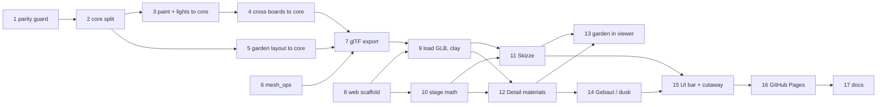

# Plan: Frechenlehen in three.js — architect's model in the browser

All work happens on branch `three-js`. Python tests run with the system `python3 -m pytest`
from the repo root. Web tests run from `web/`. `PY` below means `python3 -m pytest -q`, and
`BL` means `/Applications/Blender.app/Contents/MacOS/Blender`.

Two tracks can run side by side: the Python core and exporter (steps 1–7) and the web
scaffold (steps 8, 10). They meet at step 9.

## Python: parity guard and shared core

- [ ] [blender] Capture a parity snapshot of today's Blender build and a test that compares against it
  - Depends on: none
  - Test first: `tests/test_blender_parity.py` › "rebuild matches golden snapshot".
    - It runs `BL -b --factory-startup --python tests/blender/snapshot.py -- <tmp>.json`.
      This is headless, so the Blender MCP is not needed.
    - The snapshot script execs `code/build_house.py` and writes, per object in `Haus`:
      vertex count, face count, bounding box (rounded to 1e-5), material names as a
      **unique sorted set**, `rnd` checksum (or "none"), origin.
    - The test compares that with `tests/golden/blender_snapshot.json` and reports which
      objects differ.
    - Fails today: neither the script nor the golden exists.
    - Generate the golden from the **unchanged** code. `code/` at HEAD is identical to
      `f23ddf2`. Then check that the test passes, and that it fails after a deliberate 1 cm
      change to one wall (revert the change afterwards).
  - Verify: `PY tests/test_blender_parity.py` → 1 passed
- [ ] [python] Move constants, `MAT_DEF`, the registries, primitives, builders and `ROOM_NAMES` into
  `code/house_core.py` with `build() -> Blueprint`. Make `build_house.py` the Blender backend
  that imports it, using `sys.path` and `importlib.reload`.
  - Depends on: 1
  - Test first: `tests/test_core.py`:
    - › "build runs without bpy": import `house_core` under plain `python3`, call `build()`,
      and expect a non-empty `geo` containing `("EG", "EG_Waende")` and `("Dach", …)`
      objects. Fails today: there is no module.
    - › "build is deterministic": two `build()` calls give an identical `geo`.
    - › "parts cover all faces": for every object, the `parts` ranges are contiguous and add
      up to `len(f)`.
  - Verify: `PY tests/` → all green, **including** the parity test (Blender output
    unchanged)
- [ ] [python] Move the RAL paint colours (`PAINT`) and `ROOM_LIGHTS` into the core. `paint.py` and
  `film.py` import them. The shed battens in `build_shed` use `Holz`, and `paint.py` drops
  its `FL_Laden → FL_Holz` swap on `Schuppen_Holz`.
  - Depends on: 2
  - Test first: `tests/test_core.py`:
    - › "paint and room lights live in the core". It asserts that `PAINT` maps
      `Putz`/`Rahmen` to RAL 9010 and `Laden`/`Kachel` to RAL 5014 as sRGB 0–255, and that
      `len(ROOM_LIGHTS) == 23`. It also greps that `paint.py` and `film.py` no longer define
      `RAL =` or `ROOM_LIGHTS =`.
    - › "shed battens are wood": no face of `("Umgebung", "Schuppen_Holz")` in `build().geo`
      has material `Laden`, and `paint.py` no longer mentions `Schuppen_Holz`.
    - Fails today: the names don't exist in the core, and the battens are `Laden`.
    - Before the move, extend `tests/blender/snapshot.py` to run `paint.py` too and record
      the four painted base colours and the `Laeden_Querbretter` object. Regenerate the
      golden, so the move itself is checked. `Schuppen_Holz` keeps the same unique material
      set (`FL_Holz`, …) after the change.
  - Verify: `PY tests/` → all green, including parity
- [ ] [python] Compute the shutter cross boards in the core (`build_cross_boards()` from the shutter
  Parts, the same boxes on both faces, object `("EG", "Laeden_Querbretter")`, material
  `Rahmen`). `paint.py` keeps only the colours.
  - Depends on: 3
  - Test first: `tests/test_core.py`:
    - › "cross boards: 4 boxes per shutter". Each shutter Part of `EG_Laeden`/`OG_Laeden`
      gets 2 heights × 2 faces, and the boxes are 10 cm high and 12 mm thick.
    - › "cross boards don't shift rnd": `build()` `rnd` values of all other objects equal
      those of a build without boards.
    - Fails today: there is no `build_cross_boards`.
  - Verify: `PY tests/` → all green. Parity is identical for `Laeden_Querbretter` (vertex
    and face counts, bounding box, material), with the `rnd` checksum skipped for this
    object only.
- [ ] [blender] Move the garden layout into the core:
  - the windrose's `CENTER`/`R`;
  - the `no_grass` rectangles from `GEO`;
  - the separate `windrose` rectangles: the star `CENTER ± R`, plus a ±0.6 m square around
    each letter at `R + 0.9`;
  - the density field;
  - the clump recipe (`random.Random(5)`, so the clump stays identical);
  - the shrub placements (own stream, `random.Random(6)`).

  `garden.py` and `windrose.py` read them from the core, and the shrub leaves use a third
  stream. The Blender shrubs and a few meadow cells by the letters change once, on purpose.
  - Depends on: 2
  - Test first:
    - `tests/test_core.py` › "garden layout":
      - `no_grass` equals today's house rectangles. A fixture is recorded from
        `exclusion_rects()` in Blender before the move, without the `Windrose`/`WR_*`
        entries.
      - `windrose` has 5 rectangles. The star rectangle equals the recorded `Windrose`
        bounding box, and each letter square contains its recorded `WR_*` box centre.
      - `density` is 1 at `HOUSE_C`, `FAR_DENS` beyond `FAR`, and monotone in between.
      - The clump has 6 blades × 4 vertex pairs with `h` from 0 to 1, and its vertices equal
        the recorded Blender `GA_Grasbuschel`.
      - Shrubs come in groups of three with a gap, inside `Beet_Ost`/`Beet_West`, with a
        deterministic layout.
      - Fails today: there is no `garden_layout`.
    - Extend `tests/blender/snapshot.py` to run `windrose.py` and `garden.py` and record the
      `Garten` and `Windrose` objects: emitter cell count, shrub count, bounding boxes.
      Regenerate the golden with the **old** code first.
  - Verify:
    - `PY tests/` → all green, after deliberately regenerating the golden for `Garten`
      only. The test asserts that the diff to the previous golden touches only:
      - the `Garten` shrub objects;
      - the emitter: its cell count may differ only by cells within 5 m of the windrose
        centre;
      - `GA_Grasbuschel`, which must be unchanged.
    - Render a README-camera still before and after to `tmp/details/garden_before.png` and
      `garden_after.png`, read both and confirm that the beds look the same. Also render a
      close-up of the windrose (before/after) and check that no grass covers the letters.

## Python: glTF backend

- [ ] [python] `code/mesh_ops.py`: ear-clipping triangulation of planar n-gons, plus per-part outward
  orientation by consistent winding and signed volume; open Parts are reported as open
  - Depends on: none
  - Test first: `tests/test_mesh_ops.py`:
    - › "triangulates a concave notched board": a U-shaped 8-gon in the yz plane. The sum of
      triangle areas equals the polygon area, and no triangle's centroid lies outside the
      polygon.
    - › "triangulates a baluster cut-out profile": a fixture copy of one profile from
      `baluster_cut()`, so the step doesn't depend on the core split.
    - › "orients a box with mixed winding outward": every face normal points away from the
      centroid.
    - › "flips an inside-out prism": negative signed volume becomes positive.
    - › "open cone is reported open": an uncapped 32-segment frustum is wound consistently
      and flagged open, and it isn't flipped.
    - All fail today: there is no module.
  - Verify: `PY tests/test_mesh_ops.py` → all green
- [ ] [python] `code/export_gltf.py`: Blueprint → `.glb`
  - It writes:
    - one node per object with pivot translation and `extras.collection`
    - one primitive per material with `POSITION`/`NORMAL`/`_RND`
    - `FL_*` materials with `MAT_DEF` + paint in `extras`, `doubleSided` where an open Part
      uses them
    - `scene.extras` with `room_lights`, key constants and `garden` (incl. the separate
      `windrose` rectangles)
    - a hidden `GA_Grasbuschel` node with `_H`
  - It converts z-up → y-up.
  - Depends on: 4, 5, 6
  - Test first: `tests/test_gltf.py` parses the written GLB with the standard library:
    - › "valid GLB": magic, version 2, JSON + BIN chunk lengths.
    - › "one node per GEO object": names and collections match `build().geo`, including
      `Laeden_Querbretter`.
    - › "triangle count": equals the sum over faces of (n − 2).
    - › "every primitive has `_RND`, and its values come from the part's rnd".
    - › "materials carry `extras.kind` and paint overrides" (`FL_Laden` has RAL 5014).
    - › "bounding box": x ≈ 0…14.885 plus the overhangs; the ridge is at +Y 7.67.
    - › "`EG_Haustuer` node translation equals its pivot".
    - › "garden extras": the `no_grass` count, the `windrose` count (5), the shrub count and
      the density parameters match `garden_layout`; the `GA_Grasbuschel` node has `_H`.
    - › "open lamp cones are double-sided": the materials of the `Aussenleuchten` cones
      (`FL_Eisen`, `FL_Emaille`) have `doubleSided: true`.
    - All fail today: there is no exporter.
  - Verify: `PY tests/` → all green, and
    `python3 code/export_gltf.py tmp/frechenlehen.glb` writes the file. Report its size.

## Web: scaffold and model

- [ ] [web] Scaffold `web/`:
  - Vite vanilla + `three` + Vitest + `@playwright/test`. Pin the exact versions from
    `npm view three version` etc. at setup time.
  - `.gitignore`: `node_modules/`, `web/dist/`, `web/public/frechenlehen.glb`,
    `web/test-results/`.
  - Playwright saves screenshots to `tmp/web/`.
  - Depends on: none
  - Test first: `web/e2e/viewer.spec.js` › "page renders a canvas without console errors".
    Fails today: there is no app. `web/src/sanity.test.js` › trivial Vitest check, to prove
    the harness runs.
  - Verify: `cd web && npm test && npx playwright test` → all green
- [ ] [web] Load the GLB with GLTFLoader, render it with WebGPURenderer and OrbitControls in clay
  (Massenmodell) with sun shadows, and frame the camera from the south-east. Add
  `npm run blueprint` (runs `python3 ../code/export_gltf.py public/frechenlehen.glb`) as
  `predev`/`prebuild`/`pretest`.
  - Depends on: 7, 8
  - Test first:
    - `web/src/blueprint.test.js` › "GLTFLoader exposes `_RND` as `_rnd`". It loads the
      real GLB in Node via `GLTFLoader.parse` and asserts the attribute name and the node
      count. Fails today: there is no `blueprint.js`. GLTFLoader may need browser globals,
      so run the test in Vitest's `happy-dom` environment if Node lacks them.
    - `web/e2e/viewer.spec.js` › "blueprint is loaded": `window.__fl.objectCount` equals the
      GLB node count, and the canvas centre pixel is not the background colour.
  - Verify: `cd web && npm test && npx playwright test` → all green. Read the screenshot
    `tmp/web/massing.png` at 1× and check that the whole house is visible: roof, all four
    sides and the ground.
- [ ] [web] `stages.js`: `weights(p)` and `stageAt(p)` for the four stages
  - Depends on: 8
  - Test first: `web/src/stages.test.js`:
    - › weights sum to 1 for p in 0…3 (step 0.01)
    - › integer p gives a pure stage
    - › p = 1.5 has only massing and detail non-zero
    - › weights are continuous
    - › `stageAt` rounds to the nearest stage
    - Fails today: there is no module.
  - Verify: `cd web && npm test` → all green

## Web: the four stages

- [ ] [web] Skizze, hidden-line:
  - ink `EdgesGeometry` lines, merged per collection, with no lines for `SMOOTH` objects
    (`Kiesel`, `Aussenleuchten`);
  - surfaces drawn in paper colour, writing depth, with a polygon offset;
  - the surface colour blends paper → clay across p 0→1, and the lines fade out across
    p 1→2.
  - Depends on: 9, 10
  - Test first: `web/e2e/stages.spec.js`:
    - › "Skizze is hidden-line": after `setProgress(0)`, the line objects are visible, more
      than 1 % of canvas pixels are ink-coloured, and none are clay-coloured.
    - › "Skizze hides interior lines": with the camera aimed at the closed south facade, the
      ink-pixel count inside the facade rectangle stays below the count with surfaces
      hidden (`__fl.setSurfaces(false)`, test hook).
    - › "no pebble lines": no `LineSegments` source includes `Kiesel` or `Aussenleuchten`.
    - Fails today: there are no lines.
  - Verify: `npx playwright test` → green. Read `tmp/web/skizze.png` at 1× and check:
    - the lines reach the roof ridge, the gable ends and the ground (the edges of the model,
      not just the centre);
    - no furniture or stair lines show through the walls;
    - the gravel strip is a clean outline.
- [ ] [web] Detailmodell: TSL materials from the material extras (plain / wood / speck / bump /
  alpha / emit, with `rnd` variation as in Blender) mixed with clay through `uDetail`
  - Depends on: 9, 10
  - Test first:
    - `web/src/materials.test.js`:
      - › every `MAT_DEF` kind in the GLB gets a node material
      - › `FL_Glas` is transparent with `depthWrite` false
      - › `FL_Feuer` is emissive
      - › `FL_Laden` uses the RAL 5014 paint colour
      - › wood materials read `_rnd`
      - Fails today: there is no `materials.js`.
    - `web/e2e/stages.spec.js` › "Detailmodell is coloured": at p = 2, the shutter region is
      bluish (with white cross boards) and the west cladding region is larch-brown.
  - Verify: `cd web && npm test && npx playwright test` → green. Read
    `tmp/web/detail.png` and a 1× close-up of the west side, and compare them with
    `docs/images/ansicht_nordwest.png` (same palette, recognisably the same house).
- [ ] [web] Garden in the viewer: grass `InstancedMesh` at 25 % density within ~30 m, no grass in
  the `no_grass` rectangles (the `windrose` rectangles are ignored), shrubs per stage (ink
  circle / clay blob / leaf cloud)
  - Depends on: 11, 12
  - Test first:
    - `web/src/garden.test.js`:
      - › no clump lies inside a `no_grass` rectangle
      - › clumps do lie inside the windrose star rectangle (it is ignored)
      - › clump count is within ±10 % of the expected 25 % density integral
      - › no clump lies beyond 30 m
      - › same seed gives the same scatter
      - › one shrub per `shrubs` entry
      - Fails today: there is no `garden.js`.
    - `web/e2e/stages.spec.js` › "garden per stage": grass is hidden at p = 0 and p = 1 and
      visible at p = 2; shrubs are circles at p = 0. It reports `grassCount` and the mean
      frame time.
  - Verify: `cd web && npm test && npx playwright test` → green. Read `tmp/web/detail.png`
    and check that grass reaches the far edges of the frame around the house and stays out
    of the terrace and gravel strip.
- [ ] [web] Gebaut: dusk sky, low sun, warm `PointLight`s at `ROOM_LIGHTS`, all scaled by `uDusk`;
  the sun toggle forces day or dusk
  - Depends on: 12
  - Test first:
    - `web/src/lighting.test.js` › "one room light per `ROOM_LIGHTS` entry at floor +
      2.0 m, converted to y-up". Fails today: there is no `lighting.js`.
    - `web/e2e/stages.spec.js` › "Gebaut is darker outside, warm windows": at p = 3 the mean
      sky luminance is below the p = 2 value, and some window-area pixels are warm (r > b).
  - Verify: `cd web && npm test && npx playwright test` → green. Read `tmp/web/gebaut.png`.

## Web: UI and hosting

- [ ] [web] Timeline bar (play/pause, scrubber 0–3, four stage names), title, cutaway buttons
  (Ganzes Haus / Ohne Dach / Nur EG), sun toggle, `body.dataset.stage` / `dataset.cutaway`.
  All labels are German.
  - Depends on: 11, 14
  - Test first: `web/e2e/ui.spec.js`:
    - › clicking "Detailmodell" sets `data-stage="detail"`
    - › dragging the scrubber to its end sets `data-stage="built"`
    - › Play advances p and stops at 3
    - › "Ohne Dach" hides every `Dach` node (including `Verschalung_West`) and keeps the
      ground visible
    - › "Nur EG" also hides OG and the `Balkon_OG_*` balconies, and keeps `Balkon_EG_Nord`
    - Fails today: there are no controls.
  - Verify: `npx playwright test` → green. Read `tmp/web/ui.png` at 1× and check that the
    bottom bar, the title and the top-right buttons don't overlap at 1280×720 and 1920×1080
    (desktop only for now).
- [ ] [web] GitHub Pages (indexable, no `noindex`):
  - `.github/workflows/pages.yml`: on push to `main` and on `workflow_dispatch`, it sets
    up Python and Node, runs `npm ci` and `npm run build` in `web/`, uploads with
    `upload-pages-artifact` and deploys with `deploy-pages`.
  - `base: '/frechen_blender/'` for production builds, with the `.glb` loaded via
    `import.meta.env.BASE_URL`.
  - Depends on: 15
  - Test first: `web/e2e/preview.spec.js` (Playwright project `preview`, served by
    `vite preview` from the production build) › "page loads under /frechen_blender/ with
    the blueprint": no 404s and `objectCount` > 0. Fails today: the build uses base `/`, so
    the GLB request 404s under the sub-path.
  - Verify: `cd web && npm run build && npx playwright test --project=preview` → green, and
    `npx --yes @action-validator/cli ../.github/workflows/pages.yml` → exit 0. The first
    real deploy and the one-time Pages setting (`build_type=workflow`) happen with the merge
    into `main`, after `/spec:archive`.

## Docs

- [ ] [docs] README (German):
  - new `house_core.py` / `mesh_ops.py` / `export_gltf.py` rows in the script table
  - a "Web-Ansicht (three.js)" section with `cd web && npm install && npm run dev` and the
    Pages link
  - a `web/` row in the structure table
  - a note that the shrubs moved slightly
  - `paint.py`'s row no longer mentions the cross boards
  
  CLAUDE.md:
  - the core/backend architecture and the Blueprint term
  - the `importlib.reload` note
  - the test commands
  - that the `.glb` is generated
  - that the garden layout, cross boards and windrose position live in the core
  - Depends on: 2, 16
  - Test first: none — docs, no runtime surface.
  - Verify: `grep -q house_core README.md && grep -q "npm run dev" README.md && grep -q
    importlib CLAUDE.md && grep -q Blueprint CLAUDE.md && PY tests/ && (cd web && npm test
    && npx playwright test)` → exit 0. Then start `npm run dev`, open it in the browser and
    check that it responds.

System docs are updated at `/spec:archive`.
