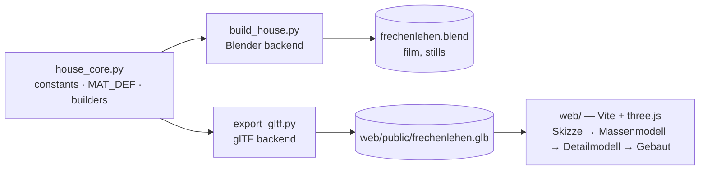

# Proposal: Frechenlehen in three.js — architect's model in the browser

## What

Show the Frechenlehen house **interactively in the browser** with three.js. The page follows
the style of the
[techartist_ demo](https://x.com/techartist_/status/2102503719762018434/video/1), an
"Architect's Model" page. A timeline moves the house through four stages:

| # | Stage (UI label) | What you see |
|---|---|---|
| 1 | **Skizze** | Ink lines of the visible edges (hidden-line) on a paper-coloured ground. |
| 2 | **Massenmodell** | The whole house as a white clay model with soft sun shadows. |
| 3 | **Detailmodell** | Real materials: plaster, larch, oak, limestone, RAL-blue shutters, glass. Daylight. |
| 4 | **Gebaut** | Dusk: low sun, blue sky and warm light in the rooms that shows through the windows. |

You orbit with the mouse. A timeline bar at the bottom has play/pause, a scrubber and the
four stage names. Buttons hide the roof or the whole OG so you can look inside. The west larch
cladding belongs to the roof collection and goes with it.

The house geometry is **not** modelled twice. The geometry code in `build_house.py` is
already pure Python up to `flush_geometry()`. We move it into a **shared core** with **two
backends**:

- **Blender backend:** builds the `.blend` exactly as today.
- **glTF backend:** writes a `.glb` file with plain Python. The three.js app loads it.

## Why

- Today the model can only be viewed in Blender, as stills or as the 139 s film. Family
  and friends can't explore it themselves.
- The demo shows a much more engaging way to present the house: from the architect's first
  line to the finished home.
- From the owner's note: "Create an abstraction layer that creates both, blender AND
  three.js". One source of truth means every fix to a wall or door appears in both outputs.

## Scope

**In:**

1. **Parity guard.** A headless Blender snapshot of today's build (per object: vertex and
   face counts, bounding box, materials). The refactor must reproduce it exactly.
2. **`code/house_core.py`:** constants, `MAT_DEF`, paint colours, room-light positions,
   primitives, builders and room names. It imports neither `bpy` nor `mathutils`.
3. **`build_house.py`** becomes the Blender backend: materials, flush, room names, reference
   planes, scene. `paint.py` reads its colours from the core and `film.py` reads its
   room-light positions from it.
4. **`code/export_gltf.py`:** core → `.glb`, standard library only. It triangulates concave
   n-gons, orients faces outward and keeps `rnd` per face. It also carries material
   parameters and room-light positions as glTF `extras`.
5. **`web/`:** a Vite + three.js app (WebGPURenderer with TSL, falling back to WebGL2)
   with:
   - the four stages and a scrubbable timeline
   - orbit controls and roof/OG cutaway
   - procedural TSL materials that follow `MAT_DEF`
   - dusk room lights
6. **Tests:** pytest for core, mesh operations and exporter. Vitest for the web logic.
   Playwright for the page itself (screenshots of every stage go to `tmp/`).
7. **Docs:** README and CLAUDE.md describe the new layout and how to run each part.
8. **Shutter cross boards** (white boards on the blue shutters) are computed in the core,
   so both backends show them. The shed battens are built as wood in the core instead of
   being swapped in `paint.py`.
9. **Garden:** meadow grass and the shrubs in the beds, in the viewer as well as in Blender.
   - The core holds the garden layout, and each side plants from it. The browser uses 25 %
     grass density.
   - The Blender shrubs move by a few cm once, on purpose: their placement gets its own
     random stream.
   - The windrose's position and size move into the core, so Blender keeps grass off the star
     and its letters (letter areas approximated).
   - The viewer draws no windrose, so grass grows there.
10. **GitHub Pages:** a workflow builds the `.glb` and the Vite app and publishes the page
    on every push to `main`, so family and friends get a link.
    - The page goes live when `three-js` is merged, after review and archive.
    - It may be indexed by search engines.
    - The UI is German; desktop browsers are the target.

**Out (non-goals of this change):**

- The walkthrough film route. The page has orbit only and no first-person walk.
- Room names as floor text (Blender font curves).
- The windrose and the hidden reference plans.
- Phones and tablets. Desktop browsers only for now.
- A construction build-up animation (parts appearing in building order). Stages crossfade.
- Matching the Blender renders pixel for pixel. The look is tuned in later iterations.
- Sketch-style trees, pool and staging props from the demo. Frechenlehen has none of them.
- Any change to the Blender output beyond the small shrub shift and a few meadow cells
  around the windrose letters. The house, the film route and the README images stay the
  same.
- Horizontal section cuts for the cutaway. That is a candidate for a later look iteration.

## Expected outcome

- `npm run dev` in `web/` regenerates the `.glb` from the Python core. It then opens a page
  that shows Frechenlehen in all four stages, with garden, in German, on desktop browsers.
- After the merge into `main`, the same page is live on GitHub Pages.
- The Blender build is identical to before, apart from the deliberate shrub shift. The
  parity test proves it.
- Each later model change is made once in `house_core.py` and appears in both Blender and
  the browser.

## Work happens on branch `three-js`

As asked, the whole change lives on its own git branch `three-js` (created from `main` at
`f23ddf2`). `main` keeps the working Blender-only state until the change is reviewed. There
are **no model edits on `main`** until `three-js` is merged, so the move into the core can't
conflict with them. `code/` is unchanged between `f23ddf2` and the current HEAD.

## Original request

> We built our model with blender, now we would like to build it with three.js.
>
> Sources:
> - This is where the inspiration came from and the way we want it to look:
>   https://x.com/techartist_/status/2102503719762018434/video/1
> - This is the guy's Github account: https://github.com/iamtechartist. Maybe there is the
>   repo with this demo
>
> I would expect that we can
> - analyse and understand three.js https://threejs.org https://threejs.org/docs/
> - Maybe re-use our scripts that build the blender model, and either translate them to
>   build three.js models, or even better: Create an abstraction layer, that creates both,
>   blender AND three.js

**Research findings (2026-10-08):**

- The demo ("Architect's Model — Courtyard House — From line to life") is built with
  three.js + TSL.
- Its four stages appear in the 19 s video: Sketch → Massing Model → Detailed Model →
  Built Reality. Day/night toggle, "drag to orbit · scroll to explore · scrub to
  transform".
- **No public repo** of it exists. The author's closest repos are `home-sweet-home` (three
  r185, single `index.html`, WebGL + GLSL) and `tideglass-cove` / `sun-temple` (TSL). They
  are all procedural, with no bundler and no imported assets.
