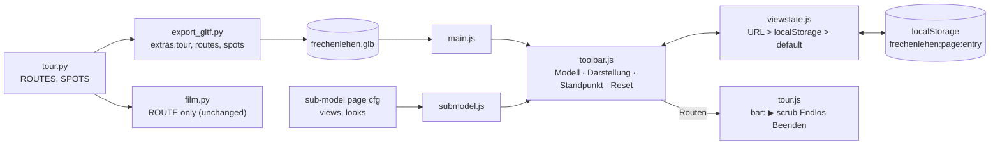

# Architecture: one navigation for house and sub-models: model, Darstellung, Standpunkt

## Approach

- **Core (`code/tour.py`, pure Python).**
  - `ROUTE` and `build_tour()` stay byte-identical: the film, `extras.tour` and
    `tests/golden/tour.json` don't move.
  - New `ROUTES`: an ordered list of `(name, segments)`. The first entry is
    `("Um und durch das Haus", ROUTE)`; the others are closed walks built from the same `path` /
    `turn` / `hold` segments.
  - `build_tour(route=ROUTE)` bakes any of them.
  - New `SPOTS`: one entry per Standpunkt, `(name, entries, cam, at, fov)`. Inside spots sit at
    `EYE` above their floor. The standard house view (`[33, -24, 13]` → `[7.4, 6.4, 3.2]`, fov 28)
    moves here from `main.js`.
- **Export.** `export_gltf.py` adds `scene.extras.routes = [{name, frames}]` (all routes except
  the first, which stays `extras.tour`) and `scene.extras.spots`.
- **Viewer.**
  - **`web/src/viewstate.js`** (new, pure, no three.js). It holds the saved views:
    - key `frechenlehen:<page>:<entry>`, value = the same query string `saveView()` already writes;
    - `initialQuery(location.search, storage, key)`: the URL wins, else the stored query, else
      the default;
    - `save()` and `reset()`.
  - **`web/src/toolbar.js`** (new; replaces `nav.js` and the toolbar part of `ui.js`). It builds
    the panel: three custom drop-downs that always open below (button + listbox; keys ↑ ↓ Enter
    Esc): Modell (with a separator line), Darstellung, and Standpunkt (group headings
    Standpunkte / Routen; "Eigene Ansicht" shown only after a camera move). Then Reset,
    and the sun toggle (house only). Each page passes `{entries, levels, spots, routes,
    onLevel, onSpot, onRoute, onReset}`.
  - **`main.js`.** The house entries switch the cut in place, without a reload. A sub-model entry
    navigates to its page. Inside spots use the paused-tour look-around: target `LOOK` (5 cm)
    ahead, `maxPolarAngle` π, zoom and pan off. Outside spots restore orbiting. `ui.js` keeps only
    the title.
  - **`submodel.js`.** `cfg.views` becomes `{key: [label, cam, at]}`, and the three looks
    (wire/mass/full with their labels) are one constant there. The five HTML pages lose their
    hard-coded buttons.
  - **As built (2026-11-10):**
    - The inside/outside decision is "eye level inside the footprint" in `main.js` (inside the
      footprint and below a storey's ceiling), not `garden.js` `indoors()`. With `indoors()`, a
      `show.py` view from above inside the walls would lose orbit and zoom.
    - An entry's default view (its standard Standpunkt, lowest Darstellung) is never stored, and
      its URL is bare.
    - Switching to a house entry with nothing saved goes to that entry's standard Standpunkt and
      keeps the current Darstellung.
    - `tour.js` exposes `route`, `duration` (per route) and `key(i)`.
    - The `__fl.project` test hook updates the camera matrix before projecting.
  - **`tour.js`.** `createTour` takes the list of routes and plays the chosen one. It loses its
    start button; the toolbar's Routen group calls `enter(i)`. The bottom bar (▶, scrubber,
    Endlos, Beenden) stays.

## Impact

- **Build scripts:**
  - `tour.py`: new `ROUTES`, `SPOTS`; `build_tour(route)`.
  - `export_gltf.py`: `extras.routes`, `extras.spots`.
  - `house_core`, `film.py`, `build_house.py`: none.
- **Materials:** none.
- **Garden / film:** `ROUTE` unchanged. New viewer-only routes get the camera clearance check
  (BVH `find_nearest` ≥ 0.25 m plus `ray_cast` between frames), and so do all inside spots.
  `NO_GRASS` and lights: none.
- **Web viewer:**
  - New: `toolbar.js`, `viewstate.js`.
  - Changed: `main.js`, `submodel.js`, `tour.js`, `ui.js` (title only), `ui.css` (panel
    layout, no `.fl-bar` outside routes), `index.html` and the five sub-model HTML pages
    (buttons removed, labels into cfg), `ofen.js`, `desk.js`, `bad.js`, `kueche.js`,
    `gaeste_wc.js` (cfg).
  - Removed: `nav.js`.
  - `web/film.mjs` and `tmp/threejs_film.mjs` select route "Um und durch das Haus" instead of
    clicking "Rundgang". The open change `nightly-film` runs `film.mjs`.
- **Render / output:** no Blender re-render. The viewer film capture looks the same (the toolbar is
  hidden there).
- **Show (`code/show.py`):** none. It emits `cut=all|noroof|eg` and `p=4`, which stay valid URL
  values.

## Key decisions

| Decision | Alternatives considered | Why |
|---|---|---|
| Routes are a group inside the Standpunkt drop-down | 4th "Routen" drop-down | The owner chose it (2026-11-10): three drop-downs everywhere. |
| Cutaway becomes the house entries of the Modell drop-down (Ganzes Haus/`all`, Erdgeschoss/`eg`, 1. Stock/`noroof`) | Separate cut buttons; cut implied by spots | The owner chose it. Mapping to today's values keeps `show.py`, `shot.js` and every `cut=` URL valid. |
| Timeline bar and Play are removed | Keep a slim ▶ + scrubber | The owner chose it. Fewer controls; the bar returns only for a route. |
| Custom drop-downs (button + `role="listbox"` list) instead of native `<select>`; they always open below the box | Native `<select>`; Chrome's `appearance: base-select` | The owner wants them to open downwards (mock, 2026-11-10). A native macOS select opens so that the chosen entry sits over the box, i.e. upwards when it is far down the list. `base-select` is Chrome-only. The e2e tests click `role=button` and then `role=option` instead of calling `selectOption`. |
| The URL wins over `localStorage`; storage holds the same query string | Storage wins; a separate JSON state | `show.py`, `shot.js`, the blueprint-watch reload, shared links and the e2e tests all open `?cam=…`. One format, one parser. |
| Key prefix `frechenlehen:` + page + entry | Bare keys | GitHub Pages shares the `tillg.github.io` origin with other repos, and dev and preview share localhost. |
| A saved view per model entry (Ganzes Haus, Erdgeschoss, 1. Stock separately) | One per page | The owner asked for a saved view and a Reset per model. A house entry with nothing saved opens at its standard Standpunkt. |
| Standpunkte and routes live in `tour.py`, exported in `extras` | JS literals in `main.js` | ADR-001-XEWL: model facts once in the core. `tour.py` is already the camera-path file, and the pytest/golden machinery is there. |
| Sub-model views stay in the page cfg (labels move there too) | Move them into the core | They are already per-page config, not model facts used anywhere else. Surgical. |
| Inside spots use the look-around of the paused route | Plain orbit around a room point | An orbit target in the room swings the camera through walls. |
| Starting a route sets Eingerichtet + Ganzes Haus (as today); the Darstellung drop-down stays usable during it; choosing another Standpunkt or Modell ends the route | Keep the chosen level | Matches the film and today's behaviour. The owner can still switch the level while walking. |
| A route is not saved; the saved view is the camera before the route | Save the route time | Beenden already restores that view; a half-played route on reopening would surprise. |
| Short routes must be closed (`build_tour` smooths cyclically, `step()` wraps with `% T`) | Jump back on loop | A seamless Endlos; a pytest enforces it. |
| The public page shows room names | Neutral names | The owner chose it (2026-11-10). |

No ADR: every decision is reversible and local to the viewer and `tour.py`.

## Integration points

- **Code:**
  - `code/tour.py`, `code/export_gltf.py`, `tests/test_tour.py`, `tests/golden/tour.json`
    (unchanged) and a new golden for the extra routes (`UPDATE_TOUR_GOLDEN`).
  - `web/src/main.js`, `submodel.js`, `tour.js`, `ui.js`, `ui.css`, the five sub-model pages and
    their cfg modules.
  - `garden.js` `indoors()` (decides inside vs. outside spot).
- **Tests:** `web/e2e/ui.spec.js`, `tour.spec.js`, `stages.spec.js`, `ofen.spec.js`,
  `desk.spec.js`, `bad.spec.js`, `kueche.spec.js`, `gaeste_wc.spec.js` click controls that go
  away. They are re-pointed or deleted as listed in `plan.md`, step 2.
- **Tools:** `web/film.mjs`, `tmp/threejs_film.mjs`, `just film`.
- **Live ADRs:**
  - ADR-001-XEWL: spots and routes in the core.
  - ADR-002-MLQS: new data rides in `scene.extras` of our own writer.
  - ADR-003-SKGB: no renderer change.
