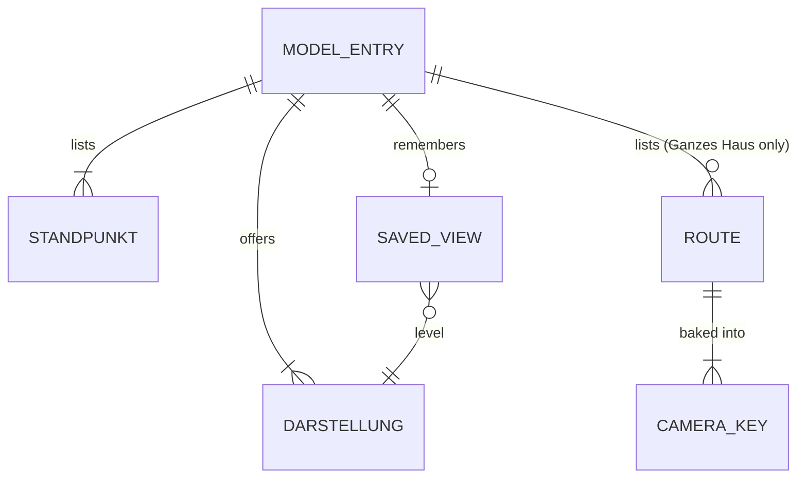

# Domain: one navigation for house and sub-models: model, Darstellung, Standpunkt

## Concepts

**Model entry.** One item of the Modell drop-down. There are three house entries:

| Entry | Cutaway |
|---|---|
| Ganzes Haus | `all` |
| Erdgeschoss | `eg` |
| 1. Stock | `noroof` |

The five sub-models follow. This changes the system term **Cutaway**: the cutaway is no longer a
separate control but part of the house entry. The URL keeps `cut=`.

**Darstellung.** The level of rendering of a model entry:

- house: the five **Stages**;
- sub-model: the three looks Drahtmodell / Masse / Gerendert.

The lowest level is Skizze or Drahtmodell. This changes the system term **Timeline**: there is no
timeline bar and no Play any more. The stage is chosen in the drop-down, and `p` stays the
internal value 0…4.

**Standpunkt.** A named camera pose of a model entry: position, look-at point and vertical field
of view.

- An **outside Standpunkt** is orbited around its look-at point.
- An **inside Standpunkt** stands at eye height (1.6 m) in a room. The mouse looks around in place,
  as in a paused route.
- A house Standpunkt lists the house entries it appears in. An inside Standpunkt appears in Ganzes
  Haus and in its own storey's entry.
- Each entry has one **standard Standpunkt** (the house: Von Südosten, today's opening view).
- Once the user moves the camera, the drop-down shows "Eigene Ansicht".

**Route.** This changes the system term **Route**: there are several routes, each closed (it ends
at its start pose).

- "Um und durch das Haus" is the existing route: the film's, unchanged.
- Shorter routes (e.g. "Durch die Stube & Küche") exist only in the viewer.
- Routes appear only in Ganzes Haus.
- The **Rundgang** (viewer) plays the chosen route.

**Saved view.** Per model entry, the browser keeps the last Darstellung and camera pose. It is used
when the page opens without a view in its URL. **Reset** deletes it and returns the entry to its
lowest Darstellung and its standard Standpunkt.

## Vocabulary

| Term | Meaning |
|---|---|
| Modell (drop-down) | Model entry chooser: Ganzes Haus, Erdgeschoss, 1. Stock │ the sub-models. |
| Darstellung | Level of rendering: house stages or sub-model looks. |
| Standpunkt | Named camera pose (outside: orbit; inside: look around at eye height). |
| Eigene Ansicht | Shown in the Standpunkt drop-down after the user moved the camera. |
| Route | A closed camera path baked to keys; "Um und durch das Haus" is the film's. |
| Saved view | `localStorage` entry per model entry: Darstellung and camera pose. |
| Reset | Deletes the saved view and returns to the lowest Darstellung and the standard Standpunkt. |
