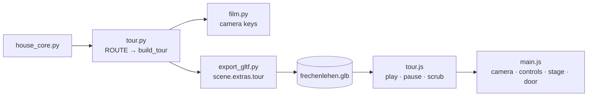

# Architecture: Rundgang in the web viewer

## Approach

`code/tour.py` is a second pure-Python single-source module beside the core, in the spirit of
[ADR-001-XEWL](../../architecture/adr-001-xewl-shared-python-core.md): it imports `HOUSE_C`, `Z_OG`
from `house_core`, `house_core` never imports it. It holds `ROUTE`, the segment helpers and
`build_tour()`, which returns the smoothed per-frame camera keys. Both backends consume it:
`film.py` only writes the keys onto `FL_Kamera_Rundgang`; `export_gltf.py` writes them (house only,
not the Ofen) as `scene.extras.tour = {fps, frames}`. The viewer module `web/src/tour.js` plays
them; `main.js` wires it in.

Viewer details: playback is time-based (elapsed s × fps → fractional frame, lerp between keys).
Orientation from the direction `(cos p·cos y, cos p·sin y, sin p)` mapped with `yup` and
`camera.lookAt`. Lens → vertical fov: `2·atan(18/lens/aspect)` for landscape (Blender sensor fit
AUTO, 36 mm), `2·atan(18/lens)` for portrait. While playing, OrbitControls are off; on pause the
controls target is put 5 cm ahead of the camera so the user can look around. Start: stage
Eingerichtet, cutaway Ganzes Haus, `EG_Haustuer` rotated 90° about three.js y (= model z).
Exit: door closed, previous camera, target and fov restored; stage and cutaway stay.
Closed route: `tour.py` appends a return leg (OG → stair down → Windfang → entrance → east →
orbit 0° → −45°). When the last raw frame equals the first, `build_tour()` smooths cyclically
(the window wraps; yaw offset by the full turn), so the last key equals the first and the loop seam
is smooth. The viewer plays at `SPEED = 0.75` and wraps `t` when "Endlos" is on; while the tour
runs the cutaway buttons are disabled; the sun is anchored to a fixed copy of the start target.
While the tour is on, the render loop draws at most 30 frames per second (`drawDue`; the film has 25)
to cut GPU load on 60/120 Hz displays.

## Impact

- **Build scripts:** none in the core; `film.py` takes `ROUTE` and the frame baking from `tour.py`.
- **Materials:** none.
- **Garden / film:** `ROUTE` moves unchanged to `tour.py`; camera keys identical; lights unchanged.
- **Web viewer:** new `tour.js` (+ unit test, e2e spec), `main.js` wiring, Rundgang button in the
  tools panel, tour bar during playback; glb grows by the key list (4464 × 6 numbers).
- **Render / output:** none; no re-render, `.blend` unchanged.

## Key decisions

| Decision | Alternatives considered | Why |
|---|---|---|
| Own module `code/tour.py`, not a field of the core Blueprint | `ROUTE` in `house_core.py` | User wants the route editable independently of house and film. |
| Export baked, smoothed keys | Export segments, re-implement baking in JS | One implementation of the route math (ADR-001-XEWL). |
| Keys as JSON in scene extras | Binary accessor | Small (~150 kB), simplest; consistent with room lights / garden. |
| `tour.js` builds its own button and bar; `ui.js` only returns `setCut` | Build the tour controls in `ui.js` | Keeps the tour separable; one line in `ui.js` keeps the cutaway buttons in sync. |
| Slower playback in the viewer only | Lower `WALK` in `tour.py` | The film keeps its pace; the owner asked about the browser. |
| Close the route in `tour.py` (film too) | Viewer-only return leg | One route (ADR-001-XEWL); the film ends where it began. |

No ADR: the decision follows ADR-001-XEWL.

## Integration points

`house_core` (`HOUSE_C`, `Z_OG`), `film.py`, `export_gltf.py` (`if bp.garden:` block),
`web/src/main.js` (camera, controls, `setProgress`, `setCutaway`, `bp.byName.EG_Haustuer`),
`tests/test_gltf.py`, `tests/blender/snapshot.py` (room lights only, not the camera).
Live ADRs: ADR-001-XEWL, ADR-002-MLQS, ADR-003-SKGB.
