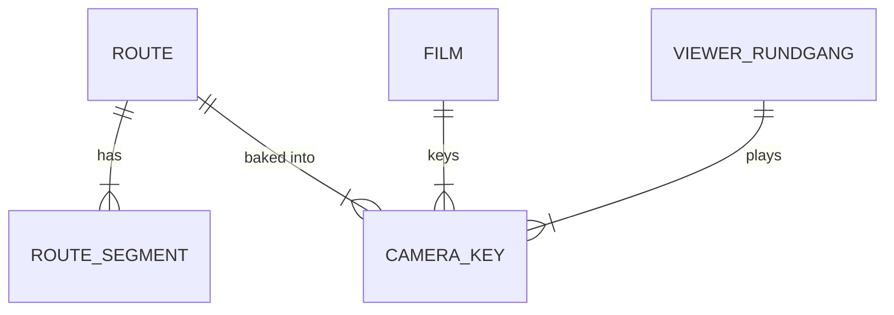

# Domain: Rundgang in the web viewer

## Concepts

Changes system term **Route**: the route is no longer film-only. It lives in `code/tour.py` and is
baked once into **camera keys**, which both the film and the viewer play.

**Camera key**: the camera pose of one frame (25 fps): position (x, y, z), yaw, pitch (radians,
model z-up) and lens (mm, 36 mm sensor width), already smoothed.

**Viewer Rundgang**: the viewer plays the camera keys in real time with the house in stage
Eingerichtet, whole house, entrance door open. It can pause (then the user looks around), be
scrubbed, and be left ("Beenden"), which restores the previous view.

## Vocabulary

| Term | Meaning |
|---|---|
| Camera key | One smoothed frame `(x, y, z, yaw, pitch, lens)` of the route. |
| Rundgang (viewer) | Live playback of the camera keys in the viewer. |
