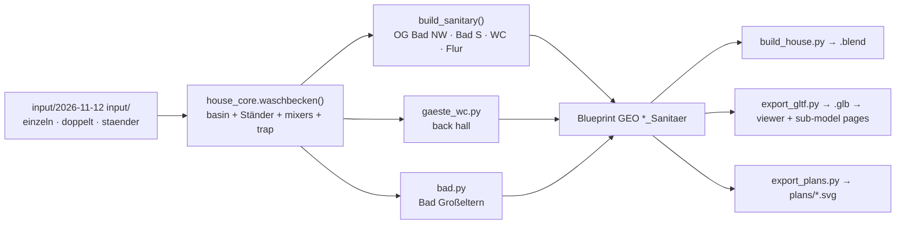

# Architecture: Waschbecken on a chrome stand in all six places

## Approach

One new pure-Python builder in `code/house_core.py`, next to `toilet()`. Its signature:

```python
waschbecken(coll, wx, wy, fx, fy, w, d, taps, z=0.0, tile=0.0, rng=None)
```

It builds into `<coll>_Sanitaer`, in the wall frame of `at_wall(wx + fx·tile, wy + fy·tile, fx,
fy)`: u runs along the wall, v into the room, and (wx, wy) is the basin's centre on the wall face.
`tile` puts the basin in front of WC tiles (`WC_TILE_T`). `taps` is 1 (einzeln) or 2 (doppelt).

**Basin (Keramik).** Outer w × d, top at z + 0.85, 17 cm high. It is hollow and built from
`xy_prism` boxes like today's `wc_basin`:

- bowl floor;
- tap deck along the wall, 10 cm, holding the mixer(s): one at u = 0, or two at u = ±w/4;
- front rim and side rims, 1.5 cm;
- one drain disc in the bowl's centre and a small overflow disc on the deck's bowl face.

Each mixer is shaped like today's (`turned` body, spout, lever).

**Ständer (Metall), all `turned` tubes:**

- two front legs at u = ±(w/2 − 0.05), v = d − 0.05, from the floor to the basin's underside,
  each with a collar at the rail height (0.52) and a tapered foot;
- a front rail between the collars;
- two side rails from the collars back to the wall, each ending in a ball (Ø 6 cm) on a rosette;
- two back posts from the side rails up to the basin near the wall;
- a bottle trap: a tail pipe from the drain, the bottle, and an arm back to a wall rosette.

**rnd.** Every Part takes its `rnd` from `rng`, a `random.Random` passed in. Without one, the
builder creates `random.Random(16)` inside each call (as `wainscot()` does, never as a default
argument, so a second `build()` in the same process gives the same values). The basins draw
nothing from the global stream.
`bad.py` passes `random.Random(rng.random())`. That is one draw from its own stream, as the
Waschtrog took, so later Bad parts don't shift.

**Callers:**

- `build_sanitary()`:
  - OG Bad NW: 120 doppelt on the north wall;
  - OG Bad S: 100 doppelt on the south wall;
  - OG WC: 50 × 40 einzeln on the east wall, `tile=WC_TILE_T`;
  - OG Flur: 60 einzeln with `tile=0.02` (in front of the 2 cm slate panel, y 6.35…6.37), in what
    is left of `flur_sink()`, now `flur_panel()`: the slate panel alone.
- The OG Bäder keep their plain mirror (from `basin()`), widened to the basin's width, as a small
  `bad_mirror()`.
- The OG WC keeps the stepped black frame; it moves out of `wc_basin()` into `wc_mirror()` and,
  with the basin, from y 5.2 to 4.95.
- `gaeste_wc.py`: the back hall basin, 40 × 28 einzeln (`BW, BD` unchanged), `tile=WC_TILE_T`.
  The dimension lines stay as they are.
- `bad.py`: 100 doppelt replaces the Waschtrog block (`TROG` → width/depth/top of the basin), with
  the dimension label "Waschbecken 100".

**Removed:** `basin()`, `wc_basin()` and the inline Waschtrog. `rounded()` stays (`toilet()` uses
it), and so does `Schiefer` (the Flur panel).

**Positions** (the centre u on the wall; the checks from the 2026-11-12 Blueprint scan):

| Site | Wall point (wx, wy), facing | Footprint (world) | Neighbours it must clear |
|---|---|---|---|
| Bad Großeltern | low wall's east face, centred on it (as the Waschtrog) | 100 along y, 47 into the room | Durchgang to the front sliding leaf |
| Back hall | (2.358, BM = 7.0655), −x | y 6.866…7.266, x ≥ 2.068 (as today) | WC leaf open at x ≤ 1.265; Windfang leaf sweep (y ≥ 7.44 at x = 2.358); architrave at 7.338; Garderobe passage (x 1.419…2.218 at y 6.723): 65 cm stay free beside the basin (as today) |
| OG Bad NW | (0.31 + 0.05 + 0.60, 8.57), −y | x 0.36…1.56 | door leaf on the east wall (x ≥ 2.425, y ≤ 7.66), west window |
| OG Bad S | (5.59 + 0.05 + 0.50, 0.40), +y | x 5.64…6.64 | window jamb 6.84 (and its mirror), shower at y ≥ 1.64 |
| OG WC | (9.92, 4.95), −x | y 4.70…5.20, x ≥ 9.51 | door leaf at 90° (x 9.535…9.675, y ≥ 5.226), toilet (x ≤ 9.475, y ≤ 4.68) |
| OG Flur | (6.45, 6.35), +y | x 6.15…6.75, y 6.35…6.82 | slate panel behind it (kept); the Waschküche leaf lies inside the HWR (y < 6.06), so nothing else |

Today's OG WC hand basin (y 5.0…5.4) overlaps that door leaf by 4.5 × 17 cm. The move to y ≤ 5.20
fixes this; it was noticed during this proposal.



## Impact

- **Build scripts:**
  - `house_core.py`: new `waschbecken()`; `bad_mirror()`/`wc_mirror()` split out of the old
    builders; `basin()` and `wc_basin()` removed; `flur_sink()` reduced to `flur_panel()`;
    `build_sanitary()` call sites.
  - `gaeste_wc.py`: `BW`, `BD` and the call; `bad.py`: the Waschtrog block, `TROG` and its dims
    label.
  - New Parts in the existing `EG_Sanitaer`, `OG_Sanitaer`, `Bad_Sanitaer` and
    `GaesteWC_Sanitaer`; no new objects, no change to `LEAVES`, `OPENINGS` or `PLAN`.
  - **rnd shift:** the old basins drew their `rnd` from the global stream, and the new ones don't.
    Every global-stream Part built after the Gäste-WC (in `build_eg`) and after `build_sanitary`
    gets a different `rnd`, so board and slab shades shift slightly. Measured 2026-11-12 (old
    basins replaced by no-ops, per-object vertex count and bbox compared): outside `*_Sanitaer`,
    only `EG_Bodenbelag` changes geometry, because its oak plank splits come from the stream (5944
    → 6032 vertices). The parity golden diff therefore has `*_Sanitaer`, `EG_Bodenbelag` and `rnd`
    hashes, and the EG plan sheet changes wherever planks are drawn.
- **Materials:** none new. `Keramik` becomes a neutral bright white, (0.90, 0.90, 0.88) →
  (0.95, 0.95, 0.95) (user, 2026-11-12: "strahlend weiß"); all ceramic changes with it. Most of
  the beige seen in the house is the viewer's evening light in the stages Gebaut/Eingerichtet
  (`setDusk(w.built)`, lamps 0xffb070), which stays; by day the basin is white. `Keramik` for the basin and `Metall` (metal 1.0) for the chrome. The
  viewer gives metal ≥ 0.5 an env map (`web/src/materials.js`), so `Metall` renders bright there,
  as today's console legs do. If the shot shows it dark, the Ständer moves to `Stahl` (light,
  metal < 0.5), as the kitchen did.
- **Garden / film:** no `NO_GRASS`, `ROUTE` or light change. The back hall and the OG Flur basins
  gain a stand (and the Flur basin's rail reaches the wall), so a camera clearance check is
  needed for all routes and inside Standpunkte.
- **Web viewer:** no code change. The `.glb` is regenerated, and the `bad.html` and
  `gaeste_wc.html` dimension labels change through the core. In `web/src/bad.js` the header
  comment's "Waschtrog" becomes "Waschbecken".
- **Render / output:**
  - `plans/eg.svg` and `og.svg` regenerated;
  - parity golden regenerated;
  - `.blend` rebuilt and saved;
  - one still per storey;
  - no film re-render in this change.

## Key decisions

| Decision | Alternatives considered | Why |
|---|---|---|
| One builder `waschbecken()` for all six sites, in `house_core.py` | A module of its own like `bad.py`; keep `basin`/`wc_basin` and add a third | One design in six places is one function; the sub-model modules already call `hc.*` builders (`toilet`, `wainscot`). A module is for a room-sized sub-model. |
| Its own `random.Random(16)` (rng passed in for `bad.py`) | Global stream as before | New basins don't add new draws to the global stream; future basin edits shift nothing else. |
| Accept the one-time reshuffle of the EG oak plank splits and of later `rnd` shades | Pad the global stream with dummy draws equal to the old basins' count | Padding is a hack that would have to be kept forever. A plank pattern no one has agreed on changes, and nothing is placed by it. |
| Sizes per site, chosen by the free space (user agreed 2026-11-12) | Today's footprints; one size per kind | The photos show the Vero Air proportion (47 deep); the walls and doors fix the widths. |
| The back hall basin keeps 40 × 28, "as small as possible" (user, 2026-11-12) | 50 × 47 (agreed first), 50 × 40, 50 × 35 | At 50 × 47 the Garderobe passage, 9 cm south of the basin, would keep only 46 cm free (65 today). 40/28 is the agreed `gaeste_wc_v3.svg` size and the smallest that still holds a 10 cm deck with a mixer and a bowl. |
| `Metall` (metal 1.0) for the Ständer | `Stahl` | Chrome is a mirror metal; the viewer already lights metal ≥ 0.5 with an env map. Checked in a shot in step 1. |
| Mixers after the basin photos, not the stand photo's nostalgic taps | Cross-head taps from `waschbecken_staender.png` | The stand photo is for the frame; the basin photos show the taps the family chose. |
| No sub-model page | `waschbecken.html` | The Bad Oma & Opa and Gäste-WC pages already show a double and a single with dimensions. |

No ADR: nothing here is hard to reverse or surprising. The change follows ADR-001-XEWL (the change
is made in the core only; the backends and the viewer are untouched) and ADR-002-MLQS (no new
material kind).

## Integration points

- `house_core.py`: `at_wall`, `xy_prism`, `turned`, `box`, `WC_TILE_T`, `build_sanitary()`,
  `toilet()` (a clearance neighbour), `LEAVES` and `Blueprint.doors` (clearance tests).
- `gaeste_wc.py` (`BW`, `BD`, `BM`, the dimension lines, the three swinging leaves' `SWING`
  states) and `bad.py` (`TROG`, `LOW`, the rng draw, the dimension lines).
- Tests rewritten (agreed 2026-11-12):
  - `tests/test_core.py`: `test_og_flur_waschbecken_right_of_the_waschkueche_door`,
    `test_wc_fixtures_after_the_photo`, the Gäste-WC test (the "hand basin 14 / 40 / 14" block),
    the Bad Großeltern test (the "Waschtrog" block).
  - `web/e2e/bad.spec.js` and `web/e2e-preview/preview.spec.js`: the label 'Waschtrog 100' only.
    The Gäste-WC labels ('HWB 40', '83 frei') stay.
  - `tests/test_plans.py`, `tests/test_blender_parity.py` (regenerated outputs).
- `CLAUDE.md` names `wc_basin(mirror=False)` and the Waschtrog; it is updated in the docs step.
- Live ADRs: ADR-001-XEWL, ADR-002-MLQS, ADR-003-SKGB (viewer untouched).
