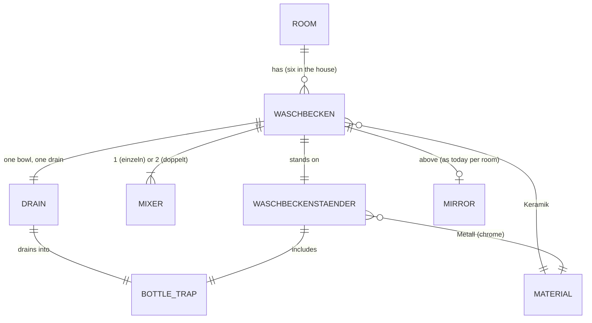

# Domain: Waschbecken on a chrome stand in all six places

## Concepts

**Waschbecken** (new): the one washbasin design of the house, after
`input/2026-11-12 input/waschbecken_einzeln.jpeg` and `waschbecken_doppelt.jpg`. It is a rectangular
ceramic basin with straight outer sides, a flat rim, a tap deck along the wall and one bowl with
one drain. It comes in two kinds:

- **einzeln:** one mixer, for one person;
- **doppelt:** one long bowl with two mixers, for two people.

Its size (width × depth) is chosen per place. It is always on a Waschbeckenständer and its top is
always at 85 cm.

**Waschbeckenständer** (new), also **Ständer** or **Rohre**: the chrome tube frame under every
Waschbecken, after `waschbecken_staender.png`. It is more decoration than support. Its parts:

- two front legs with collars and turned feet;
- a front rail and two side rails at one height, the side rails running back to the wall into
  balls on wall rosettes;
- two short back posts from the side rails up to the basin;
- a chrome bottle trap from the drain to the wall.

**Waschtrog** changes the system term in *Bad Großeltern terms*: it is gone. The Bad Großeltern
has a Waschbecken doppelt 100 × 47 on the low wall's east face instead.

**Handwaschbecken** changes the system term in *Gäste-WC terms*: the back hall basin is a
Waschbecken einzeln on its Ständer (was an open bowl on console legs). It keeps its 40/28
footprint, as small as possible, and is still centred on the wall piece between the WC wall and
the Windfang door, below the wooden mirror.

The OG fittings in `functional.md` change too:

- The OG Bäder's "basin with mirror" becomes a Waschbecken doppelt: 120 in the Bad at the end of
  the Flur, 100 in Nadine & Till's Bad.
- The OG WC's "basin on chrome console legs" becomes a Waschbecken einzeln 50 × 40.
- The OG Flur's "deep ceramic sink on a dark stone panel" becomes a Waschbecken einzeln 60 × 47
  in front of the same panel.

## Vocabulary

| Term | Meaning |
|---|---|
| **Waschbecken einzeln / doppelt** | The house's one basin design, rectangular, top 85 cm. *einzeln*: one mixer. *doppelt*: one long bowl, one drain, two mixers. Size per place: Bad Großeltern d 100×47, back hall e 40×28, OG Bad NW d 120×47, OG Bad S d 100×47, OG WC e 50×40, OG Flur e 60×47. |
| **Waschbeckenständer** (Ständer, Rohre) | Chrome tube frame under every Waschbecken: front legs with feet, front rail, side rails to ball wall rosettes, back posts, bottle trap. Decoration more than support. |
| **Waschtrog** | *Removed:* the Bad Großeltern's former 1.00 m trough, now a Waschbecken doppelt. |
| **Handwaschbecken** | *Changed:* the back hall basin is a Waschbecken einzeln 40/28 on the Ständer (same footprint). |
