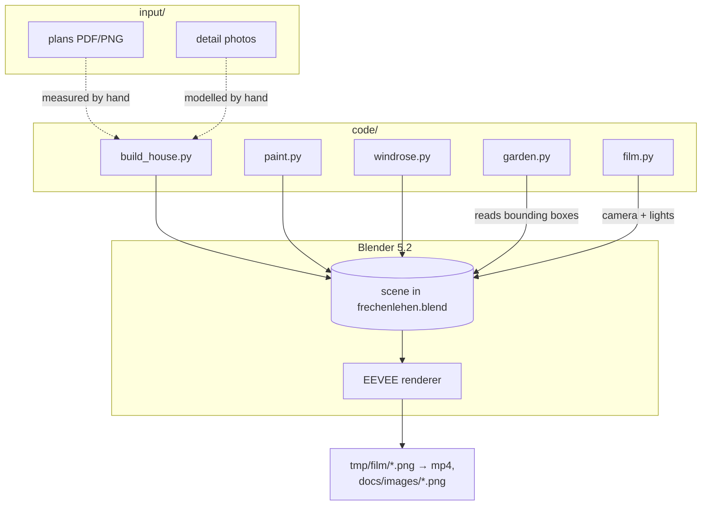
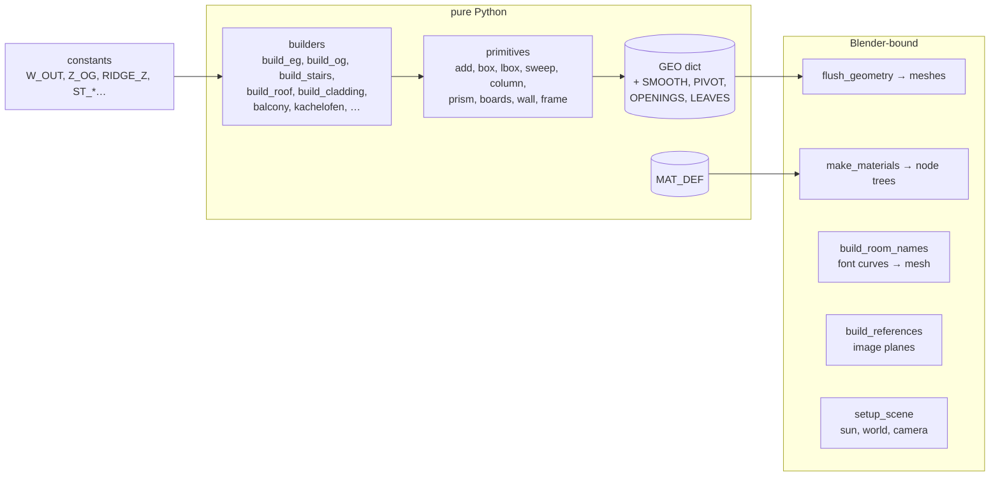

# Architecture: Frechenlehen house model

## Overview

A set of Python scripts that run **inside Blender**. They build the scene procedurally into
one `.blend` file, and Blender renders stills and a film from it. There is no server, no
package and no test suite. Details on running the scripts and on pitfalls are in
`CLAUDE.md`. The script table is in `README.md`.

## Technology stack

| Part | Role |
|---|---|
| Python 3 (Blender's own) | All model code: `bpy`, `bmesh`, `mathutils`. |
| Blender 5.2 | Scene, materials (shader node trees), Geometry Nodes (grass), EEVEE render, AgX view transform. |
| Blender MCP server | How the agent runs code in the open Blender (`execute_blender_code`). |
| ffmpeg | Encodes the film frames to H.264 MP4. |

## Components

### `build_house.py` — the house

It runs in three layers. Only the last one needs Blender:

- **Geometry accumulator.** Builders never call `bpy`. They append vertices, faces,
  material names and an `rnd` value per face to `GEO[(collection, object)]`. Faces are
  polygons (quads or n-gons, may be concave) with no consistent winding.
  `flush_geometry()` makes one mesh per entry. It writes the `rnd` face attribute,
  recalculates normals with bmesh, applies `SMOOTH` and moves origins to `PIVOT`.
- **Local wall frames.** `frame(ax)` returns `P(u, t, z)`, so wall, door and cladding code
  works for walls along x and along y.
- **`MAT_DEF`** is a pure data table. `make_materials()` turns it into Principled BSDF node
  trees:
  - **wood:** noise stretched along the grain axis → colour ramp → hue/value varied by `rnd`
    → bump
  - **speck:** isotropic noise → ramp
  - **bump:** noise → bump
  - **alpha:** blended
  - **emit:** emission
  All texture coordinates are **object space**.
- **Randomness.** `random.seed(22)` makes builds repeatable.
- The only `bpy` dependencies are `make_materials`, `build_room_names` (Blender font
  curves), `build_references`, `reset_collections`, `flush_geometry`, `setup_scene` and
  `mathutils.Vector` (used in `setup_scene`).

### Other scripts

| Script | Responsibility | Depends on |
|---|---|---|
| `paint.py` | Overwrites the base colour of plain materials with RAL colours and adds shutter cross boards. | `FL_*` materials and shutter objects from `build_house` |
| `windrose.py` | Compass rose, in its own collection. | — |
| `garden.py` | Meadow: a Geometry Nodes scatter of grass clumps over an emitter grid, with no grass inside the bounding boxes in `NO_GRASS`. Shrubs in the beds. | scene objects from `build_house` |
| `film.py` | `ROUTE` → per-frame camera keys on `FL_Kamera_Rundgang`, room fill lights (`Innenlicht`), opens `EG_Haustuer`. | `EG_Haustuer` pivot, room layout |

## Data

- **Source of truth:** the scripts. The constants and builder calls in `code/*.py` are the
  model's data.
- **Generated:** `frechenlehen.blend` (committed, ~5.6 MB), `frechenlehen_rundgang.mp4`
  (committed, ~45 MB), `docs/images/*.png`.
- **Scratch:** `tmp/` (git-ignored): film frames, detail stills, logs.

## System boundaries and external systems

- **Input:** `input/` (PDFs, rendered plan PNGs, colour swatches, photos).
- **Output:** the `.blend`, the MP4 and README images. Nothing is served over a network.
- **External tools:** Blender, the Blender MCP add-on and ffmpeg. There are no web
  dependencies and no JavaScript in the repo.

## Infrastructure

Everything runs locally on the owner's Mac (arm64). A headless film render is
`Blender -b frechenlehen.blend -a`, at about 1 s per frame for 3480 frames. Git with GitHub
is the only remote. The MP4 is linked raw from GitHub.
