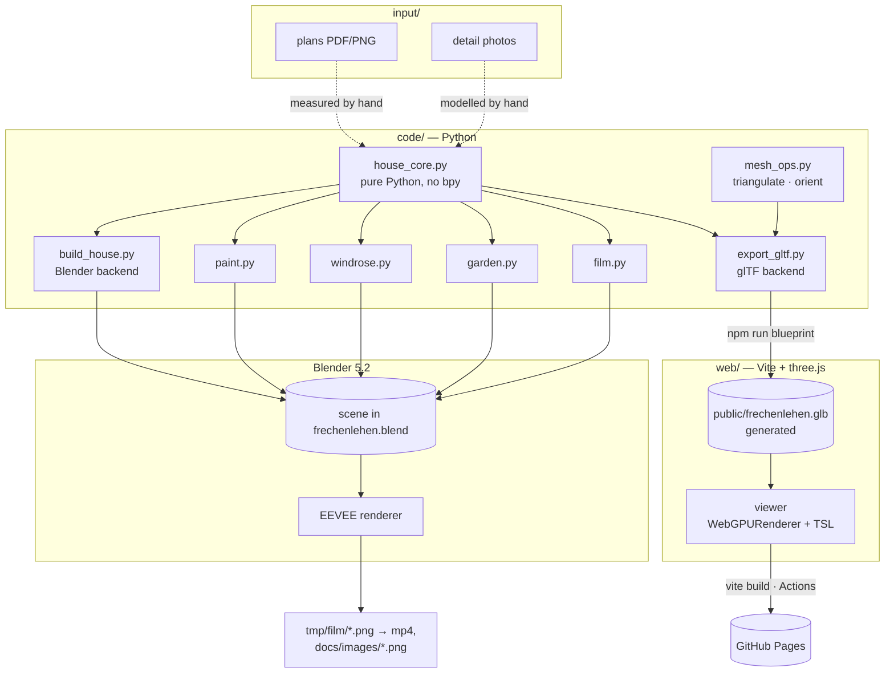
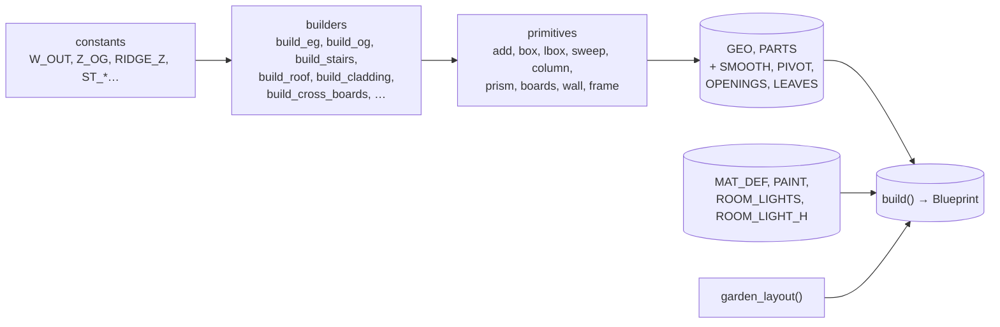
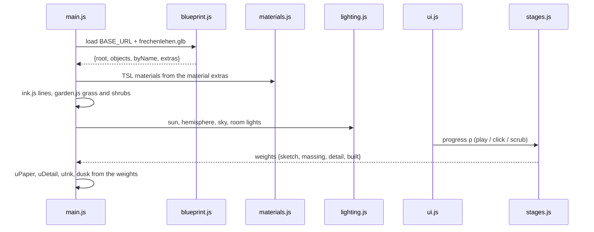

# Architecture: Frechenlehen house model

## Overview

The house is described once, in a **pure-Python core** (`code/house_core.py`, no `bpy`). Two
**backends** turn its **Blueprint** into output
([ADR-001-XEWL](../architecture/adr-001-xewl-shared-python-core.md)):

- `build_house.py` builds the Blender scene. Blender renders the stills and the film from it.
- `export_gltf.py` writes a `.glb` for the three.js **viewer** in `web/`. GitHub Pages
  publishes the viewer.

Details on running the scripts and on pitfalls are in `CLAUDE.md`. The script table is in
`README.md`.

## Technology stack

| Part | Role |
|---|---|
| Python 3 | The core, `mesh_ops` and the glTF backend use only the standard library and run with the system `python3`. The Blender scripts run on Blender's own Python with `bpy`, `bmesh`, `mathutils`. |
| Blender 5.2 | Scene, materials (shader node trees), Geometry Nodes (grass), EEVEE render, AgX view transform. |
| Blender MCP server | How the agent runs code in the open Blender (`execute_blender_code`). |
| three.js 0.187 | Viewer: `WebGPURenderer` with TSL node materials. It falls back to WebGL2 automatically ([ADR-003-SKGB](../architecture/adr-003-skgb-webgpu-tsl.md)). |
| Vite 8 | Bundler and dev server for `web/`; vanilla JS, no framework. |
| pytest · Vitest · Playwright | Python tests, web unit tests, browser e2e (headless Chromium on the real GPU via `--use-angle=metal`, WebGL2 path). |
| GitHub Actions + Pages | Builds the `.glb` and the viewer on push to `main` and publishes `web/dist`. |
| ffmpeg | Encodes the film frames to H.264 MP4. |

## Components

### `house_core.py` — the core

- **Geometry accumulator.** Builders append vertices, faces, material names and an `rnd`
  value per face to `GEO[(collection, object)]`. Faces are polygons (quads or n-gons, may be
  concave) with no consistent winding. Each `add()` call is one **Part** (a closed solid,
  except the two open lamp cones); `PARTS` records its face range.
- **Local wall frames.** `frame(ax)` returns `P(u, t, z)`, so wall, door and cladding code
  works for walls along x and along y.
- **`MAT_DEF`** is a pure data table of the `FL_*` materials: `rgba`, `wood`, `speck`,
  `bump`, `alpha`, `emit`. **`PAINT`** holds the RAL overrides for the plain materials.
- **Shutter cross boards** (`build_cross_boards()`) are computed from the shutter Parts, per
  storey (`Laeden_Querbretter`, `OG_Laeden_Querbretter`). Each board keeps its shutter's
  `rnd`.
- **Garden layout** (`garden_layout()`): ground, no-grass rectangles computed from `GEO`,
  windrose rectangles, density field, the grass clump and the shrub placements.
- **Room lights.** `ROOM_LIGHTS` (x, y, floor z) plus `ROOM_LIGHT_H`, the light height above
  the floor.
- **Randomness.** `build()` clears every registry and seeds `random` with 22, so builds are
  repeatable and both backends get the same `rnd` values. The clump uses
  `random.Random(5)` and the shrubs `random.Random(6)`.

`build()` returns the **Blueprint**: `geo`, `parts`, `smooth`, `pivot`, `mat_def`, `paint`,
`room_lights`, `garden`.

### `build_house.py` — Blender backend

It keeps only what needs Blender: `make_materials` (MAT_DEF → Principled BSDF node trees;
wood is noise stretched along the grain → ramp → hue/value by `rnd` → bump; all texture
coordinates in object space), `reset_collections`, `flush_geometry` (one mesh per GEO entry,
`rnd` face attribute, normals recalculated with bmesh, `SMOOTH`, origins at `PIVOT`),
`build_room_names` (font curves), `build_references` and `setup_scene` (sun, world, camera).

### `mesh_ops.py` and `export_gltf.py` — glTF backend

Standard library only ([ADR-002-MLQS](../architecture/adr-002-mlqs-gltf-own-writer.md)):
`python3 code/export_gltf.py web/public/frechenlehen.glb`.

- `mesh_ops` does what bmesh does in Blender:
  - **triangulates** n-gons by ear clipping on the dominant plane of the Newell normal;
  - **orients** each Part outward: flood-filled consistent winding, flipped if the signed
    volume is negative. Open Parts keep their winding and are marked open.
- **One node per GEO object.** The name is the object name, `translation` is the pivot.
  `extras.collection` holds the collection; `extras.smooth` marks `SMOOTH` objects.
- **One primitive per material**, with `POSITION`, `NORMAL` (flat, or averaged within a
  Part for smooth objects), `_RND` and uint32 indices. Accessor `min`/`max` are the stored
  float32 values.
- **Materials** `FL_<name>`: a `pbrMetallicRoughness` approximation. The full `MAT_DEF` entry,
  `kind` and paint go in `extras`. Materials of open Parts are `doubleSided`.
- **`scene.extras`:** `room_lights`, `ROOM_LIGHT_H`, `Z_OG`, `W_OUT`, `D_OUT`, `RIDGE_Z`
  and the garden layout.
- **Hidden node `GA_Grasbuschel`:** the grass clump, with `_H` (0 at the root … 1 at the tip).
- **Axes:** z-up model → y-up glTF as `(x, z, -y)`, so north is −Z in three.js.

### Other Blender scripts

Each one imports the core with `sys.path` + `importlib.reload(house_core)`, so a
long-running Blender session picks up core edits.

| Script | Responsibility | Depends on |
|---|---|---|
| `paint.py` | Overwrites the base colour of plain materials with `PAINT`. | `FL_*` materials from `build_house` |
| `windrose.py` | Compass rose at `WINDROSE_CENTER`/`WINDROSE_R`, in its own collection. | core |
| `garden.py` | Meadow: a Geometry Nodes scatter of grass clumps over an emitter grid built from the garden layout (no grass on `no_grass` or `windrose`). Leafy shrubs at the layout's shrub placements. | core, `Beet_*` objects |
| `film.py` | `ROUTE` → per-frame camera keys on `FL_Kamera_Rundgang`, room fill lights (`Innenlicht`) at `ROOM_LIGHTS` + `ROOM_LIGHT_H`, opens `EG_Haustuer`. | core, `EG_Haustuer` pivot |

### `web/` — the viewer

- **`stages.js`.** `weights(p)` gives four weights that sum to 1, with a smoothstep blend
  between neighbouring stages. `stageAt(p)` gives the nearest stage. No three.js.
- **`materials.js`.** One `MeshStandardNodeMaterial` per `FL_*` material, built from the
  extras: plain, wood (noise along the grain, ramp, `_rnd` variation), speck, bump, alpha,
  emit. The colour is `mix(paper, clay, …)` → `mix(clay, detail, uDetail)`. In Skizze the
  surfaces are paper and write depth, so the ink lines are hidden-line.
- **`ink.js`.** `EdgesGeometry` (30°) per mesh except `SMOOTH` objects, merged into one
  `LineSegments` per collection.
- **`lighting.js`.** Day: sun from Blender's angle, hemisphere, sky. Dusk: low warm sun,
  deep-blue sky, warm `PointLight`s at `ROOM_LIGHTS` + `ROOM_LIGHT_H`.
- **`garden.js`.**
  - **Grass:** an `InstancedMesh` of the clump, scattered per 25 cm cell, outside
    `no_grass`, within 30 m of the house, at 25 % of Blender's density.
  - **Shrubs:** an ink circle in Skizze, a clay blob in Massenmodell, a leaf cloud in
    Detailmodell and Gebaut. The leaves grow about a per-instance centre, an
    `InstancedBufferAttribute`.
- **`ui.js`.** Title, timeline bar (play/pause, scrubber 0–3, stage names), cutaway buttons
  and the sun toggle. `body.dataset.stage`/`cutaway` mirror the state.
- **Test hook.** `window.__fl` (`setProgress`, `setCutaway`, `setSurfaces`, `lookFrom`,
  `project`, state getters), only outside production builds.

## Key decisions

ADRs: [ADR-001-XEWL](../architecture/adr-001-xewl-shared-python-core.md) (shared core),
[ADR-002-MLQS](../architecture/adr-002-mlqs-gltf-own-writer.md) (own glTF writer),
[ADR-003-SKGB](../architecture/adr-003-skgb-webgpu-tsl.md) (WebGPURenderer + TSL).

| Decision | Alternatives considered | Why |
|---|---|---|
| The core's output is called **Blueprint** | "Model" | "Model" means the whole 3D house (scene, `.blend`). |
| The **parity test** pins the Blender build to `tests/golden/blender_snapshot.json` (per object: counts, bbox, materials, `rnd` hash) and checks the saved `.blend` | Visual checks only | Moving code between core and backends can change the output silently. Deliberate changes regenerate the golden. |
| Stages change by **crossfade** | Construction build-up | Smaller scope; build-up is a later candidate. |
| **GitHub Pages**, public and indexable; deploys on push to `main` | Local only; password; `noindex` | Family and friends need a link; the film is already public; the viewer shows no room names. |
| **Desktop browsers** only; **German UI**, English code and specs | Mobile too; one language | Keeps light, shadow and line budgets free of mobile limits; matches the README and the code base. |
| Look: **same palette, recognisably the same house** as the Blender renders | Pixel parity | A starting point, tuned in later iterations. |
| The core holds the **garden layout**; each backend scatters and grows plants itself | Core computes every instance; web-only garden | Shared layout without forcing Geometry Nodes or `mathutils.noise` into pure Python. Blades and leaves differ in detail, by design. |
| Browser grass at **25 %** of Blender's density, within 30 m | Full density | ~4 M triangles is too heavy; 25 % still reads as a meadow. |
| **Cross boards** in the core, **per storey** | In `paint.py` from mesh islands; one EG object | Both backends show them; per storey so "Nur EG" hides the OG boards. |
| Windrose area = star square + four letter squares (`WR_LABEL_HALF` 0.6 m); the viewer ignores it | Blender font bounding boxes | The letters' real extent needs Blender font metrics. The viewer draws no rose, so grass grows there. |
| **Skizze is hidden-line**; no lines for `SMOOTH` objects | X-ray lines; lines everywhere | Interior parts and ~1,600 pebbles would be ink noise. |
| Garden per stage: circles → clay blobs → grass and leaves | Edge lines for every leaf | ~1,400 leaves per shrub would be ink noise. |
| The **cutaway hides whole collections**; `Verschalung_West` goes with `Dach` | Section planes with caps | Simplest; section cuts are a later candidate. |
| The page **opens at Skizze**; Play takes 4 s per stage; the sun toggle is off below p 1.5 | Autoplay | Starting from the first line is the point of "Vom Strich zum Haus". |
| **Room-light height** `ROOM_LIGHT_H` is a core fact read by `film.py` and the viewer | A height per backend | One source of truth (ADR-001-XEWL). |
| Shrub leaves grow about a **per-instance centre** attribute | `positionLocal.mul(uDetail)` | In three.js 0.187 `positionLocal` is already instance-transformed when `positionNode` runs. `instancedBufferAttribute(typedArray, 'vec3')` drops the instanced flag, so a real `InstancedBufferAttribute` is needed. |
| e2e runs headless Chromium with `--use-angle=metal` (WebGL2 path) | SwiftShader | SwiftShader took 1.6 s per frame; headless Chromium has no WebGPU. The WebGPU path is checked by hand. |
| **Open Parts** (lamp cones) are exported double-sided | Guess an orientation | An open surface has no well-defined outward side. |

## Data

- **Source of truth:** the core. The constants and builder calls in `code/house_core.py` are
  the model's data; the backends and the viewer repeat none of them.
- **Generated, committed:** `frechenlehen.blend` (~5.8 MB, must equal the current build),
  `frechenlehen_rundgang.mp4` (~45 MB), `docs/images/*.png`,
  `tests/golden/blender_snapshot.json`.
- **Generated, git-ignored:** `web/public/frechenlehen.glb` (`npm run blueprint`, run before
  `dev`, `build` and `test`), `web/dist/`.
- **Scratch:** `tmp/` (git-ignored): film frames, detail stills, web screenshots, logs.

## System boundaries and external systems

- **Input:** `input/` (PDFs, rendered plan PNGs, colour swatches, photos).
- **Output:** the `.blend`, the MP4, the README images and the viewer page.
- **External tools:** Blender, the Blender MCP add-on, ffmpeg, Node/npm (three.js, Vite and
  the test tools from npm), GitHub Actions and Pages.

## Infrastructure

Model work runs locally on the owner's Mac (arm64). A headless film render is
`Blender -b frechenlehen.blend -a`, at about 1 s per frame for 3480 frames. The MP4 is
linked raw from GitHub. `.github/workflows/pages.yml` builds on `ubuntu-latest`
(Python 3.13, Node 24) and deploys `web/dist` to `https://tillg.github.io/frechen_blender/`
(base path `/frechen_blender/`). Only the deploy job holds `pages: write`/`id-token: write`.
