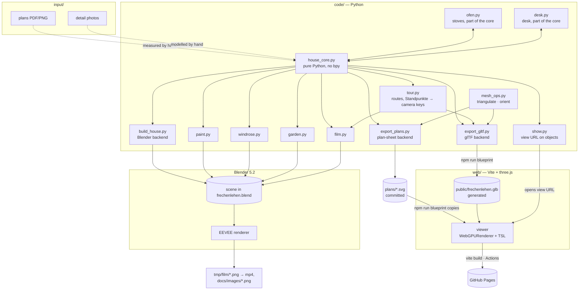
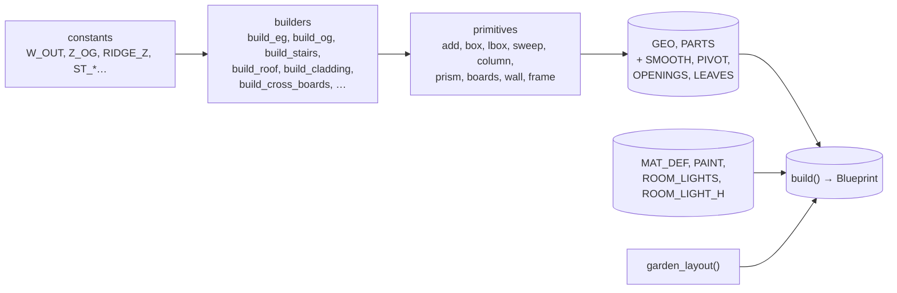
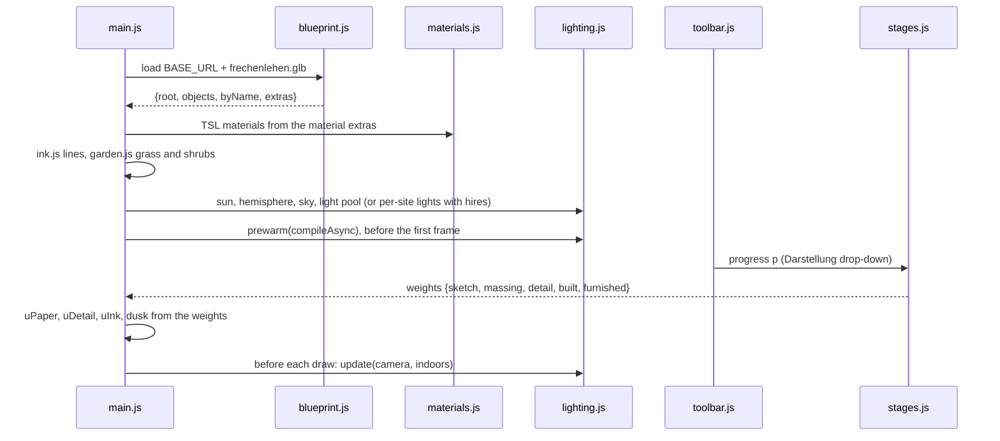
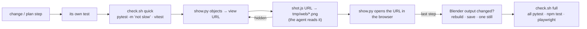

# Architecture: Frechenlehen house model

## Overview

The house is described once, in a **pure-Python core** (`code/house_core.py` plus the sub-model modules
`code/ofen.py` (stoves), `code/desk.py` (Büro desk), `code/bad.py` (Bad Großeltern),
`code/kueche.py` (Küche), `code/gaeste_wc.py` (Gäste-WC) and `code/regal.py` (Schrank im Büro), no `bpy`). Three
**backends** turn its **Blueprint** into output
([ADR-001-XEWL](../architecture/adr-001-xewl-shared-python-core.md)):

- `build_house.py` builds the Blender scene. Blender renders the stills and the film from it.
- `export_gltf.py` writes a `.glb` for the three.js **viewer** in `web/`. GitHub Pages
  publishes the viewer.
- `export_plans.py` writes the six **plan sheets** for the architect to `plans/` (committed).

Details on running the scripts and on pitfalls are in `CLAUDE.md`. The script table is in
`README.md`.

## Technology stack

| Part | Role |
|---|---|
| Python 3 | The core, `mesh_ops` and the glTF backend use only the standard library and run with the system `python3`. The Blender scripts run on Blender's own Python with `bpy`, `bmesh`, `mathutils`. |
| Blender 5.2 | Scene, materials (shader node trees), Geometry Nodes (grass), EEVEE render, AgX view transform. |
| Blender MCP server | How the agent runs code in the open Blender (`execute_blender_code`). |
| three.js 0.187 | Viewer: `WebGPURenderer` with TSL node materials. It falls back to WebGL2 automatically ([ADR-003-SKGB](../architecture/adr-003-skgb-webgpu-tsl.md)). |
| Vite 8 | Bundler and dev server for `web/`; vanilla JS, no framework. |
| pytest · Vitest · Playwright | Python tests, web unit tests, browser e2e (headless Chromium on the real GPU via `--use-angle=metal`, WebGL2 path). pytest runs from a repo-local `.venv` (`requirements-dev.txt`); `pytest.ini` registers the marker `slow` (Blender parity) with `--strict-markers`. Playwright starts no server of its own: project `dev` tests `/`, project `preview` the build under `/frechen_blender/` (setup project `build` runs `npm run build` first), both on the one dev server on 5377; tests tagged `@eye` are left out unless `@eye` is on the command line. `scripts/check.sh quick\|full` runs and times the two check tiers. |
| GitHub Actions + Pages | Builds the `.glb` and the viewer on push to `main` and publishes `web/dist`, plus the newest film (`film_release.py latest`) as `rundgang.mp4`, so the browser plays it (GitHub's raw files download as `application/octet-stream`). |
| ffmpeg | Encodes the film frames to H.264 MP4. |

## Components

### `house_core.py` — the core

- **Stoves.** `code/ofen.py` holds the Ofen sub-model (`ofen_neu()`), its placement in the Stube
  (`ofen_im_haus()`) and `werkstattofen()`; `house_core` imports it and calls them, `build_ofen()`
  stays in `house_core`. `ofen.py` uses the primitives and `GEO`/`PARTS` through `house_core` (the two
  modules import each other). Its materials are entries of `MAT_DEF`.
- **Desk.** `code/desk.py` the same way: the table builder `desk()` (Büro desk, OG laundry
  table), `desk_neu(c, x0, y0)` (table, two monitors, MacBook, keyboard, trackpad, built straight
  into collection `c`: `EG` at `DESK_AT`, or `Desk` at the origin) and `stuhl()`; `build_desk()`
  stays in `house_core`. The devices draw `rnd` from their own `random.Random(3)`, so no later part
  shifts. Each screen pane is an object with a `PIVOT` (lower-left corner) and a `TURN` (yaw);
  its material carries `image` (path under `web/public/`) and `size` (w, h in metres), mapped in
  object space by both backends (`local()` stores the mesh unturned).
- **Bad Großeltern.** `code/bad.py` the same way: `bad_neu(c, x0, y0)` builds the bathroom into
  collection `c` with the room's inner SW corner at (x0, y0) (`EG` at `BAD_AT`, or `Bad` at the
  origin), after `input/2026-11-08 input/grosseltern_v4.svg`: its own walls (12 cm niche wall,
  lintel, 1 m low wall), glass, walk-in shower with limestone cladding, the Waschbecken doppelt
  (`waschbecken(…, rng=random.Random(rng.random()))`: one draw from its stream), toilet + WC
  tiles (`toilet()`, `wainscot()`), the white Schrank (`_Schrank`) and the two interlocking
  sliding leaves (WC leaf open, both in `LEAVES`); own `random.Random(5)`. Its floor too, last
  and from its own `random.Random(7)` (`floor()`: limestone strip, oak, a `Fuge` base in
  `_Boden`, laid with `tiles(…, rng)`); the house leaves the room (`BAD_EG`) out of the EG's
  `floor_cover()`. The outer walls and the shortened bedroom wall stay in `build_eg()`.
- **Küche.** `code/kueche.py` the same way: `kueche_neu(c, x0, y0)` builds Spülzeile, Ostzeile,
  Halbinsel, the Wamsler (`ofen.wamsler()`) with its hood, Besenschrank and the
  Abzug (`c + "_Waende"`) straight into collection `c` with the room's inner NW corner at
  (x0, y0) (`EG` at `KUECHE_AT`, or `Kueche` at the origin, so the sub-model lies at y ≤ 0).
  Positions are written in house coordinates (those of `input/2026-11-09 input/speis_kueche_v6.svg`)
  and shifted; own `random.Random(14)`. The room's walls, the kitchen door and the Speis
  (`speis()`: shelves A/B, cabinet C, sliding leaf on the kitchen side, own `random.Random(9)`)
  stay in `house_core`.
- **Gäste-WC.** `code/gaeste_wc.py` the same way: `gaeste_wc_neu(c, x0, y0)` builds WC and
  Garderobe by the back hall into collection `c` with the old WC room's inner SW corner at
  (x0, y0) (`EG` at `WC_AT`, or `GaesteWC` at the origin), after
  `input/2026-11-10 input/gaeste_wc_v3.svg`; positions in house coordinates and shifted, as the
  hand basin stands outside the room. Its walls: the partition and the WC's north wall
  (`interior()` with the WC door and the open Garderobe passage). Toilet and WC tiles
  (`toilet()`, `wainscot()`), the basin (`waschbecken()`, einzeln 40 × 28, `tile=WC_TILE_T`) with tiles on the back hall's
  east wall (`wainscot(sides="e")`) and a pine-framed mirror, the Garderobe (`_Garderobe`: bench,
  hook board, hooks, hat shelf); own `random.Random(12)`, the north wall and the toilet from the
  global stream. It also builds the back hall's other two doors: `back_door(c, dx, dy)` and the
  glazed Windfang door (`panel_door(…, leaf=)`; the long wall keeps an open passage there). The
  three leaves are objects of their own (`_Hintertuer`, `_WC_Tuer`, `_Windfangtuer`) with a
  `PIVOT` at the hinge and a `SWING`. The floor stays the core's limestone (`GAESTE_WC_EG`;
  `TRENNWAND_EG` is left out of `floor_cover()`'s slabs).
- **Schrank im Büro.** `code/regal.py` the same way: `regal_neu(c, x0, y0, walls=False)` builds the
  Tegernsee bookcase around the Bibliothek's east window into collection `c` with the room's inner
  SE corner at (x0, y0) (`EG` at `REGAL_AT` into `EG_Moebel`, i.e. furniture; or `Regal` at the
  origin), after `input/2026-11-11 input/buero_regal_v2.svg`: two 94 columns, the middle 94 split
  into a base under the window and a bridge over it, one stepped cornice, books; own
  `random.Random(14)`; `vitrine(c)` the set's 52 vitrine in the NW corner (`VITRINE_AT`, house only,
  `random.Random(15)`). The openings around it are defined once there (`FENSTER`, `BALKONTUER`,
  `TUER`, the Büro door moved `SHIFT` = 0.50 m west) and `build_eg()` passes them to its
  `wall()` / `interior()` calls; `walls=True` (the sub-model) adds the pieces of those three walls
  (`waende()`, global random stream). `tuer(c)` gives the Büro door's leaf an object of its own
  (`<c>_Buerotuer`) with a `PIVOT` at the hinge and a `SWING`.
- **Waschbecken.** `waschbecken(coll, wx, wy, fx, fy, w, d, taps, z, tile, rng)` builds one
  washbasin into `<coll>_Sanitaer` in the wall frame of `at_wall()`: the hollow `Keramik` basin
  (top z + 0.85, 17 cm high, `taps` mixers), the `Metall` Waschbeckenständer and the bottle trap;
  `tile` puts it in front of WC tiles. Every Part shares one `rnd` from `rng`, else a new
  `random.Random(16)` per call. Callers: `build_sanitary()` (OG Bad NW and S, OG WC with
  `wc_mirror()`, OG Flur with `flur_panel()`; the Bäder's mirrors from `bad_mirror()`),
  `gaeste_wc.py` and `bad.py`.
- **Sub-models.** `build_ofen()` / `build_desk()` / `build_bad()` / `build_kueche()` /
  `build_gaeste_wc()` / `build_regal()` return a Blueprint of the sub-model alone (`garden=None`, its dimension lines
  in `dims`) for `web/ofen.html` / `web/desk.html` / `web/bad.html` / `web/kueche.html` /
  `web/gaeste_wc.html` / `web/regal.html`. A dimension label containing "angenommen" is an assumed
  measure (shown in italics).
- **Geometry accumulator.** Builders append vertices, faces, material names and an `rnd`
  value per face to `GEO[(collection, object)]`. Faces are polygons (quads or n-gons, may be
  concave) with no consistent winding. Each `add()` call is one **Part** (a closed solid,
  except the two open lamp cones); `PARTS` records its face range.
- **Local wall frames.** `frame(ax)` returns `P(u, t, z)`, so wall, door and cladding code
  works for walls along x and along y.
- **`MAT_DEF`** is a pure data table of the `FL_*` materials: `rgba`, `wood`, `speck`,
  `bump`, `alpha`, `emit`. **`PAINT`** holds the RAL overrides for the plain materials (`FL_Front`:
  the painted kitchen and Speis cabinet fronts, built by `mallnitz_front()` in the core).
- **Shutter cross boards** (`build_cross_boards()`) are computed from the shutter Parts, per
  storey (`Laeden_Querbretter`, `OG_Laeden_Querbretter`). Each board keeps its shutter's
  `rnd`.
- **Garden layout** (`garden_layout()`): ground, no-grass rectangles computed from `GEO`,
  windrose rectangles, density field, the grass clump and the shrub placements.
- **Room lights.** `ROOM_LIGHTS` (x, y, floor z) plus `ROOM_LIGHT_H`, the light height above
  the floor.
- **Randomness.** `build()` clears every registry and seeds `random` with 22, so builds are
  repeatable and both backends get the same `rnd` values. The clump uses
  `random.Random(5)` and the shrubs `random.Random(6)`.

`build()` returns the **Blueprint**: `geo`, `parts`, `smooth`, `pivot`, `mat_def`, `paint`,
`room_lights`, `garden`, `furniture` (objects shown only in the viewer stage "Eingerichtet"),
`dims` (sub-models only), `turn` (`TURN`: object → yaw in degrees about its pivot), `slide`
(`SLIDE`: object → (dx, dy, dz) to its other end of travel; the Bad's two sliding leaves, one
object each; glTF node `extras.slide`), `swing` (`SWING`: object → degrees about its pivot from
as built to its other state; the back hall's three door leaves; glTF node `extras.swing` in
radians about y). `panel_door(…, leaf=)` puts a single leaf opened at 90° into its own object,
hinged at the lining's corner, with the `SWING` that closes it.

### `build_house.py` — Blender backend

It keeps only what needs Blender: `make_materials` (MAT_DEF → Principled BSDF node trees;
wood is noise stretched along the grain → ramp → hue/value by `rnd` → bump; all texture
coordinates in object space), `reset_collections`, `flush_geometry` (one mesh per GEO entry,
`rnd` face attribute, normals recalculated with bmesh, `SMOOTH`, origins at `PIVOT`, z rotation
from `TURN`; image materials map the picture through Texture Coordinate › Object),
`build_room_names` (font curves), `build_references` and `setup_scene` (sun, world, camera).

### `mesh_ops.py` and `export_gltf.py` — glTF backend

Standard library only ([ADR-002-MLQS](../architecture/adr-002-mlqs-gltf-own-writer.md)):
`python3 code/export_gltf.py web/public/frechenlehen.glb` (`--ofen` / `--desk` / `--bad` / `--kueche` / `--gaeste-wc` / `--regal`: the sub-model's
`.glb` instead).

- `mesh_ops` does what bmesh does in Blender:
  - **triangulates** n-gons by ear clipping on the dominant plane of the Newell normal;
  - **orients** each Part outward: flood-filled consistent winding, flipped if the signed
    volume is negative. Open Parts keep their winding and are marked open.
- **One node per GEO object.** The name is the object name, `translation` is the pivot,
  `rotation` the `TURN` yaw.
  `extras.collection` holds the collection; `extras.smooth` marks `SMOOTH` objects,
  `extras.furniture` the `FURNITURE` objects.
- **One primitive per material**, with `POSITION`, `NORMAL` (flat, or averaged within a
  Part for smooth objects), `_RND` and uint32 indices. Accessor `min`/`max` are the stored
  float32 values.
- **Materials** `FL_<name>`: a `pbrMetallicRoughness` approximation. The full `MAT_DEF` entry,
  `kind` and paint go in `extras`. Materials of open Parts are `doubleSided`.
- **`scene.extras`:** `room_lights`, `ROOM_LIGHT_H`, `Z_OG`, `W_OUT`, `D_OUT`, `RIDGE_Z`,
  the garden layout and (house only, not the Ofen) `tour = {fps, frames}`, the camera keys of
  `tour.build_tour()` as JSON, `routes = [{name, frames}]` (the viewer's shorter routes, i.e.
  `ROUTES[1:]`) and `spots = [{name, group, entries, cam, at, fov}]` (`SPOTS`).
- **Hidden node `GA_Grasbuschel`:** the grass clump, with `_H` (0 at the root … 1 at the tip).
- **Axes:** z-up model → y-up glTF as `(x, z, -y)`, so north is −Z in three.js.

### `export_plans.py` — plan-sheet backend

Standard library only, no Blender: `python3 code/export_plans.py plans/` calls `house_core.build()`
and writes `eg.svg`, `og.svg` (Grundrisse) and `nord.svg`, `ost.svg`, `sued.svg`, `west.svg`
(Ansichten). It knows only how to draw; what an object is comes from the core:

- **Core records** (no geometry, no `random` draws): `DOORS` (every hinged leaf: storey, hinge,
  width, closed / open direction, the leaf's plan box as built incl. levers; recorded by
  `panel_door`, `entrance_door`, `back_door`), `PLAN_ROOMS` (the architect's room names with
  storey and anchor), `PLAN` (object classes: wall suffix and material, frames, skip words for
  floors and ceilings, ground, extra collections and objects such as the balconies and the west
  cladding, `stair_objects`) and `STAIRS` (each stair: storeys, plan box, risers, walking line,
  rise, run). The Blueprint carries them as `doors`, `plan_rooms`, `plan`, `stairs`.
- **Section (Grundriss).** Every closed Part of the storey is sliced at its cut height (`CUT`: EG
  1.80, OG 1.55 above `Z_OG`; a test asserts every opening spans it). Wall loops are hatched and
  get one heavy outline, the union boundary (no seams between abutting boxes); other cut Parts a
  thin outline. Loose furniture (`FURNITURE`), door leaves as built (their `DOORS` box) and the
  `PLAN` stair objects are neither cut nor projected.
- **Projection.** One hidden-line routine for plans (from the cut height down) and elevations (one
  facade, all non-furniture house geometry, no ground): faces oriented outward per Part
  (`mesh_ops`), back faces culled, painted far to near as white-filled polygons with a thin
  stroke (glass opaque), a 2 cm occupancy raster drops covered faces, coplanar same-material edges
  are not stroked.
- **Annotation.** Door swings: the conventional 90° leaf and quarter arc from `DOORS`. The stair
  as in the architect's plan, in every storey it serves (`STAIRS`): outline, a line at each riser,
  the walking line from a circle at the bottom step to an arrow at the top, in its bottom storey
  "15 STG 18.0/25.5". Room labels from `PLAN_ROOMS` with the net area of the region round the
  anchor in a section just below the ceiling (`ROOM_CUT`, openings closed by their lintels).
  Dimension chains on all four sides scanned from the section (openings, walls and rooms,
  overall; rounded cumulatively so they sum up). Elevations: level marks (±0,00, OK FFB OG,
  eaves, ridge) and the overall width.
- **Sheet.** A3 landscape, `viewBox="0 0 420 297"` in mm (1 m = 10 mm), frame, title block with
  the model state (a hash of every plan input, no date), scale bar, north arrow on the floor
  plans; fixed decimals and a stable element order, so the output is byte-identical across runs.
  `tests/test_plans.py` (its currency test `slow`) fails when `plans/` is older than the model.

### `tour.py` — routes and Standpunkte

A second pure-Python module beside the core (ADR-001-XEWL): it imports `HOUSE_C`, `Z_OG` from
`house_core`; the core never imports it. It holds `ROUTE` (orbit / path / turn / stair / hold
segments, the helpers `turn()` and `peek()`, the variables `EYE`, `TURN`, `PAUSE`), `ROUTES`
(ordered `(name, segments)`; the first is `("Um und durch das Haus", ROUTE)`, the film's, the rest
are viewer-only closed walks), `SPOTS` (the house Standpunkte: `(name, group, entries, cam, at,
fov)`, the first of an entry is its standard; inside spots sit at `EYE` above their floor) and
`build_tour(route=ROUTE)`, which bakes a route into one smoothed camera key per frame at 25 fps
`(x, y, z, yaw, pitch, lens)`. When the last raw frame equals the first, it smooths cyclically
(the window wraps, yaw offset by the full turn), so the last key equals the first and the route
loops without a seam. `tests/golden/tour.json` pins the keys (`UPDATE_TOUR_GOLDEN=1` after a
deliberate route change). The film bakes only `ROUTE`.

### Other Blender scripts

Each one imports the core with `sys.path` + `importlib.reload(house_core)`, so a
long-running Blender session picks up core edits. The path is `code/` next to the open `.blend`
(`bpy.data.filepath`), so each clone's Blender builds its own core; with no `.blend` open (the
headless parity build) the caller's `PROJECT` (`tests/blender/snapshot.py`) gives it.

| Script | Responsibility | Depends on |
|---|---|---|
| `paint.py` | Overwrites the base colour of plain materials with `PAINT`. | `FL_*` materials from `build_house` |
| `windrose.py` | Compass rose at `WINDROSE_CENTER`/`WINDROSE_R`, in its own collection. | core |
| `garden.py` | Meadow: a Geometry Nodes scatter of grass clumps over an emitter grid built from the garden layout (no grass on `no_grass` or `windrose`). Leafy shrubs at the layout's shrub placements. | core, `Beet_*` objects |
| `film.py` | Keys `FL_Kamera_Rundgang` with `tour.build_tour()` (frame range = key count), room fill lights (`Innenlicht`) at `ROOM_LIGHTS` + `ROOM_LIGHT_H`, opens `EG_Haustuer`. | core, `tour.py`, `EG_Haustuer` pivot |

### `web/` — the viewer

- **`stages.js`.** `weights(p)` gives five weights that sum to 1, with a smoothstep blend
  between neighbouring stages. `stageAt(p)` gives the nearest stage. No three.js.
- **`materials.js`.** One `MeshStandardNodeMaterial` per `FL_*` material, built from the
  extras: plain, wood (noise along the grain, ramp, `_rnd` variation), speck, bump, alpha,
  emit, image (`texture()` over `positionLocal` / `size`, loaded in the background; a missing
  file is logged). The colour is `mix(paper, clay, …)` → `mix(clay, detail, uDetail)`. In Skizze the
  surfaces are paper and write depth, so the ink lines are hidden-line.
- **`ink.js`.** `EdgesGeometry` (30°) per mesh except `SMOOTH` and furniture objects, merged into one
  `LineSegments` per collection.
- **`lighting.js`.** Day: sun from Blender's angle, hemisphere, sky. Dusk: low warm sun,
  deep-blue sky, warm room and outside-lamp lights. `createLighting(…, { hires })`:
  - **Fast mode** (default): a **light pool** of `ROOM_N` = 6 `PointLight`s and `OUTSIDE_N` = 2
    `SpotLight`s (targets 1 m below), created once. `setDusk(v)` sets `visible = v > 0` on the
    pool. `update(cameraPos, inside)` (called by `main.js` right before each `renderer.render`;
    a no-op by day) ranks each kind's sites by site distance (`hypot(dx, dy, 3·dz)` while
    `indoors()`), moves pooled light *k* to the *k*-th nearest site and sets
    `intensity = base · v · clamp((d_cut − d) / FADE, 0, 1)` (`base` 9 room / 14 outside,
    `FADE` 1.0 m). `prewarm(compile)` makes the pool visible, awaits
    `renderer.compileAsync`, catches a failure, and restores the day/dusk visibility; `main.js`
    awaits it after `renderer.init()`.
  - **`hires`**: one light per site (23 + 8), always in the render list, intensity `base · v`.
  - `LAMP_LIGHTS` (the reading lamp above the Ofen bed) are lit by day and at dusk in both modes.
- **`hires`.** `main.js` reads `?hires=on` once; it also sets the pixel ratio (full vs. ≤ 1.5)
  and whether the grass is hidden while `indoors()` (fast mode only, Rundgang included), and
  `saveView()` keeps it in the URL.
- **`garden.js`.**
  - **Grass:** an `InstancedMesh` of the clump, scattered per 25 cm cell, outside
    `no_grass`, within 30 m of the house, at 25 % of Blender's density.
  - **Shrubs:** an ink circle in Skizze, a clay blob in Massenmodell, a leaf cloud in
    Detailmodell and Gebaut. The leaves grow about a per-instance centre, an
    `InstancedBufferAttribute`.
- **Visibility.** `main.js` feeds materials, lights and garden a merged view
  (`built + furnished`), so Eingerichtet looks like Gebaut. One `applyVisibility()` (on
  progress and cutaway changes) shows an object iff the cutaway does not hide it and, for
  `extras.furniture`, the stage is Eingerichtet.
- **`toolbar.js`.** The one navigation panel of every page (house and sub-models): three custom
  drop-downs (button + `role="listbox"`, always open below; keys ↑ ↓ Enter Esc), Reset and, on
  the house, the sun toggle. Modell (house entries Ganzes Haus / Erdgeschoss / 1. Stock, a
  separator, the sub-model pages), Darstellung (levels) and Standpunkt (group headings; "Eigene
  Ansicht" appears after a camera move). A page passes its entries, levels, spots, routes and
  callbacks. The house entries switch the cutaway in place (`all` / `eg` / `noroof`, URL `cut=`
  kept); a sub-model entry navigates to its page (relative URLs).
- **`ui.js`.** The house page's title and its toolbar wiring (stage labels as levels, sun toggle
  enabled from p 1.5). `body.dataset.stage`/`cutaway` mirror the state.
- **`viewstate.js`.** Pure, no three.js. Saved views in `localStorage` under
  `frechenlehen:<page>:<entry>` (prefix: GitHub Pages shares its origin with other repos), value =
  the query string the URL carries; `initialQuery(search, storage, key)`: the URL's view wins, else
  the stored one, else the default; reads and writes tolerate a missing or throwing storage.
  `cleanView(search)` drops malformed view keys (cam/at not three finite numbers, p not finite, fov
  outside 10…90, a broken %-escape) before use and before saving. An entry's default view is
  never stored; Reset removes the entry's key. The house also stores the last-used entry
  (`frechenlehen:index:last`), which a bare URL opens.
- **Standpunkte.** On the house, `main.js` lists `extras.spots` (filtered by entry) as the
  Standpunkte and `extras.tour` (first, labelled "Um und durch das Haus" in `main.js`) plus `extras.routes`
  as the Routen group. An outside spot restores orbiting; an inside spot (eye level inside the house footprint
  and below a storey's ceiling) uses the paused-route look-around: orbit target `LOOK` (5 cm)
  ahead, `maxPolarAngle` π, zoom and pan off. A house entry with nothing saved opens at its
  standard Standpunkt and keeps the current Darstellung.
- **`tour.js`.** The Rundgang: `createTour` takes the list of routes and plays the chosen one (it
  has no start button; the toolbar's Routen group calls `enter(i)`); it builds its own tour bar
  (play/pause, scrubber, "Endlos", "Beenden"), the only bar of the page. A playing route is not
  saved and not written to the URL; `main.js` puts the Darstellung it started from back at
  its end unless the user changed it during the route. Playback is time-based at `SPEED = 0.75`: `step(t, dt, T, loop)` advances
  (dt clamped) and wraps or clamps, `poseAt(frames, fps, t)` lerps between keys (yaw unwrapped),
  `fovFor(lens, aspect)` turns the lens into a vertical fov (`2·atan(18/lens/aspect)` landscape,
  `2·atan(18/lens)` portrait, as Blender's sensor fit AUTO), re-applied on resize. Orientation:
  direction `(cos p·cos y, cos p·sin y, sin p)` through `yup` and `camera.lookAt`. While playing,
  OrbitControls are off; on pause their target sits 5 cm ahead of the camera. Start: stage
  Eingerichtet, cutaway Ganzes Haus, `EG_Haustuer` rotated 90°. Beenden: door closed, previous
  camera, target and fov restored. `drawDue` caps drawing at 30 fps while the tour is on; the
  sun stays anchored to a fixed copy of the start target.
- **Sub-model pages.** `submodel.js` draws a sub-model page (views, looks Drahtmodell / Masse /
  Gerendert, walls, grid, sun, dimension lines from `dims`); `ofen.js`, `desk.js`, `bad.js`,
  `kueche.js`, `gaeste_wc.js` and `regal.js` only configure it. Nodes with `extras.slide` roll there and back,
  edge lines included (`slides.js`: every 4 s one, picked at random, in 2 s, eased); nodes with
  `extras.swing` turn about their origin (the hinge) to their other state and back, their edge
  lines in a group turned about the hinge (`swingingNodes()`: every 3 s one, in 3 s; the Büro door
  `*_Buerotuer` on a clock of its own: 2 s swing, 4 s rest). `main.js`
  moves both too, in stage Eingerichtet outside the Rundgang (else as built), and draws while
  they move and their travel is in view, throttled like a fire. `submodel.js` builds the same
  `toolbar.js` panel on every sub-model page: the page config `views` (`{key: [label, cam, at]}`)
  are its Standpunkte, the three looks its Darstellung (one constant in `submodel.js`).
- **View in the URL.** `main.js` and `submodel.js` read `?cam=&at=` (model coordinates) plus
  `p`/`cut` (house) or `look` (sub-models) on load (`viewstate.initialQuery`) and write them back
  with `history.replaceState`, debounced to 300 ms, on every controls change, stage, cutaway or look
  change, and into the saved view. Not while a route plays.
- **`blueprint-watch.js`** (Vite plugin, dev server only, off under Vitest): watches `code/*.py`;
  a save runs `npm run blueprint` (debounced, one export at a time, again if saved meanwhile)
  and then sends a full reload; a failed export is logged and does not reload. `export_gltf.py`
  writes the `.glb` atomically (temp file + `os.replace`), so a page never reads a half-written
  file.
- **`serve-build.js`** (Vite plugin, dev server only): serves the production build `web/dist/`
  under `/frechen_blender/`, the GitHub Pages path, so the one dev server shows source and build.
- **Test hook.** `window.__fl` (`setProgress`, `setCutaway`, `setSurfaces`, `lookFrom`,
  `project`, state getters incl. `lights` (visible room / outside lights), `hires`, `pixelRatio`,
  `tour`, `tourKey`, `slides`, `doors`), only outside production builds; `window.__ofen`
  / `window.__desk` / `window.__bad` / `window.__kueche` / `window.__gaeste_wc` / `window.__regal` on the sub-model pages.

### Checks and Show — `scripts/check.sh`, `code/show.py`, `web/shot.js`

- **`scripts/check.sh quick|full`** (bash): runs the tier's parts with `.venv/bin/python`, times
  each, prints a table, tees to `tmp/check-<ts>.log`, warns when quick exceeds 60 s, exits 1 when
  any part failed (2 on a wrong argument).
- **`code/show.py`** (pure Python, no bpy) reads the Blueprint (`build()`, or `build_ofen()` /
  `build_desk()` / `build_bad()` / `build_kueche()` / `build_gaeste_wc()` / `build_regal()` for `--page`), so the view comes from the geometry the viewer
  draws:
  - `bbox(bp, names)`: min/max over the GEO vertices of the objects whose name starts with a
    given prefix (all objects without names; `--at` frames a 1 m box around a point).
  - `view(bp, box, side)` → `(cam, at, p, cut)`: `at` = box centre; distance so the bounding
    sphere × 1.15 fits the vertical field of view (28° house, 35° sub-model). A box within
    `EDGE` = 0.2 m of the footprint `W_OUT × D_OUT` or beyond it is outside: nearest facade, 20° up,
    `cut=all`. Otherwise inside: SE diagonal, 55° up, `cut=eg` below `Z_EG_TOP`, `noroof` below
    `Z_OG_TOP`, else `all`, by the box centre. Sub-model (`bp.garden is None`): SE, 30° up (Küche: S, its open side; Gäste-WC: N, from the back hall; Schrank im Büro: W, from the room; `FACING`).
    `side` (`--from`) picks n/e/s/w (or `top`, 85° up from the south). `p = 4` unless `--p`
    (house only).
  - `url()` writes the viewer's format (`+n.toFixed(3)`, ties away from zero); `server_is_ours()`
    compares the cwd of the process listening on 5377 (`lsof`) with this repo's `web/`; the CLI
    refuses with exit 2 otherwise, else `open`s the URL and prints it.
- **`web/shot.js <url> <png>`** (Node, `@playwright/test`'s Chromium with the config's GPU flags,
  1280×720 at 1×): waits for `__fl` / `__ofen` / `__desk` / `__bad` `ready` (on the desk page also
  for its two screen textures), 500 ms more, then saves the screenshot. Tested by
  `e2e/shot.spec.js`.

## Key decisions

ADRs: [ADR-001-XEWL](../architecture/adr-001-xewl-shared-python-core.md) (shared core),
[ADR-002-MLQS](../architecture/adr-002-mlqs-gltf-own-writer.md) (own glTF writer),
[ADR-003-SKGB](../architecture/adr-003-skgb-webgpu-tsl.md) (WebGPURenderer + TSL).

| Decision | Alternatives considered | Why |
|---|---|---|
| The core's output is called **Blueprint** | "Model" | "Model" means the whole 3D house (scene, `.blend`). |
| The **parity test** pins the Blender build to `tests/golden/blender_snapshot.json` (per object: counts, bbox, materials, `rnd` hash) and checks the saved `.blend` | Visual checks only | Moving code between core and backends can change the output silently. Deliberate changes regenerate the golden. |
| Stages change by **crossfade** | Construction build-up | Smaller scope; build-up is a later candidate. |
| A sub-model may bring **its own walls** (`bad.py`: niche wall, lintel, low wall; `gaeste_wc.py`: partition, the WC's north wall) | Walls in `build_eg()`, only fixtures in the module | The sub-model page must show them; one place describes the room (ADR-001-XEWL). Outer walls stay in `build_eg()`. |
| Speis shelves and cabinet are **built-ins** (`EG_Speis`, stage Gebaut) | Furniture (`EG_Moebel`, Eingerichtet) | Cabinet C replaces a wall; floor-to-ceiling joinery belongs to the house like the kitchen. |
| One **navigation panel** (`toolbar.js`: Modell, Darstellung, Standpunkt, Reset) on every page | Per-page buttons; a link per sub-model | The same controls at the same place everywhere; one page list in one place. |
| Routes are a **group inside the Standpunkt drop-down** | A 4th "Routen" drop-down | Three drop-downs everywhere. |
| The **cutaway is the house entries** of the Modell drop-down (Ganzes Haus `all`, Erdgeschoss `eg`, 1. Stock `noroof`) | Separate cut buttons | Today's `cut=` values stay, so `show.py`, `shot.js` and every URL stay valid. |
| **Custom drop-downs** (button + `role="listbox"`) that always open below | Native `<select>`; `appearance: base-select` | A native macOS select opens over the chosen entry, i.e. upwards far down the list; `base-select` is Chrome-only. e2e tests click `role=button`, then `role=option`. |
| The **URL wins over `localStorage`**, which holds the same query string, one saved view per model entry | Storage wins; a JSON state; one view per page | `show.py`, `shot.js`, the blueprint-watch reload and shared links all open `?cam=…`: one format, one parser. Each house entry opens at its own view. |
| **Standpunkte and routes live in `tour.py`**, exported in `scene.extras` | JS literals in `main.js` | ADR-001-XEWL: model facts once in the core; the golden and pytest machinery is there. Sub-model views stay in the page config (not used anywhere else). |
| **Inside spots use the look-around of the paused route** | Plain orbit around a room point | An orbit target in the room swings the camera through walls. |
| Starting a route sets Eingerichtet + Ganzes Haus; the Darstellung drop-down stays usable; another Standpunkt or Modell ends it; **a route is not saved** | Keep the chosen level; save the route time | Matches the film. Beenden restores the view from before; a half-played route on reopening would surprise. |
| **Short routes must be closed** (`build_tour` smooths cyclically, `step()` wraps with `% T`) | Jump back on loop | A seamless Endlos; a pytest enforces it. |
| Leaves are modelled **open** (kitchen door 90° into the Küche, Speis sliding leaf slid south) | Closed | The Rundgang walks through the kitchen door and looks into the Speis aisle. |
| The back hall's three doors **swing in the viewer** (`SWING`), the film keeps them as built | Static doors; animate in the film too | They show where the doors get in each other's way; the film camera and its clearance stay fixed. Moving only in Eingerichtet, as the Bad's leaves: the Skizze lines don't follow. |
| Back door and Windfang door are **built by the Gäste-WC sub-model** | Only the WC door in the module | The page shows all three swinging doors; one builder for house and page. |
| **GitHub Pages**, public and indexable; deploys on push to `main` | Local only; password; `noindex` | Family and friends need a link; the film is already public. The viewer names the rooms (Standpunkte). |
| **Desktop browsers** only; **German UI**, English code and specs | Mobile too; one language | Keeps light, shadow and line budgets free of mobile limits; matches the README and the code base. |
| Look: **same palette, recognisably the same house** as the Blender renders | Pixel parity | A starting point, tuned in later iterations. |
| The core holds the **garden layout**; each backend scatters and grows plants itself | Core computes every instance; web-only garden | Shared layout without forcing Geometry Nodes or `mathutils.noise` into pure Python. Blades and leaves differ in detail, by design. |
| Browser grass at **25 %** of Blender's density, within 30 m | Full density | ~4 M triangles is too heavy; 25 % still reads as a meadow. |
| **Cross boards** in the core, **per storey** | In `paint.py` from mesh islands; one EG object | Both backends show them; per storey so the Erdgeschoss entry hides the OG boards. |
| Windrose area = star square + four letter squares (`WR_LABEL_HALF` 0.6 m); the viewer ignores it | Blender font bounding boxes | The letters' real extent needs Blender font metrics. The viewer draws no rose, so grass grows there. |
| **Skizze is hidden-line**; no lines for `SMOOTH` objects | X-ray lines; lines everywhere | Interior parts and ~1,600 pebbles would be ink noise. |
| Garden per stage: circles → clay blobs → grass and leaves | Edge lines for every leaf | ~1,400 leaves per shrub would be ink noise. |
| The **cutaway hides whole collections**; `Verschalung_West` goes with `Dach` | Section planes with caps | Simplest; section cuts are a later candidate. |
| The page **opens at Skizze** (the lowest Darstellung, with no saved view); the sun toggle is off below p 1.5 | Autoplay | Starting from the first line is the point of "Vom Strich zum Haus". |
| **Room-light height** `ROOM_LIGHT_H` is a core fact read by `film.py` and the viewer | A height per backend | One source of truth (ADR-001-XEWL). |
| Shrub leaves grow about a **per-instance centre** attribute | `positionLocal.mul(uDetail)` | In three.js 0.187 `positionLocal` is already instance-transformed when `positionNode` runs. `instancedBufferAttribute(typedArray, 'vec3')` drops the instanced flag, so a real `InstancedBufferAttribute` is needed. |
| e2e runs headless Chromium with `--use-angle=metal` (WebGL2 path) | SwiftShader | SwiftShader took 1.6 s per frame; headless Chromium has no WebGPU. The WebGPU path is checked by hand. |
| **Open Parts** (lamp cones) are exported double-sided | Guess an orientation | An open surface has no well-defined outward side. |
| The route lives in its own module **`code/tour.py`**, not in the Blueprint | `ROUTE` in `house_core.py` or `film.py` | The route can be edited apart from house and film. |
| The `.glb` carries the **baked, smoothed camera keys** as JSON in `scene.extras.tour` | Export the segments and re-implement the baking in JS; binary accessor | One implementation of the route math (ADR-001-XEWL); JSON is small and matches room lights and garden. |
| `tour.js` builds its own bar; the toolbar's Routen group starts it | Tour controls in `toolbar.js` | Keeps the tour separable. |
| The viewer plays at **0.75×**; the film keeps its pace | Lower `WALK` in `tour.py` | The slower pace was asked for the browser only. |
| Screen images mapped in **object space around the pane's pivot** | UVs through accumulator, `mesh_ops` and writer | The project already maps textures in object space; no new vertex attribute in three code paths. |
| Screenshots downscaled once (`sips`) and **committed as JPEG** under `web/public/textures/` | Embed the PNGs in the `.glb`; convert at build time | CI is Ubuntu + stdlib (no `sips`, no Pillow); the house page should not load 8.6 MB more. |
| The **route is closed** in `tour.py`, for the film too | A viewer-only return leg | One route (ADR-001-XEWL); the viewer can loop it. |
| Viewer dusk lights are a **fixed light pool** moved to the sites nearest the camera | Keep one light per site and toggle `visible` on the nearest N | three.js 0.187 hashes the id of every light in the render list into each material's cache key; a changing set would recompile every material while the camera moves. |
| Separate pools: **6 room lights, 2 outside lamps**, cut-off fade 1.0 m | 4 + 2 with a 1.5 m fade; one ranking over all 31 sites | Point and spot lights can't share a pooled object, and from outside the lamps would starve the rooms. With 4 the last light was nearly always faded (sites lie centimetres apart in distance). 8 lights instead of 31. |
| Rank sites by distance to the **camera**; indoors the height difference counts **3×** | Distance to the orbit target; plain 3D distance everywhere | The camera is where the viewer stands. Plain 3D fills slots with rooms through floor or ceiling, whose light only leaks (no shadows); outside, a vertical penalty would darken the EG windows in the overview. |
| By day the pool is **out of the render list** (`visible = false`); the dusk variant is **prewarmed** at load | Intensity 0 by day (no recompile ever); accept the stall | Day lighting costs nothing per fragment. Without the prewarm the first dusk (e.g. the Rundgang start) stalled ~0.8 s; one compile at load is cheaper. |
| **Two check tiers**: quick after every step (own test + `pytest -m "not slow"` + Vitest, no e2e suite), full once at the end of a change and at archive | The full suite after every step | A `[web]` step cost ≥ 7 min of waiting; the step's own test covers the change, the Show covers the look, the final full run catches regressions. |
| Blender parity is a **`slow`** test, outside the quick check | Keep it in quick (8 s) | It starts Blender twice and needs the saved `.blend`, which is stale in the middle of a change. |
| Core changes are checked by a **Show** per step; one Blender still at the end when the Blender output changed; Blender-only steps keep per-step stills | A Blender still per step | The browser shows the same core; bpy-only changes aren't visible in the browser. |
| The **view is computed in Python from the Blueprint** (`show.py`) | A viewer `?focus=` parameter; hand-written URLs | No viewer change; the bounding boxes come from the core (ADR-001-XEWL); testable with pytest. |
| Framing rule: outside → nearest facade, inside → from above with the storeys above cut away; `--from` to override | Named views per room; ray-casting for occlusion | Simple and predictable; covers doors, windows, facades and rooms. |
| The storey cut follows the **box centre height**, not the collection | The viewer's `cutLevel` by collection | `view()` gets only a box, and `--at` points have no collection; no object is cut by its own level today. |
| `show.py` **refuses** when 5377 runs from another clone | Restart the server here; a second server | One dev server (CLAUDE.md); showing another clone's code would be a false check. |
| **`web/shot.js`** for the agent's own look | Only the Playwright MCP; the full e2e run | The MCP can be down; one shot takes seconds. |
| **`@eye`** tests out of the default e2e run; `playwright.config.js` drops `grepInvert` when an argument contains `@eye` | Keep them (66 s every run); an env var to opt in | They assert nothing a human doesn't check. A config `grepInvert` also applies under `--grep @eye` and a CLI `--grep-invert` doesn't override it. |
| Repo-local **`.venv`** with pinned pytest | pytest into the Homebrew Python; pyenv | Reproducible, leaves the system Python alone, works in non-interactive shells. |
| One URL switch **`hires=on`** for full quality (all lights, full pixel ratio, grass indoors); speed shortcuts apply in the Rundgang too | Shortcuts off whenever the tour runs; a capture-only flag | The browser Rundgang should be fast; the film capture asks for full quality by name. The capture script forces it. |
| Plan sheets from a **third stdlib backend** reading the Blueprint | Blender Freestyle SVG; an export in the viewer | ADR-001-XEWL: facts once in the core. Headless, fast, testable, deterministic; Freestyle needs Blender and is hard to control and diff. |
| Grundriss = **exact section of the closed Parts + projection below**, without loose furniture | A symbolic plan from `wall()` records; all geometry | Every model change (Bad walls, Küche, partitions) shows without a second description; the sheets show the building and its built-ins. |
| **Cut height per storey** (EG 1.80, OG 1.55), asserted against all openings | DIN 1.00–1.20 with high windows dashed | At 1.20 the WC windows (sill 1.57) would not show. |
| **Painter's algorithm** with opaque fills and a raster cull | Exact hidden-line removal; a raster image | Vector output the architect can read; ~3 s and 0.5 MB per elevation. |
| Dimension chains **scanned from the section**, rounded cumulatively | Chains typed per facade | They follow every model change and always sum to the overall length. |
| **`PLAN_ROOMS`** with the architect's names; areas computed | Reusing `ROOM_NAMES` (the family's names) | The sheets are for the architect; areas are never typed. |
| **`DOORS`, `STAIRS`, `PLAN`** recorded in the core | Deriving arcs from `LEAVES`; name rules in the exporter | `LEAVES` has no hinge or width; what an object is, is a model fact (ADR-001-XEWL). Records keep `GEO` and the random sequence unchanged. |
| Doors as the **conventional 90° symbol**, stairs as the **architect's symbol** (risers, walking line, arrow up) | The leaf at its built angle; the cut and projected treads | The architect reads the standard symbols; nothing shows twice. |
| **`plans/*.svg` committed**, a test that they equal a fresh export | Generated and git-ignored like the `.glb` | Ready to send; `git diff plans/` shows what a change did to the drawings. Every core change re-exports them. |
| **One basin builder `waschbecken()`** in the core for all six washbasins, with its own `random.Random(16)` per call (`bad.py` passes one drawn from its stream) | A sub-model module; one builder per kind; the global stream | One design in six places is one function. Basin edits shift no other part's `rnd`. |
| Waschbeckenständer in **`Metall`** (metal 1.0) | `Stahl` | Chrome is a mirror metal; the viewer lights metal ≥ 0.5 with an env map, so it renders bright. |
| **`Keramik` neutral white** (0.95, 0.95, 0.95) | The former slightly warm (0.90, 0.90, 0.88) | The basins should be "strahlend weiß". The warm look in the house's Gebaut/Eingerichtet stages is the evening light, which stays. |
| **A3, 1:100**, one view per sheet, mm `viewBox`; **model-state hash**, no date | The architect's 1:128 sheet; a date or git SHA | True scale at 100 %; a date breaks determinism, the SHA is unknown before the commit. |

## Data

- **Source of truth:** the core. The constants and builder calls in `code/house_core.py` are
  the model's data; the backends and the viewer repeat none of them.
- **Generated, committed:** `frechenlehen.blend` (must equal the current build), the two newest
  Rundgang films `YYYY-MM-DD_frechen_rundgang_threejs.mp4` (~88 MB each), `docs/images/*.png`,
  `plans/*.svg` (must equal a fresh export), `tests/golden/blender_snapshot.json`.
- **Generated, git-ignored:** `web/public/frechenlehen.glb` (`npm run blueprint`, run before
  `dev`, `build` and `test`, and by the dev server after each saved `code/*.py`), `web/dist/`,
  the test environment `.venv/`.
- **Scratch:** `tmp/` (git-ignored): film frames, detail stills, web screenshots, logs.

## System boundaries and external systems

- **Input:** `input/` (PDFs, rendered plan PNGs, colour swatches, photos).
- **Output:** the `.blend`, the MP4, the README images and the viewer page.
- **External tools:** Blender, the Blender MCP add-on, ffmpeg, Node/npm (three.js, Vite and
  the test tools from npm), GitHub Actions and Pages.

## Infrastructure

Model work runs locally on the owner's Mac (arm64). A headless film render is
`Blender -b frechenlehen.blend -a`, at about 1 s per frame, one frame per camera key. The MP4 is
linked raw from GitHub. `.github/workflows/pages.yml` builds on `ubuntu-latest`
(Python 3.13, Node 24) and deploys `web/dist` to `https://tillg.github.io/frechen_blender/`
(base path `/frechen_blender/`). Only the deploy job holds `pages: write`/`id-token: write`.
