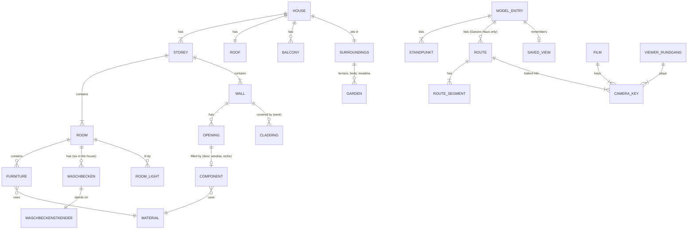
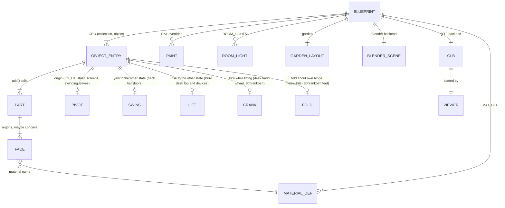
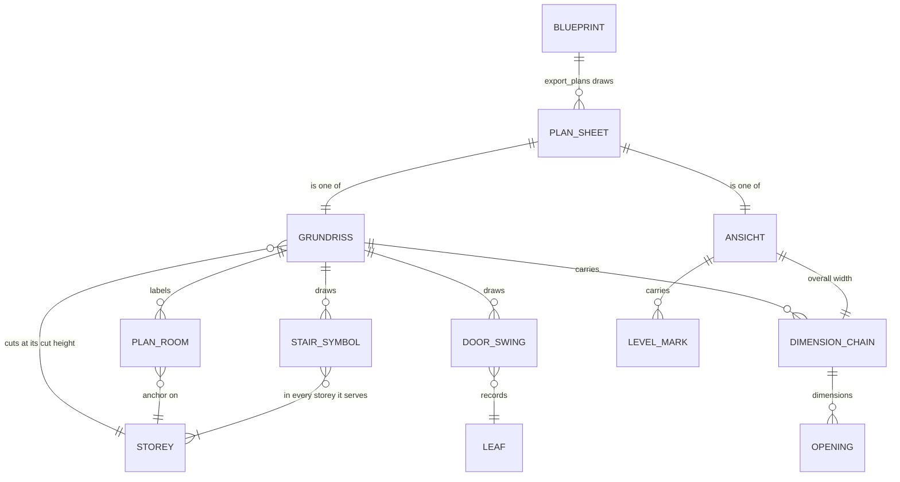
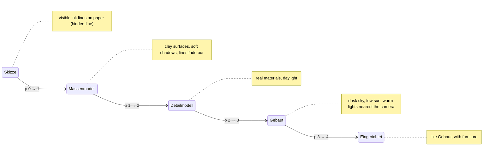
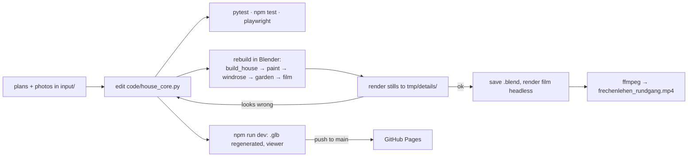

# Domain: Frechenlehen house model

## Purpose

A 3D model of the house **Frechenlehen**: an Alpine-style family house with two storeys, a
pitched roof, larch cladding on the west and the gables, balconies, a terrace and a small annex. The model is built from
the architect's plans and from detail photos. It serves the family (the owner, Till) to
see the house, walk through it on film, explore it in the browser and show it to others.
The README (German) is the user-facing description.

## Vocabulary

The code mixes German building terms (from the plans) with English code names. Kept as
the team uses them:

| Term | Meaning |
|---|---|
| **EG** (Erdgeschoss) | Ground floor, z = 0 … 2.40 m. |
| **OG** (Obergeschoss) | Upper floor, z = 2.70 … 4.90 m (`Z_OG`, `Z_OG_TOP`). |
| **Dach** | Roof: ridge runs east–west at 7.67 m, ~20° pitch, wide eaves (`EAVE_OH`) and gable overhangs (`GABLE_OH`). |
| **Grundriss** | Floor plan, 1:100: the architect's input plan (`grundriss_eg.png`, `grundriss_og.png` in the folder of the current plans, see `LOG.md`) and our generated one, a horizontal section through a storey at its **cut height (Schnitthöhe)** seen from above. Parts the cut passes through are **cut** (walls hatched inside one heavy outline, other parts a thin one); parts below it are **projection** in thin lines; loose furniture and parts above the cut are left out. |
| **Ansicht** | Elevation drawing: the architect's, and our generated one, named after the facade it shows (Ansicht Süd = the south facade seen from the south), orthographic with hidden lines removed, glass opaque, a grey ground band below ±0,00. |
| **Plan sheet** (Planblatt) | One A3 SVG at 1:100 in `plans/` (`eg`, `og`, `nord`, `ost`, `sued`, `west`), sized in mm (1 m = 10 mm), with a title block (Frechenlehen, sheet, M 1:100, model state), a scale bar and, on the floor plans, a north arrow. |
| **Door swing** (Türaufschlag) | A hinged leaf's record (hinge, width, room side, its box as built); the plan draws the conventional symbol, the leaf at 90° and a quarter arc, however far the door stands open in the model. |
| **Stair symbol** | The stair in the plan as the architect draws it, in every storey it serves: outline, a line at each riser, the walking line (**Lauflinie**) from a circle at the bottom step to an arrow at the top, always pointing up; in its bottom storey the step count with rise/run ("15 STG 18.0/25.5"). |
| **Plan room** (Raumstempel) | The architect's room name and the computed net area ("Küche / 24,06 m²"): the region round its anchor in a section just below the ceiling, door openings closed by their lintels. One anchor per region. |
| **Dimension chain** (Maßkette) | A ticked row of lengths along one side; a floor plan has three per side (openings, walls and rooms, overall), summing exactly. Lengths ≥ 1 m in metres with two decimals ("2.05"), below in cm ("31"), a remaining half centimetre as a superscript 5 ("4.01⁵", "41⁵"). |
| **Level mark** (Höhenkote) | A level in metres relative to OK FFB EG (±0,00; +2,70 OK FFB OG; eaves, ridge) on the elevations. |
| **Model state** | A short hash of everything the plan sheets are drawn from, printed instead of a date so the output stays deterministic. |
| **Putz** | Plaster, the white facade (RAL 9010). |
| **Laden / Läden** | Window shutters, blue RAL 5014. |
| **Cross boards** (Querbretter) | The two white boards across every shutter, per storey (`Laeden_Querbretter`, `OG_Laeden_Querbretter`). |
| **Lärche / Lärchenschalung** | Larch wood / the larch board cladding of the west side, the east gable and the annex. |
| **Windfang** | Entrance lobby behind the east front door, with a glazed double door. |
| **Stube** | Living room with the **Ofenbett**: a plastered stove with a bed above it and an **Ofenbank** (stove bench). The plans still label it "Kachelofen". |
| **Opening** | A hole in a wall: `W` window, `FD` french door, `WF` tall window with a fixed light below, `GD` glazed larch door, `D` solid door, `I` bare opening filled by a dedicated builder. |
| **Leaf** | An interior door leaf, normally opened flat against the wall. A **swinging leaf** is an object of its own with its origin at the hinge (`PIVOT`) and `SWING`, the yaw to its other state. |
| **Component** | A named building part (e.g. entrance door). The name of a reference photo in `input/` is the component it shows. |
| **Route** | A camera path in `tour.py` (`ROUTES`): orbit / path / turn / stair / hold segments; turning speed `TURN` and pause length `PAUSE` are one variable each. Each route is closed: it ends at its start pose. "Um und durch das Haus" (`ROUTE`) is the film's and the viewer's first; "Durch die Stube & Küche" is a shorter walk only the viewer plays. |
| **Camera key** | One smoothed frame of a route at 25 fps: position (x, y, z), yaw, pitch (radians, model z-up) and lens (mm, 36 mm sensor width). `tour.build_tour(route)` bakes a route into them; the film (first route) and the viewer (all routes) play them. |
| **Rundgang** (viewer) | Live playback of the chosen route's camera keys in the viewer, in stage Eingerichtet with the whole house and the entrance door open; it can pause (then the user looks around), be scrubbed, loop ("Endlos") and be left ("Beenden"). It is started from the Routen group of the Standpunkt drop-down. A playing route is neither saved nor written to the URL; when it ends, the Darstellung it started from returns unless the user changed it meanwhile. |
| **Standpunkt** | A named camera pose of a model entry in `tour.py` (`SPOTS`: name, group, entries, camera, look-at point, vertical field of view). Outside Standpunkte (groups Außen, Übersicht) are orbited around their look-at point; inside ones (groups Erdgeschoss, 1. Stock) stand in the room, as a rule at eye height `EYE` in a corner (a room's first is named after it, e.g. "Bibliothek - Ecke hinten rechts"; exception: "Bibliothek - Klavierspieler", seated on the piano bench, eye 1.25 m), and the mouse looks around in place (no orbit, zoom or pan). The first Standpunkt of an entry is its standard (house: Von Südosten). Sub-models list their own views (Schräg, Von oben, …) from their page config. After the user moves the camera, the drop-down shows **Eigene Ansicht**. |
| **Collection** | Blender grouping. The house lives in `Haus` with sub-collections `FL_EG`, `FL_OG`, `FL_Dach`, `FL_Balkone`, `FL_Umgebung`, `FL_Referenz`. In the `.glb` it is `extras.collection` per node. |
| **rnd** | A random value per Part, stored per face, that varies the shade of boards and slabs. |
| **Core** (`house_core`) | The pure-Python description of the house: constants, materials as data, primitives, builders. It knows nothing about Blender or three.js. |
| **Blueprint** | What one core build returns: the GEO entries and their Parts, `SMOOTH`, `PIVOT`, `TURN`, `SLIDE`, `SWING`, `LIFT`, `CRANK`, `FOLD`, `VARIANT`, `MAT_DEF`, paint colours, room lights and the garden layout. Not to be confused with "model", the whole 3D house. |
| **Backend** | Turns a Blueprint into output. **Blender backend** (`build_house.py`): the `.blend` scene. **glTF backend** (`export_gltf.py`): the `.glb` file. |
| **Part** | The geometry of one `add()` call: a closed solid (box, prism, sweep, …) with one `rnd` value. The unit for normal orientation. |
| **Parity snapshot** | Per-object fingerprint of the Blender build (vertex and face counts, bounding box, materials, `rnd` hash), compared with the golden. |
| **Viewer** | The three.js web page in `web/`. |
| **Sub-model** | A piece of the house built alone at its own origin with dimension lines, on its own page reached through the viewer's "Modell" drop-down: the **Ofen** (`ofen.py`, `ofen.html`), the **Schreibtisch** (`desk.py`, `desk.html`), the **Bad Großeltern** (`bad.py`, `bad.html`; it brings walls of its own), the **Küche** (`kueche.py`, `kueche.html`) the **Gäste-WC** (`gaeste_wc.py`, `gaeste_wc.html`; with its partition, the WC's north wall and the back hall's three doors) the **Schrank im Büro** (`regal.py`, `regal.html`; the Tegernsee bookcase around the Bibliothek's east window, with pieces of the three walls around it) and the **Schrankbett** (`schrankbett.py`, `schrankbett.html`; the Yoga room's wall bed, with pieces of the west and south wall). The house places the same parts, only translated. |
| **Gäste-WC terms** | **WC** (west of the **Trennwand**, the new 10 cm partition; door to the back hall, leaf opening outward), **Garderobe** (east of it, open through the old 80 opening: Bank, Hakenbrett, Hutablage), **Handwaschbecken** (the WC's basin outside it, a Waschbecken einzeln 40/28 on its Ständer, on the back hall's east wall, with tiles and a wood-framed mirror), **schwenkende Türen** (Hintertür, WC-Tür, Windfangtür: in the viewer one of them swings to its other state now and then, to show where they get in each other's way). |
| **Küche terms** | **Spülzeile** (sink run on the north wall, door frame → NE corner), **Ostzeile** (60 cm base unit on the east wall), **Halbinsel** (peninsula with the cooktop), **Abzug** (flue box in the NE corner from 1.80 m up), **Besenschrank** (broom cupboard behind the open kitchen door). |
| **Bad Großeltern terms** | **Nische** (the 1.20 m WC + Schrank strip in the south, split by a 12 cm wall), **verschränkte Schiebetüren** (two sliding leaves on offset tracks closing the Nische; at most one half open), **Raumteiler** (1 m wall and one L-shaped glass pane: above the wall to the ceiling, 35 cm from the north wall down to the floor; between shower and basin), a **Waschbecken doppelt** 100 × 47 on the Raumteiler's east face, **Durchgang** (the passage between the front sliding leaf and the Raumteiler's end). |
| **Waschbecken einzeln / doppelt** | The house's one basin design, after `input/2026-11-12 input/waschbecken_einzeln.jpeg` / `waschbecken_doppelt.jpg`: a rectangular white ceramic basin, top 85 cm, 17 cm high, a tap deck along the wall, one bowl, one drain. *einzeln*: one mixer; *doppelt*: one long bowl with two mixers. Size per place: Bad Großeltern d 100 × 47, back hall e 40 × 28, OG Bad NW d 120 × 47, OG Bad S d 100 × 47, OG WC e 50 × 40, OG Flur e 60 × 47. |
| **Waschbeckenständer** (Ständer, Rohre) | The chrome tube frame under every Waschbecken (`waschbecken_staender.png`), more decoration than support: two front legs with collars and tapered feet, a front rail and two side rails at 52 cm running back to balls on wall rosettes, two back posts up to the basin, a bottle trap from the drain to the wall. |
| **Speis A / B / C** | The pantry's built-ins: open shelf A on the Flur wall, open shelf B on the aisle, cabinet C back to back with B with doors to the Essen; all to the ceiling. In the variant **Alternativ**, C stands against the Essen's west wall over its full width and B has a closed back towards the Essen. |
| **Variante** | An alternative layout of part of the house, shown next to the **default** (the agreed layout: Blender, film, Rundgang, plan sheets and every Modell entry but one). One so far: **Alternativ** (EG): C on the Essen's west wall, the Speis/Küche wall 60 cm shorter, a **saloon door** (Pendeltür: two half-height leaves without handles that swing) instead of the sliding door. Its objects are flagged `alt`, the default-only ones it replaces `main` (`VARIANT`); all others are shared. |
| **Lift / Crank** | A group of objects that moves straight up together to its other state and back (`LIFT`: the Büro desk top with its devices), and an object turning about its pivot while they move (`CRANK`: the desk's hand wheel; also without a lift: the Schrankbett folding up 90° about x), and one folding about a hinge of its own in its turning frame meanwhile (`FOLD`: the Schrankbett's feet folding onto its underside). All on one clock. Like slide and swing, the viewer animates them in Eingerichtet only, outside the Rundgang; Blender and the film keep them as built (desk low, bed down). |
| **Schrankbett terms** | **Schrankwand** (the 45 cm deep carcass on the Yoga room's south wall: a **Seitenschrank** left and right, the **Nische** between them, a **Blende** over it up to the ceiling), **Klappbett** (the folding bed, lying area 2.00 × 2.00, built **ausgeklappt** = folded down; **hochgeklappt** its framed, six-panel underside closes the niche flush with the doors), **Klappfüße** (its feet, folding onto the underside). |
| **Kurbelgestell** | The Büro desk's cast-iron crank frame after `schreibtischgestell.jpg`, under a solid cherry (Kirschbaum) top. |
| **Bildschirm** | A monitor pane of the Schreibtisch whose material shows a screen image (a screenshot) instead of a colour or procedural texture. |
| **Stage** | One of five looks of the house in the viewer: **Skizze** (sketch), **Massenmodell** (massing model), **Detailmodell** (detailed model), **Gebaut** (built reality), **Eingerichtet** (furnished: Gebaut plus furniture). The Darstellung drop-down chooses it; the internal progress `p` is 0…4 (the URL value), and the stages blend only in the code. |
| **Modell** (drop-down) | The model-entry chooser at the top right of every viewer page: **Ganzes Haus**, **Erdgeschoss**, **Erdgeschoss - Alternativ**, **1. Stock** │ the sub-models Ofen, Schreibtisch, Bad Oma & Opa, Küche, Gäste-WC, Schrank im Büro, Schrankbett. The four house entries are the **cutaway**: roof and OG hidden or not (`cut=` `all` / `eg` / `eg_alt` / `noroof`), the ground never hidden; `eg_alt` cuts as `eg` and shows the variant Alternativ instead of the default. |
| **Darstellung** | The level of rendering of a model entry, chosen in its drop-down: the five stages for the house, Drahtmodell / Masse / Gerendert for a sub-model. Skizze / Drahtmodell is the lowest. |
| **Reset** | The button beside the drop-downs: forgets the current entry's saved view and returns it to its lowest Darstellung and its standard Standpunkt. |
| **Saved view** | Per model entry, the browser (`localStorage`, key `frechenlehen:<page>:<entry>`) keeps the last Darstellung and camera pose as the same query string the URL uses. The URL wins over it; a bare house URL opens the last-used house entry. An entry's default view is never stored. A view key that is malformed (cam/at not three finite numbers, p not finite, fov outside 10…90) is dropped before use and before saving. |
| **Clay / Ink / Paper** | The off-white Massenmodell material / the dark Skizze line colour / the Skizze background and surface colour. Surfaces drawn in paper hide the lines behind them (**hidden-line**). |
| **Garden layout** | The shared description of the garden: ground area, no-grass areas, grass density, clump shape and shrub placements. Each backend plants from it in its own way. |
| **No-grass area** | A rectangle where no grass grows: around house walls, terrace, gravel strip, beds, annex and the EG balcony (`no_grass`). The **windrose area** (`windrose`: star square plus four letter squares) is separate: Blender keeps grass off it, the viewer ignores it. |
| **Clump** (Grasbüschel) | One grass instance: 6 curved, tapering blades, 0.3–0.6 m tall. |
| **Shrub** (Strauch) | A rounded leafy bush in one of the beds (`Beet_Ost`, `Beet_West`), placed in groups of three with a gap. |
| **Room light** | A warm point light at one of the 23 `ROOM_LIGHTS` sites (x, y, floor z), `ROOM_LIGHT_H` above the floor. In Blender, one film fill light per site. In the viewer (fast mode) by day none is on; at dusk the `ROOM_N` sites nearest the camera are lit; with `hires=on` every site has its own light. |
| **Outside lamp light** | The viewer's warm spot under an `OUTSIDE_LIGHTS` bulb (gooseneck wall lamps): off by day; at dusk the `OUTSIDE_N` nearest the camera (fast mode) or all of them (`hires=on`). |
| **Light site** | A position a light can sit at: one `ROOM_LIGHTS` entry + `ROOM_LIGHT_H`, or one `OUTSIDE_LIGHTS` bulb. |
| **Light pool** | The viewer's fixed set of `ROOM_N` (6) room `PointLight`s and `OUTSIDE_N` (2) outside `SpotLight`s. Its members never change; at dusk each sits at one of the nearest sites, by day the whole pool is off (`visible = false`, out of the render list). |
| **Site distance** | How far a light site is from the camera for the ranking: `hypot(dx, dy, 3·dz)` while the camera is indoors (own storey first), else the plain 3D distance. |
| **Cut-off fade** | A pooled light's intensity factor `clamp((d_cut − d) / FADE, 0, 1)`, `d_cut` = distance of the nearest site left out, `FADE` = 1.0 m: a light leaves the pool already dark. |
| **Fast mode / Full quality (`hires`)** | The viewer's two modes, chosen per page load by the URL switch `hires`. Fast mode (default, Rundgang included): light pool, pixel ratio ≤ 1.5, no grass while the camera is indoors. `?hires=on` (film capture): none of these shortcuts. |
| **Quick check** (per-step check) | What runs after every change: the change's own new test alone, `pytest -m "not slow"` and Vitest (`scripts/check.sh quick`, ≤ 60 s), then a Show when the change is visible. |
| **Full check** (final check) | Everything: all pytest incl. slow tests, Vitest, all Playwright projects except `@eye` (`scripts/check.sh full`); once at the end of a change (after a Blender rebuild, save and still if the Blender output changed), at archive and on request. Known bugs in `specs/bugs/` don't count as new failures. |
| **Slow test** | A pytest test marked `slow` (the Blender parity tests: they start Blender); not in the quick check. |
| **`@eye` test** | A Playwright test that only makes pictures for a human (stills along the Rundgang); not in the default run, `--grep @eye` runs it. |
| **View URL** | The viewer's URL state: house `?cam=x,y,z&at=x,y,z&p=0…4&cut=` `all` / `noroof` / `eg`, sub-model pages `?cam=&at=&look=`, model coordinates (z up). |
| **Show** | Opening the user's browser at a view URL that frames changed objects (`code/show.py`), after the agent has looked at a screenshot of the same URL (`web/shot.js`). |

## Concepts and entities

- **House:** a main block of 14.885 × 12.887 m with an annex (Elektroraum, Heizung) in the SW corner.
- **Storeys:** EG and OG. They are joined by an open stair with 15 risers (18.0/25.5 cm) and
  a stairwell in the OG slab.
- **Rooms:** EG has Stube, Küche/Essen, Bibliothek, Speis, Oma & Opa (bedroom open to its Bad,
  WC in the Bad's niche), the Windfang and, by the back hall, the Gäste-WC with its Garderobe. OG has
  Nadine & Till, Waschküche, Saschi, Bichlach, Jugend and Yoga, plus bathrooms and WCs.
  Their names are written on the floor (Blender only).
- **Materials:** about 35 named materials (`FL_*`). Kinds:
  - plain colour
  - procedural wood with grain along an axis
  - speckled stone
  - bumped plaster
  - glass
  - emissive: stove fire, lamp filaments

The plan sheets draw from the Blueprint and its plan records:

## Stages of the viewer

- **The Darstellung drop-down** jumps to a stage; there is no timeline bar and no Play.
- **The sun toggle** (beside Reset, house only) switches between day and dusk lighting from
  Detailmodell on. Any stage change resets it.
- **Garden per stage.** In Skizze, each shrub is one ink circle and there is no grass. In
  Massenmodell, shrubs are clay blobs and there is no grass. In Detailmodell and Gebaut,
  grass and leaves grow in with the detail blend.

## Actors

| Actor | Does |
|---|---|
| Owner (Till) | Gives plans and photos, asks for changes, watches stills, films and the viewer. |
| Claude (agent) | Edits the core and the scripts, runs them in Blender over the Blender MCP server, runs the tests, renders stills and films and checks them. |
| Blender 5.2 | Runs the Blender scripts, holds the scene, renders with EEVEE. |
| Browser | Loads the viewer from GitHub Pages or the Vite dev server. |
| Family and friends | Open the viewer link. |
| Architect (indirect) | Source of the plans (`input/*.pdf`). |

## Processes

1. **Rebuild.** Run all Blender scripts in a fixed order. Each one replaces only its own
   collection or objects. Save the `.blend`.
2. **Verify a change.** Run the test suites. Render a still from a temporary camera and look
   at it, then remove the camera. For the viewer, look at the Playwright screenshots in
   `tmp/web/`.
3. **Deliberate change to the Blender output.** Regenerate the parity golden, diff it, then
   rebuild and save the `.blend`.
4. **Film.** Bake the route into camera keys (`tour.build_tour()`), render one frame per key
   headless and encode them. The viewer's Rundgang plays the same keys live.
5. **Refresh the README views:** `docs/images/ansicht_*.png`.
6. **Publish the viewer:** merge to `main`; the Pages workflow builds and deploys.

## Rules and constraints

- **One source of truth.** Geometry, material parameters, paint colours, cross boards, room
  lights, the windrose position and the garden layout are defined only in `house_core.py`.
  Neither backend nor the viewer repeats them
  ([ADR-001-XEWL](../architecture/adr-001-xewl-shared-python-core.md)). No hand edits live in
  the `.blend`.
- **Same randomness.** `build()` seeds `random` with 22, so `rnd` values and board splits match
  in both outputs.
- **Faces point outward.** Every closed Part is oriented to a positive signed volume, as
  Blender's normal recalculation does. Open Parts (the two lamp cones) are double-sided.
- **Object space = world space.** GEO vertices are in world coordinates, except pivoted
  objects, which are shifted by the pivot (and stored unturned when they have a `TURN`). Wood grain lines up the same way in Blender and in
  the `.glb`.
- **The garden is alike, not identical.** Both outputs plant from the same garden layout;
  blades and leaves land in different spots, and the browser uses 25 % of the grass density.
- **Skizze is hidden-line.** Only the visible edges are drawn. `SMOOTH` objects (pebbles,
  outside lamps) get no lines.
- **The cutaway never hides the ground.** Entry 1. Stock (`noroof`) hides `Dach` (with `Verschalung_West` and the annex roof `Dach_Anbau`).
  Entry Erdgeschoss (`eg`) also hides `OG` and the OG balconies (`Balkon_OG_*`).
- **Coordinates:** metres. The origin is the outer SW corner, +X east, +Y north, Z up. The
  `.glb` stores `(x, z, -y)`.
- **Accuracy:** plan measurements are about ±5 cm. Pink-hatched walls are walls. Lighter
  hatching marks a closed-up door.
- **Faces that overlap in one plane** must share one `rnd` value or be offset by
  millimetres, or they z-fight.
- **Colours:** facade and windows RAL 9010, shutters RAL 5014. Doors stay
  natural wood.
- **Every route camera** (film and viewer Rundgang, all routes) and every inside Standpunkt stay ≥ 0.25 m from all geometry and never
  passes through a wall.
