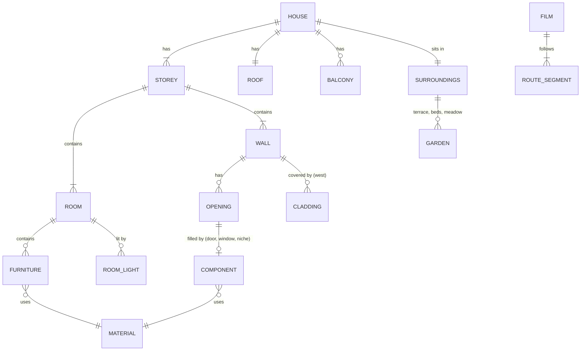
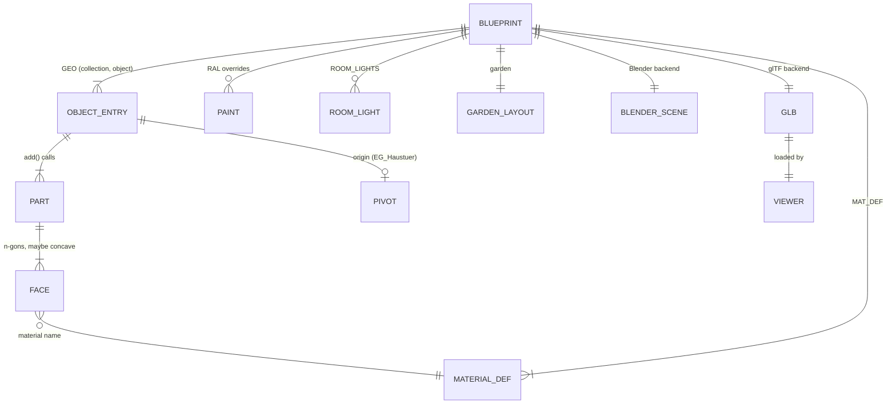
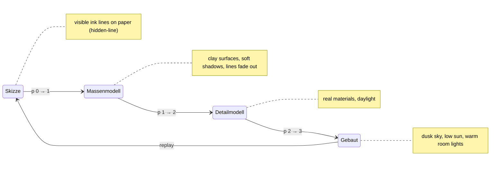
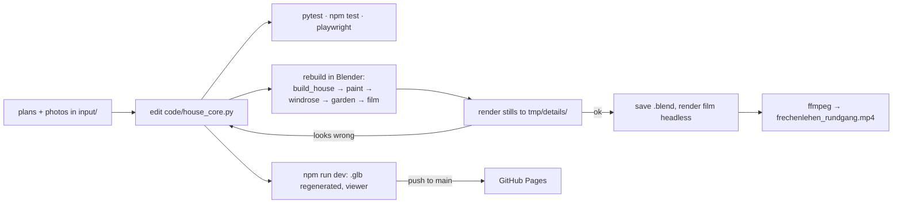

# Domain: Frechenlehen house model

## Purpose

A 3D model of the house **Frechenlehen**: an Alpine-style family house with two storeys, a
pitched roof, larch cladding on the west and the gables, balconies, a terrace and a small annex. The model is built from
the architect's plans and from detail photos. It serves the family (the owner, Till) to
see the house, walk through it on film, explore it in the browser and show it to others.
The README (German) is the user-facing description.

## Vocabulary

The code mixes German building terms (from the plans) with English code names. Kept as
the team uses them:

| Term | Meaning |
|---|---|
| **EG** (Erdgeschoss) | Ground floor, z = 0 … 2.40 m. |
| **OG** (Obergeschoss) | Upper floor, z = 2.70 … 4.90 m (`Z_OG`, `Z_OG_TOP`). |
| **Dach** | Roof: ridge runs east–west at 7.67 m, ~20° pitch, wide eaves (`EAVE_OH`) and gable overhangs (`GABLE_OH`). |
| **Grundriss** | Floor plan (`grundriss_eg.png`, `grundriss_og.png` in the folder of the current plans, see `LOG.md`), 1:100. |
| **Ansicht** | Elevation drawing. |
| **Putz** | Plaster, the white facade (RAL 9010). |
| **Laden / Läden** | Window shutters, blue RAL 5014. |
| **Cross boards** (Querbretter) | The two white boards across every shutter, per storey (`Laeden_Querbretter`, `OG_Laeden_Querbretter`). |
| **Lärche / Lärchenschalung** | Larch wood / the larch board cladding of the west side, the east gable and the annex. |
| **Windfang** | Entrance lobby behind the east front door, with a glazed double door. |
| **Stube** | Living room with the **Kachelofen** (tiled stove) and **Ofenbank** (stove bench). |
| **Opening** | A hole in a wall: `W` window, `FD` french door, `WF` tall window with a fixed light below, `GD` glazed larch door, `D` solid door, `I` bare opening filled by a dedicated builder. |
| **Leaf** | An interior door leaf, normally opened flat against the wall. |
| **Component** | A named building part (e.g. entrance door). The name of a reference photo in `input/` is the component it shows. |
| **Route** | The camera path of the walkthrough film: orbit / path / look / stair / hold segments. |
| **Collection** | Blender grouping. The house lives in `Haus` with sub-collections `FL_EG`, `FL_OG`, `FL_Dach`, `FL_Balkone`, `FL_Umgebung`, `FL_Referenz`. In the `.glb` it is `extras.collection` per node. |
| **rnd** | A random value per Part, stored per face, that varies the shade of boards and slabs. |
| **Core** (`house_core`) | The pure-Python description of the house: constants, materials as data, primitives, builders. It knows nothing about Blender or three.js. |
| **Blueprint** | What one core build returns: the GEO entries and their Parts, `SMOOTH`, `PIVOT`, `MAT_DEF`, paint colours, room lights and the garden layout. Not to be confused with "model", the whole 3D house. |
| **Backend** | Turns a Blueprint into output. **Blender backend** (`build_house.py`): the `.blend` scene. **glTF backend** (`export_gltf.py`): the `.glb` file. |
| **Part** | The geometry of one `add()` call: a closed solid (box, prism, sweep, …) with one `rnd` value. The unit for normal orientation. |
| **Parity snapshot** | Per-object fingerprint of the Blender build (vertex and face counts, bounding box, materials, `rnd` hash), compared with the golden. |
| **Viewer** | The three.js web page in `web/`. |
| **Stage** | One of four looks in the viewer: **Skizze** (sketch), **Massenmodell** (massing model), **Detailmodell** (detailed model), **Gebaut** (built reality). |
| **Timeline** | The bar that moves between stages. Its progress `p` runs from 0 to 3; integer values are the pure stages, values in between blend two neighbours. |
| **Cutaway** | Viewer setting that hides the roof ("Ohne Dach") or the roof and the OG ("Nur EG"). |
| **Clay / Ink / Paper** | The off-white Massenmodell material / the dark Skizze line colour / the Skizze background and surface colour. Surfaces drawn in paper hide the lines behind them (**hidden-line**). |
| **Garden layout** | The shared description of the garden: ground area, no-grass areas, grass density, clump shape and shrub placements. Each backend plants from it in its own way. |
| **No-grass area** | A rectangle where no grass grows: around house walls, terrace, gravel strip, beds, annex and the EG balcony (`no_grass`). The **windrose area** (`windrose`: star square plus four letter squares) is separate: Blender keeps grass off it, the viewer ignores it. |
| **Clump** (Grasbüschel) | One grass instance: 6 curved, tapering blades, 0.3–0.6 m tall. |
| **Shrub** (Strauch) | A rounded leafy bush in one of the beds (`Beet_Ost`, `Beet_West`), placed in groups of three with a gap. |
| **Room light** | A warm point light at one of the 23 `ROOM_LIGHTS` (x, y, floor z), `ROOM_LIGHT_H` above the floor. Film fill lights in Blender, dusk lights in the viewer's Gebaut stage. |

## Concepts and entities

- **House:** a main block of 14.885 × 12.887 m with an annex (Elektroraum, Heizung) in the SW corner.
- **Storeys:** EG and OG. They are joined by an open stair with 15 risers (18.0/25.5 cm) and
  a stairwell in the OG slab.
- **Rooms:** EG has Stube, Küche/Essen, Bibliothek, Speis, Oma & Opa and the Windfang. OG has
  Nadine & Till, Waschküche, Saschi, Bichlach, Jugend and Yoga, plus bathrooms and WCs.
  Their names are written on the floor (Blender only).
- **Materials:** about 35 named materials (`FL_*`). Kinds:
  - plain colour
  - procedural wood with grain along an axis
  - speckled stone
  - bumped plaster
  - glass
  - emissive: stove fire, lamp filaments

## Stages of the viewer

- **Play** runs `p` from its current value to 3 at 4 s per stage. It stops at 3; Play at 3
  restarts from 0. **Clicking a stage name** jumps there; **dragging the scrubber** sets `p`.
- **The sun toggle** switches between day and dusk lighting from p 1.5 on. Any timeline move
  resets it.
- **Garden per stage.** In Skizze, each shrub is one ink circle and there is no grass. In
  Massenmodell, shrubs are clay blobs and there is no grass. In Detailmodell and Gebaut,
  grass and leaves grow in with the detail blend.

## Actors

| Actor | Does |
|---|---|
| Owner (Till) | Gives plans and photos, asks for changes, watches stills, films and the viewer. |
| Claude (agent) | Edits the core and the scripts, runs them in Blender over the Blender MCP server, runs the tests, renders stills and films and checks them. |
| Blender 5.2 | Runs the Blender scripts, holds the scene, renders with EEVEE. |
| Browser | Loads the viewer from GitHub Pages or the Vite dev server. |
| Family and friends | Open the viewer link. |
| Architect (indirect) | Source of the plans (`input/*.pdf`). |

## Processes

1. **Rebuild.** Run all Blender scripts in a fixed order. Each one replaces only its own
   collection or objects. Save the `.blend`.
2. **Verify a change.** Run the test suites. Render a still from a temporary camera and look
   at it, then remove the camera. For the viewer, look at the Playwright screenshots in
   `tmp/web/`.
3. **Deliberate change to the Blender output.** Regenerate the parity golden, diff it, then
   rebuild and save the `.blend`.
4. **Film.** Bake the route into camera keys, render 3480 frames headless and encode them.
5. **Refresh the README views:** `docs/images/ansicht_*.png`.
6. **Publish the viewer:** merge to `main`; the Pages workflow builds and deploys.

## Rules and constraints

- **One source of truth.** Geometry, material parameters, paint colours, cross boards, room
  lights, the windrose position and the garden layout are defined only in `house_core.py`.
  Neither backend nor the viewer repeats them
  ([ADR-001-XEWL](../architecture/adr-001-xewl-shared-python-core.md)). No hand edits live in
  the `.blend`.
- **Same randomness.** `build()` seeds `random` with 22, so `rnd` values and board splits match
  in both outputs.
- **Faces point outward.** Every closed Part is oriented to a positive signed volume, as
  Blender's normal recalculation does. Open Parts (the two lamp cones) are double-sided.
- **Object space = world space.** GEO vertices are in world coordinates, except pivoted
  objects, which are shifted by the pivot. Wood grain lines up the same way in Blender and in
  the `.glb`.
- **The garden is alike, not identical.** Both outputs plant from the same garden layout;
  blades and leaves land in different spots, and the browser uses 25 % of the grass density.
- **Skizze is hidden-line.** Only the visible edges are drawn. `SMOOTH` objects (pebbles,
  outside lamps) get no lines.
- **The cutaway never hides the ground.** "Ohne Dach" hides `Dach` (with `Verschalung_West`).
  "Nur EG" also hides `OG` and the OG balconies (`Balkon_OG_*`).
- **Coordinates:** metres. The origin is the outer SW corner, +X east, +Y north, Z up. The
  `.glb` stores `(x, z, -y)`.
- **Accuracy:** plan measurements are about ±5 cm. Pink-hatched walls are walls. Lighter
  hatching marks a closed-up door.
- **Faces that overlap in one plane** must share one `rnd` value or be offset by
  millimetres, or they z-fight.
- **Colours:** facade and windows RAL 9010, shutters and stove tiles RAL 5014. Doors stay
  natural wood.
- **The film camera** stays ≥ 0.25 m from all geometry and never passes through a wall.
