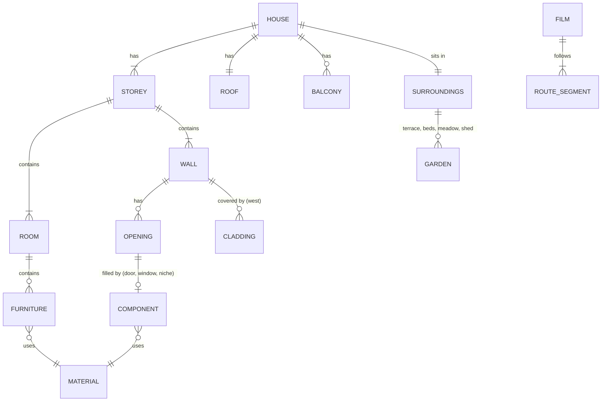
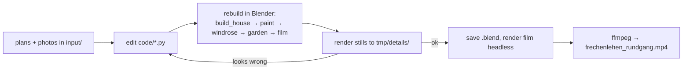

# Domain: Frechenlehen house model

## Purpose

A 3D model of the house **Frechenlehen**: an Alpine-style family house with two storeys, a
pitched roof, larch cladding on the west, balconies and a terrace. The model is built from
the architect's plans and from detail photos. It serves the family (the owner, Till) to
see the house, walk through it on film and show it to others. The README (German) is the
user-facing description.

## Vocabulary

The code mixes German building terms (from the plans) with English code names. Kept as
the team uses them:

| Term | Meaning |
|---|---|
| **EG** (Erdgeschoss) | Ground floor, z = 0 … 2.40 m. |
| **OG** (Obergeschoss) | Upper floor, z = 2.70 … 4.90 m (`Z_OG`, `Z_OG_TOP`). |
| **Dach** | Roof: ridge runs east–west at 7.67 m, ~20° pitch, wide eaves (`EAVE_OH`) and gable overhangs (`GABLE_OH`). |
| **Grundriss** | Floor plan (`input/grundriss_eg.png`, `grundriss_og.png`), 1:100. |
| **Ansicht** | Elevation drawing. |
| **Putz** | Plaster, the white facade (RAL 9010). |
| **Laden / Läden** | Window shutters, blue RAL 5014 with white cross boards. |
| **Lärche / Lärchenschalung** | Larch wood / the larch board cladding of the west side. |
| **Windfang** | Entrance lobby behind the east front door, with a glazed double door. |
| **Stube** | Living room with the **Kachelofen** (tiled stove) and **Ofenbank** (stove bench). |
| **Opening** | A hole in a wall: `W` window, `FD` french door, `GD` glazed larch door, `D` solid door, `I` bare opening filled by a dedicated builder. |
| **Leaf** | An interior door leaf, normally opened flat against the wall. |
| **Component** | A named building part (e.g. entrance door). The name of a reference photo in `input/` is the component it shows. |
| **Route** | The camera path of the walkthrough film: orbit / path / look / stair / hold segments. |
| **Collection** | Blender grouping. The house lives in `Haus` with sub-collections `FL_EG`, `FL_OG`, `FL_Dach`, `FL_Balkone`, `FL_Umgebung`, `FL_Referenz`. |
| **rnd** | A random value per part, stored per face, that varies the shade of boards and slabs. |

## Concepts and entities

- **House:** a main block of 14.885 × 12.887 m with a shed on the side.
- **Storeys:** EG and OG. They are joined by an open stair with 15 risers (18.0/25.5 cm) and
  a stairwell in the OG slab.
- **Rooms:** EG has Stube, Küche/Essen, Bibliothek, Speis, Oma & Opa and the Windfang. OG has
  Nadine & Till, Waschküche, Saschi, Bichlach, Jugend and Yoga, plus bathrooms and WCs.
  Their names are written on the floor.
- **Materials:** about 35 named materials (`FL_*`). Kinds:
  - plain colour
  - procedural wood with grain along an axis
  - speckled stone
  - bumped plaster
  - glass
  - emissive: stove fire, lamp filaments

## Actors

| Actor | Does |
|---|---|
| Owner (Till) | Gives plans and photos, asks for changes, watches stills and films. |
| Claude (agent) | Edits the build scripts and runs them in Blender over the Blender MCP server. Renders stills and films and checks them. |
| Blender 5.2 | Runs the scripts, holds the scene, renders with EEVEE. |
| Architect (indirect) | Source of the plans (`input/*.pdf`). |

## Processes

1. **Rebuild.** Run all scripts in a fixed order. Each script replaces only its own
   collection or objects.
2. **Verify a change.** Render a still from a temporary camera, look at it, then remove the
   camera.
3. **Film.** Bake the route into camera keys, render 3480 frames headless and encode them.
4. **Refresh the README views:** `docs/images/ansicht_*.png`.

## Rules and constraints

- **The scripts are the source of truth.** No hand edits live in the `.blend`, because
  `build_house.py` overwrites them.
- **Coordinates:** metres. The origin is the outer SW corner, +X east, +Y north, Z up.
- **Accuracy:** plan measurements are about ±5 cm. Pink-hatched walls are walls. Lighter
  hatching marks a closed-up door.
- **Faces that overlap in one plane** must share one `rnd` value or be offset by
  millimetres, or they z-fight.
- **Colours:** facade and windows RAL 9010, shutters and stove tiles RAL 5014. Doors stay
  natural wood.
- **The film camera** stays ≥ 0.25 m from all geometry and never passes through a wall.
