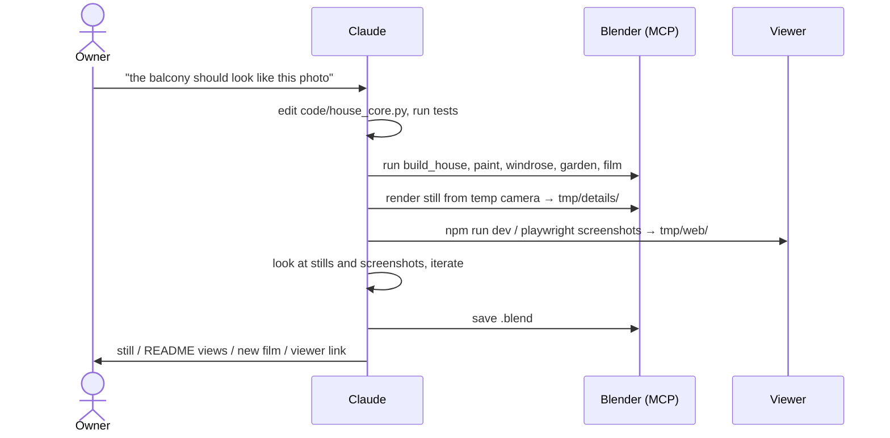
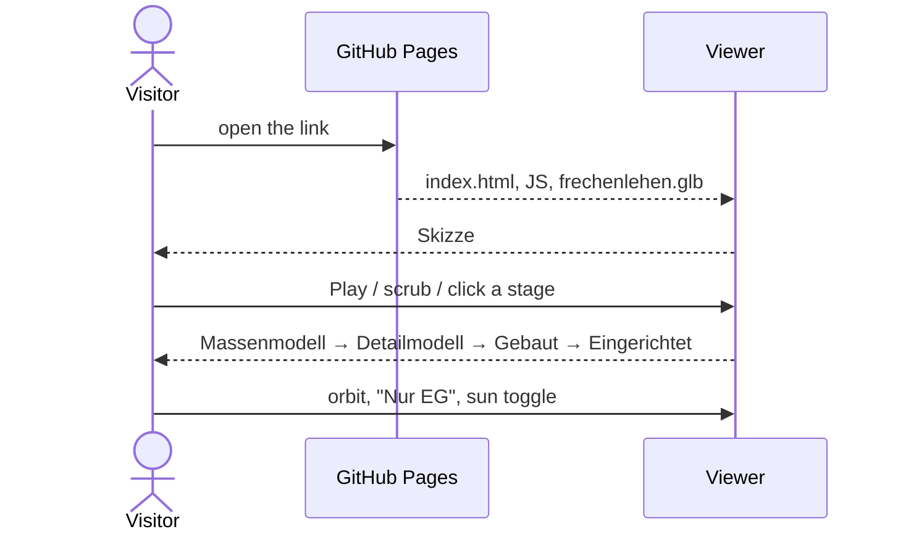

# Functional: Frechenlehen house model

## Features

### House model (`house_core.py`, built by both backends)

- **Shell:**
  - EG and OG walls with all openings from the plans
  - slabs and the stairwell
  - roof with rafters, purlins and soffit boards
  - eaves and gable overhangs
- **Exterior details from photos:**
  - round-arched entrance door, back door with an oval window and black lever handles inside and
    outside
  - windows with larch frames and glazing bars
  - blue shutters with white cross boards
  - larch terrace doors; tall OG west windows (Yoga, Bad): wall below up to a 0.75 m sill, glazed up to the ceiling
  - larch cladding of the whole west side and the east gable, cut around the openings; spaced
    slats over the gable windows
  - sliding door between Bad and WC Großeltern
  - larch balconies with cut-out balusters
  - outside lamps
- **Interior:**
  - panelled interior doors (opened)
  - glazed Windfang double door; the door to the back Windfang glazed the same way (one leaf)
  - Stube niche with a segmental arch
  - open stair with turned railing, also around the OG stairwell
  - floors: limestone in the EG corridor, the Bäder (Bad Großeltern, OG Bad NW with its shower
    alcove, Bad S) and all four WCs (also the WC in the Bad Großeltern's niche), oak planks
    elsewhere (also in the niche's Schrank)
  - Ofenbett in the Stube: plastered stove with the fire behind a glass door, bench, bed above
    with a thin cream mattress and a red-white checked blanket, one corner turned back;
    a fire window in the Flur wall shows the fire from the corridor too
  - kitchen: sink run, east run, peninsula with cooktop; at the north end of the east run a
    Wamsler wood cooker after wamsler.jpeg (grey enamel, fire burning behind the glass, flue pipe
    into the east wall) under an old-form steel hood (skirt with rail, canopy, stack to the
    ceiling); spruce wall cabinets over the sink run and over the east run beside the hood
  - big dining table (two joined) after tisch-briol.png: board top, legs splayed on a flat foot
    frame with corner blocks; 14 chairs
  - Büro desk in the Bibliothek between the two north french doors: two LG UltraFine 6K 32"
    monitors at 170° showing the screenshots `screen_a12` (left) and `screen_pilcrow` (right),
    a closed MacBook Pro partly under the left one with a softly lit logo, white Magic Keyboard
    and Magic Trackpad
  - all chairs (dining table, Bibliothek desk) are board chairs after stuhl.png: thick plank
    seat on battens, four splayed stick legs without stretchers, one tall backrest board leaning
    back with a pointed heart cut out
  - Stube seating corner between the two big windows: round pedestal side table, two small
    bouclé cocktail armchairs either side of it
  - Stube sofa after sofa.tiff: linen three-seater, 3/4 of the way from the corner pier between
    the big windows to the Ofen, facing the pier
  - bathrooms: shower, basin with mirror
  - the four WCs (also the WC Großeltern), after `input/2026-11-08 input/bad_mallnitz.jpeg`:
    green subway tiles about 1.1 m high with a cap row, floor-standing toilet with a
    close-coupled cistern; where the plan draws a hand basin (WC Großeltern, WC 2,30) a basin
    on chrome console legs under a mirror in a black frame
  - OG Flur, right of the Waschküche door: deep ceramic sink on a dark stone panel, one mixer tap
  - Waschküche: two front loaders at the east wall, a dryer stacked on the north one; a table
    0.80 m deep the full width of the back (south) wall, with two stacks of folded clothes; on the
    right wall from the door (west) an open spruce cupboard, 2.0 m high, continuous shelves
    without dividers, three coarsely woven wicker laundry baskets (stakes and weavers) per shelf
- **Annex** (SW corner): Elektroraum and Heizung, larch-clad timber walls, flat roof, plank
  door outside, panel door between the rooms.
- **Surroundings:** granite terrace with gravel strip and soil beds, ground.
- **Garden layout:** no-grass areas, grass density, clump shape and shrub placements in the
  beds.

### Blender only

- `build_house.py`: room names on the floors, the plan PNGs as hidden reference planes,
  sun/world/README camera.
- `paint.py`: RAL colours for facade, windows, shutters and stove tiles.
- `garden.py`: meadow grass (Geometry Nodes) and leafy shrubs.
- `windrose.py`: compass rose to the SW.
- **Film** (`film.py`, route in `tour.py`): a walkthrough of 305 s, 7632 frames at 1280×720,
  25 fps. Slow turns on the spot (`TURN` °/s), pauses (`PAUSE` s) and the camera height
  (`EYE`, 1.60 m above the floor) are one variable each:
  1. orbit outside, enter at the east door, which swings open
  2. EG: Stube round the sofa to the seating corner (turn, pause at the sofa and Ofen), Essen at the end of the table (turn,
     pause), look into the Speis, Küche, Großeltern: into their Bad (look into the shower and
     the WC, pause at each), then turn at the wall beside the balcony door,
     back door (turn, pause), Bibliothek back corner (turn, pause at the piano)
  3. up the stairs; OG: peeks into the first room on the right and the Waschküche, Schlafen SE
     back corner (turn, pause at the Kamin), peeks into its Bad, the NE room opposite, the SW room
     and the end Bad, Yoga back corner (turn)
  4. down the stairs, out to the start point, turn to face the house, pause; the route is closed

### Web viewer (`web/`)

- "Frechenlehen — Vom Strich zum Haus", German UI, desktop browsers. It is live at
  `https://tillg.github.io/frechen_blender/` once `main` carries the viewer and the Pages
  source is set to "GitHub Actions".
- **Five stages** on a timeline (play/pause, scrubber, stage names). It opens at Skizze.
  - **Skizze:** hidden-line ink on paper.
  - **Massenmodell:** clay with soft sun shadows.
  - **Detailmodell:** procedural materials after `MAT_DEF`, daylight, grass and leafy shrubs.
  - **Gebaut:** dusk sky, low sun, warm light in the rooms and outside lamps nearest the camera
    (6 rooms, 2 lamps; inside the house the own storey first). By day all of them are off.
  - **Eingerichtet:** like Gebaut, plus the furniture (nodes with `extras.furniture`), which no
    other stage shows. The cutaway still applies: "Nur EG" hides the OG furniture.
- **Orbit** with the mouse (drag, scroll). It starts from the README view in the south-east.
- **Cutaway:** "Ganzes Haus", "Ohne Dach", "Nur EG".
- **Sun toggle:** day or dusk, from Detailmodell on.
- **Rundgang** (button in the tools panel): plays the film's route live from the camera keys in
  the `.glb`, at 0.75× the film speed, in stage Eingerichtet with the whole house and the entrance
  door open. Play/pause, a scrubber, "Endlos" (loop; the route ends where it starts) and
  "Beenden", which closes the door and restores the previous camera (stage and cutaway stay).
  While paused, the user looks around with the mouse; while it runs, the cutaway buttons are
  disabled and the page draws at most 30 frames per second.
- **The view lives in the URL**, written as it changes: house `?cam=x,y,z&at=x,y,z&p=…&cut=…`
  (model coordinates; optional `&fov=…`, vertical field of view in degrees, default 28, and
  `&hires=on`, full quality), sub-model
  pages `?cam=…&at=…&look=wire|mass|full`. A reload or a shared link opens the same view.
- **Light on the GPU:** a frame is drawn only when something changes (camera, stage, cutaway,
  sun, window size); a burning fire in view is redrawn at most 30 times a second. In fast mode
  (the default, Rundgang included) the pixel ratio is capped at 1.5, only the light pool lights
  the dusk, and the meadow grass is not drawn while the camera is inside the main house; the
  dusk lighting is compiled once at load, so the first dusk doesn't stall. `?hires=on` (the
  film capture, `tmp/threejs_film.mjs`, always sets it) switches all of these shortcuts off.
- Local: `cd web && npm install && npm run dev` (one server, port 5377). The `.glb` is regenerated
  from the core first, and again whenever a `code/*.py` file is saved; then open pages reload at
  the same view.

## User journeys

## Inputs and outputs

| In | Out |
|---|---|
| `input/*.pdf`, `grundriss_*.png` (plans) | `frechenlehen.blend` |
| `input/*.png/jpg` detail photos, named after their component | `frechenlehen_rundgang.mp4` |
| `input/farben_*.png` colour references | `docs/images/ansicht_*.png` (README views) |
| | `tmp/details/*.png` check stills, `tmp/web/*.png` viewer screenshots |
| | `web/public/frechenlehen.glb` (generated), `web/dist/` → GitHub Pages |

## States and transitions

The model has no runtime state. In Blender the one animated part is the entrance door
(`EG_Haustuer`), which `film.py` rotates 90° around its pivot during the film. In the viewer,
the state is the timeline progress `p` (0–4), the cutaway (all / noroof / eg), a forced
dusk value from the sun toggle (cleared by any timeline move), the Rundgang
(off / playing / paused, its time and the loop flag; `body.dataset.tour`) and the `hires` mode
(fixed per page load).

## Permissions and visibility

No accounts. The repo is public on GitHub (raw MP4 link in `docs/autonomous-decisions.md`).
The viewer page is public and may be indexed. It shows no room names. The `window.__fl` test
hook exists only in dev and test builds.

## Edge cases and known limitations

- The viewer is desktop-only, has no free first-person walk (only the fixed Rundgang), and shows
  no room names, windrose or reference plans.
- The garden in the viewer is like Blender's, not identical: 25 % grass density, within 30 m,
  grass where the windrose would be.
- Headless e2e tests run the WebGL2 fallback; the WebGPU path is checked by hand.
- `film.py` adds new `Innenlicht_*` lights with rising suffixes on each run (cosmetic).
- Plan accuracy is about ±5 cm. The stair is longer than drawn ("Treppe wird verschoben").
