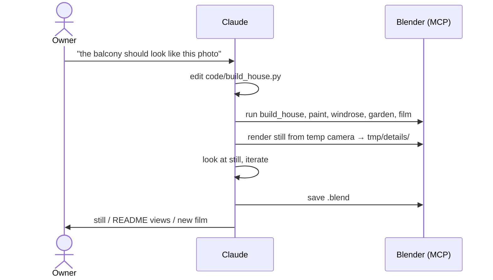

# Functional: Frechenlehen house model

## Features

### House model (`build_house.py`)

- **Shell:**
  - EG and OG walls with all openings from the plans
  - slabs and the stairwell
  - roof with rafters, purlins and soffit boards
  - eaves and gable overhangs
- **Exterior details from photos:**
  - round-arched entrance door, back door with an oval window
  - windows with larch frames and glazing bars
  - shutters
  - larch terrace doors and big west windows
  - larch cladding of the whole west side, cut around the openings
  - larch balconies with cut-out balusters
  - outside lamps
- **Interior:**
  - panelled interior doors (opened)
  - glazed Windfang double door
  - Stube niche with a segmental arch
  - open stair with turned railing, also around the OG stairwell
  - floors: limestone in the EG corridor, oak planks elsewhere
  - Kachelofen with bench and fire
  - big dining table with 14 chairs
  - bathrooms and WCs: shower, basin, wall-hung WC
  - room names on the floors
- **Surroundings:** granite terrace with gravel strip and soil beds, shed, ground.
- **References:** the plan PNGs as hidden planes, aligned to the model.

### Look

- `paint.py`: RAL colours for facade, windows, shutters and stove tiles.
- `garden.py`: meadow grass around the house, green shrubs in the beds.
- `windrose.py`: compass rose to the SW.

### Film (`film.py`)

- A walkthrough of 139 s, 3480 frames at 1280×720, 25 fps:
  1. orbit outside
  2. enter at the east door, which swings open
  3. EG rooms
  4. up the stairs
  5. OG rooms with peeks into the bathrooms

## User journeys

## Inputs and outputs

| In | Out |
|---|---|
| `input/*.pdf`, `grundriss_*.png` (plans) | `frechenlehen.blend` |
| `input/*.png/jpg` detail photos, named after their component | `frechenlehen_rundgang.mp4` |
| `input/farben_*.png` colour references | `docs/images/ansicht_*.png` (README views) |
| | `tmp/details/*.png` check stills |

## States and transitions

The model has no runtime state. The one animated part is the entrance door
(`EG_Haustuer`), which `film.py` rotates 90° around its pivot during the film.

## Permissions and visibility

None. It is a local, single-user project. The repo is public on GitHub (raw MP4 link in
`docs/autonomous-decisions.md`).

## Edge cases and known limitations

- The model can only be viewed inside Blender or as pre-rendered images and video. There
  is no interactive viewer outside Blender.
- Procedural materials exist only as Blender node trees. They don't survive a plain glTF
  export.
- Bathrooms have oak floors, not tiles (open point).
- `film.py` adds new `Innenlicht_*` lights with rising suffixes on each run (cosmetic).
- Plan accuracy is about ±5 cm. The stair is longer than drawn ("Treppe wird verschoben").
