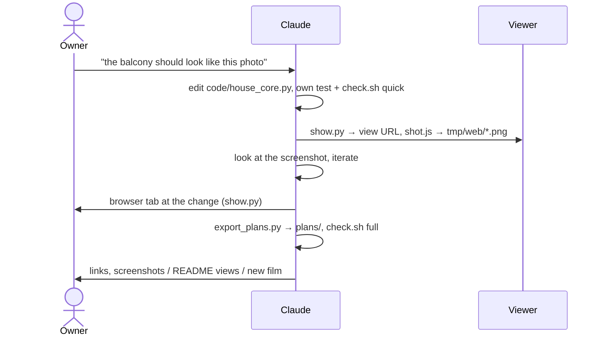
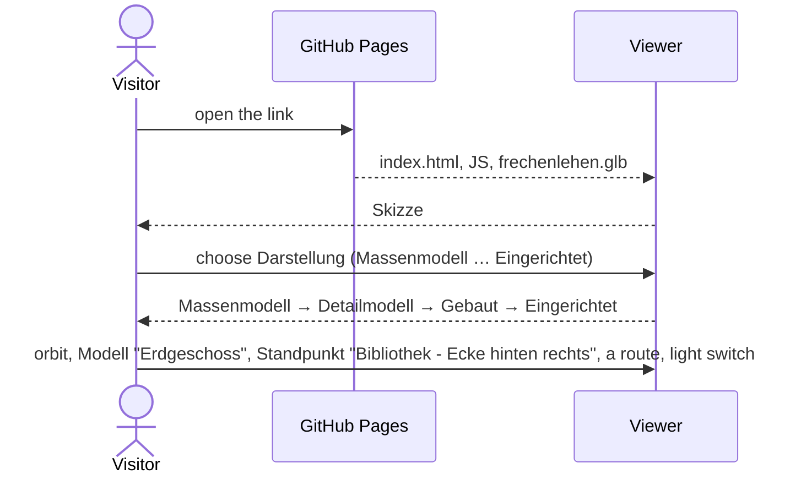

# Functional: Frechenlehen house model

## Features

### House model (`house_core.py`, built by every backend)

- **Shell:**
  - EG and OG walls with all openings from the plans
  - slabs and the stairwell
  - roof with rafters, purlins and soffit boards
  - eaves and gable overhangs
- **Exterior details from photos:**
  - round-arched entrance door, back door with an oval window and black lever handles inside and
    outside (hinged north, opening into the back hall; part of the Gäste-WC sub-model, the Duschbad's)
  - windows with larch frames and glazing bars; on the room side of every sash a satin-metal turn handle
    after klinke-fenster.webp (pointed rose, lever hanging down), at the sash's mid height
  - blue shutters with white cross boards
  - larch terrace doors; tall west windows (OG Yoga, Bad; EG Bad Großeltern, #63): wall below up to a 0.75 m sill, glazed up to the ceiling
    (the Yoga room's two merged into one twice as wide, 1.98, on 2026-11-25)
  - larch cladding of the whole west side and the east gable, cut around the openings; spaced
    slats over the gable windows
  - larch balconies with cut-out balusters
  - outside lamps
- **Interior:**
  - panelled interior doors (opened; flat ones 7.5 cm off the wall), every door with handles: black
    levers on both faces of hinged leaves, flush pulls on sliding leaves, a room-side handle on each
    french / terrace door leaf: the satin-metal lever after klinke-balkontüre.webp (oval rose, ribbed neck,
    long flat lever hanging down), at 1.05
  - glazed Windfang double door; the door to the back Windfang glazed the same way (one leaf,
    hinged north, opened 90° into the back hall, so it lies along the back hall's north wall)
  - Stube niche with a segmental arch
  - Wandlampen (brass gooseneck, opal bell) in every room of both storeys but the Speis, each centred
    in a free wall span; in the EG as agreed on `input/2026-11-14 input/lampen_eg_v1.svg` (also over the
    Ofen bed, the Duschbad's mirror and the Bad Großeltern's mirror), the Essen's pair on the drywall behind the Speis shelf B (not on
    its west wall, where the Bauernschrank stands); the Flur's two over the Garderobe's hat shelf at 2.20
  - open stair with turned railing, also around the OG stairwell
  - floors: limestone in the EG corridor (running through the door to the back Windfang, no
    threshold), the Bäder (the Gästebad with its WC, shower and tub, the Bad Nadine & Till with its two showers) and
    all four WCs (the back hall's Duschbad too); in the Bad Großeltern the whole niche (WC, shower) and a strip along the west wall,
    oak planks elsewhere (also in the Bad Großeltern east of the strip)
  - Ofenbett in the Stube: a plastered triangular stove in the NW corner (legs 1.00 along the Flur and west wall, front 1.41 on the hypotenuse
    facing the room at 45°, 1.15 high) with the fire behind a 65 cm glass door in that front, two benches, a straight bed above (70 × 190) with a thin cream mattress and a red-white checked blanket, one corner turned back;
    a fire window in the Flur wall shows the fire from the corridor too
  - small black workshop stove after `input/2026-11-03 input/werkstattofen.jpeg` (40 × 40 × 105 cm,
    fire behind glass), three times, each in a room corner 10 cm off both walls and turned 45° to
    face the room: Bibliothek (Flur wall × wall stub), Oma & Opa (north wall × the 14 cm stub north
    of the Bad opening), Schlafen SE in the OG (Bad wall × WC wall)
  - Küche after `input/2026-11-09 input/speis_kueche_v6.svg` (also a sub-model page): the door
    to the Flur where it really is (clear 81 cm, hinged west, opened 90° into the Küche); behind
    it a Besenschrank 51 × 55 × 2.20 m; the Spülzeile (~150 cm, steel sink and tap at the water connection)
    from the door frame into the NE corner, under the Abzug (plastered flue box from 1.80 m, depth
    assumed); on the east wall the 60 cm Ostzeile from the Halbinsel, then the Wamsler wood cooker
    after wamsler.jpeg (stainless steel, fire burning behind the glass, its black flue pipe from the left (north) of
    its top up to 1.95 m and there north into the Abzug, the Kaminschacht, a rosette on its face, #26b); the Halbinsel with the induction cooktop towards
    the dining table, a Muldenlüfter (downdraft vent) in its middle between the burners, no hood; no wall cabinets; east of the sink,
    where the Herd stands in front of the Spülzeile, a blind cabinet (no drawers) and the granite
    top runs up to the Herd, as the Ostzeile's does south of it; all cabinets in the style of
    `input/2026-11-10 input/kueche_mallnitz.png` (frame fronts with a recessed panel, a chrome cup
    pull on every drawer and door), painted RAL 5014 Taubenblau; under the cooktop drawers towards
    the kitchen and towards the dining table
  - Speis (no wall to the Essen): from the Flur wall open shelf A (60 cm), the aisle (91.9 cm,
    west end free) and open shelf B (60 cm) with a closed back of vertical spruce boards towards the
    Essen, all to the ceiling; the shelves spruce, stocked for illustration (food cartons,
    flour, jars of tomato sauce and pickles, cans, now and then a grey plastic crate with a lid);
    on the Essen side of B's back a thin drywall (7.4 cm, plastered) from the Essen's west wall to the
    Küche wall; in the middle of the Essen's west wall a big wooden Bauernschrank (2.10 × 2.25, like the OG
    Flur's); the wall to the Küche ends at B, and in the opening over the aisle a panel door (hinged
    south, open flat into the Küche)
  - dining table after tisch-briol.png, one table 2.00 m long: board top, legs splayed on a flat
    foot frame with corner blocks; 8 chairs (3 per long side, one at each end)
  - Büro desk in the Bibliothek between the two north french doors: a 190 × 100 × 4 cm solid
    cherry top (Kirschbaum) on the cast-iron crank frame of `input/2026-11-12 input/schreibtischgestell.jpg`
    (two arched legs, foot tube, gearboxes and spindle housings, drive rods, four spindles under
    flat bars, hand wheel on the east leg); two LG UltraFine 6K 32"
    monitors at 170° showing the screenshots `screen_a12` (left) and `screen_pilcrow` (right),
    a closed MacBook Pro partly under the left one with a softly lit logo, white Magic Keyboard
    and Magic Trackpad. In the viewer (house in Eingerichtet, outside the Rundgang, and the
    Schreibtisch sub-model) the top with everything on it cranks up 30 cm in 3 s, rests 4 s and
    comes down, the hand wheel turning 4 times per stroke; Blender and the film keep it at 75 cm
  - the dining chairs are board chairs after stuhl.png: thick plank
    seat on battens, four splayed stick legs without stretchers, one tall backrest board leaning
    back with a pointed heart cut out
  - at the Büro desk an office chair after `input/2026-11-13 input/bürostuhl.png` (#48; also in the
    Schreibtisch sub-model): black five-star base on twin castors, black gas column, grey upholstered
    seat (top at 51 cm), a light-grey mesh back in a black frame leaning back 10°, a mesh headrest
    (top at about 1.30 m), two black T-armrests (pads at 66 cm, below the desk top); centred on the
    desk, facing it, seat front 8 cm short of the top's front edge (furniture: Eingerichtet only)
  - Stube seating corner between the two big windows: round pedestal side table, two small
    bouclé cocktail armchairs either side of it
  - Stube sofa after sofa.tiff: linen three-seater, 3/4 of the way from the corner pier between
    the big windows to the Ofen, facing the pier
  - every sub-model page with a bath, toilet or shower (Bad Großeltern, Gäste-WC, Gästebad, Bad Nadine &
    Till) dimensions the room's width (west–east, "Raumbreite") and depth (south–north, "Raumtiefe") from
    wall face to wall face (2026-11-25)
  - Bad Großeltern after `input/2026-11-08 input/grosseltern_v4.svg` and, since #63, variant B of
    `input/2026-11-28 input/bad_grosseltern_optionen.svg` (also a sub-model page), open to the bedroom:
    on the north wall in the NW corner a Waschbecken einzeln 60 × 47 (axis 0.40 from the west wall, west
    of the north window, which stays, sill 1.00) under a mirror 60 × 85 in an 8 cm wooden frame, a
    Wandlampe over it; in the west wall a big window (1.98 wide, sill 0.75, up to the ceiling, like the OG's
    west windows, larch cladding trims, centred between the niche front wall and the north wall); in the
    south a niche 1.30 m clear, one room like the Duschbad: the WC in the west behind an opening (102.4)
    under a lintel, east of it a walk-in shower 90 × 130 (no tray, the limestone floor runs through; limestone on its
    walls to 2.0, head on the east wall), a glass pane 75 from the south wall on its west side, the entry
    55; one sliding door, built open in front of the 12 cm front wall, rolls over the opening; floor:
    limestone in the whole niche and a strip along the west wall, oak elsewhere, part of the sub-model.
    The bedroom wall ends at the niche's front wall. The sliding door shows how it works: every 4 s it
    rolls to the other end of its track in 2 s, on the sub-model page and in the house in stage
    Eingerichtet; the Rundgang sees it as built (open)
  - Duschbad by the back hall (sub-model page Gäste-WC; after `input/2026-11-27 input/hintereingang_optionen.svg`,
    variant B): one room 204.8 × 129.9, in the east a walk-in shower 90 × 130 on the room's limestone floor
    (limestone walls to 2.0, head on the east wall, glass 75 from the south wall, the entry 55 north of
    it), in the west the toilet on the south wall (Taubenblau tiles on the WC part's walls) and the Waschbecken
    einzeln 40 × 28 on the west wall north of the window under a mirror 40 × 60 in a pine frame. The 76 cm
    door in the north wall (west part) opens outward into the back hall, hinged east, standing open at 90°.
    In the back hall east of the door a shoe rack 80 × 33, 2 m high with nine levels, about half full of
    shoes (furniture, stage Eingerichtet, not on the plan sheets). Back door, Duschbad door and Windfang door swing to show where they get in each other's
    way: every 3 s one, picked at random, opens or closes in 3 s, on the sub-model page and in
    the house in stage Eingerichtet; the film and the Rundgang see them as built (Duschbad and Windfang
    door open, back door closed)
  - Schrank im Büro after `input/2026-11-11 input/buero_regal_v2.svg` (also a sub-model page): the
    Tegernsee bookcase (2.38 m high, dark wood, books) around the Bibliothek's east window: a 94
    column on each side, the middle 94 split into a base up to 95 cm (5 cm under the sill, 48 deep)
    and a bridge from 2.02 m over the window, one cornice over all three; 42 deep; 30 cm free to the
    north wall, 48 cm to the Flur wall. The set's
    narrow element, a 52 vitrine (glazed door, glass shelves, wine glasses), stands opposite in the
    NW corner behind the piano (house only). The Büro
    door moved 50 cm west (106 wide, hinged east, open 90°): its leaf stands 10.5 cm in front of
    the south column; it shows how: it swings shut in 2 s, rests 4 s, swings open, rests 4 s, on
    the sub-model page and in the house in stage Eingerichtet (the film and the Rundgang see it
    open). Depths and shelf heights estimated from the photo
  - Schrankbett in the Yoga room (OG, NW) (also a sub-model page; first drawn as
    `input/2026-11-13 input/schrankbett_v1.svg`, 2 × 2 m on the south wall with side cabinets): since
    2026-11-25 on the opposite, north wall, slid into the corner with the west (back) outer wall, without
    side cabinets: a wall bed 1.40 wide (lying area 1.40 × 2.00, one mattress, spruce) in a 45 cm deep
    case 150 wide (the 146 niche and its two sides) up to the 2.20 m ceiling, a 10 cm Blende over the
    niche. Folded down the bed lies with its head at the north wall (to 2.21 m from it, mattress top
    39 cm); folded up its underside, framed with six raised panels like the doors, closes the niche flush
    with the case, its feet folded onto it. It shows how: it folds up in 3 s, rests 4 s, folds down, on
    the sub-model page and in the house in stage Eingerichtet (the film, the Rundgang and the plan sheets
    see it down). The west window behind it is gone, merged into the room's other west window (2026-11-25),
    which is twice as wide (1.98, from its old south jamb northwards to 5 cm before the case), so the case stands against plain wall
  - Schlafzimmer Nadine & Till (OG, SE; #44): a small country desk after `input/2026-11-15 input/
    kleiner-schreibtisch.webp` (old pine, top 110 × 55 at 78 cm with 4 cm overhang, four turned legs
    with ball feet, apron with one drawer and a round knob on the sitter's side) with its back to the
    low wall (1.20 m) at the bed's head end, on the wall's west side, its south end 32 cm in from the
    wall's end, by the balcony door; on its far side a small matching ladder-back chair (seat 38 × 38
    at 45.5 cm, turned legs, stretchers, back posts with finials, two slats), pushed in 10 cm under
    the top. Furniture (stage Eingerichtet, not on the plan sheets); the Rundgang passes it 0.25 m
    clear in plan
  - Garderobe in the big EG Flur (house only, on the south wall, the Speis's back, x 2.80 .. 4.80, after
    `garderobe mallnitz.jpeg`): a spruce hook board 2 m long with 20 + 19 iron hooks in two staggered rows
    (1.50 / 1.65 m), a hat shelf at 1.95 m on four brackets, six coats hanging from the hooks, and under
    them a wooden bench 1.80 × 0.28 (seat 0.45, dark plank, splayed green legs) after
    `input/2026-11-27 input/bank-garderobe.jpeg`; coats and bench are furniture, board, shelf and hooks
    a built-in
  - Bauernschränke (freestanding, old pine, `bauernschrank()`, furniture): beside the OG Flur's also one
    in Saschi's room on the west wall, in the Schlafzimmer Nadine & Till on the north wall (facing
    south) and, 1.40 wide, in the Bichlach on the east wall north of the balcony door (facing west), each in
    place of a built-in wardrobe; the Essen's: see Speis
  - Bichlach (OG, NE; 2026-11-25): its door in the Flur wall moved towards the stair, the opening 15 cm
    east of the stair hole (11.40 .. 12.28, hinged west, opened 90°); a double bed (two mattresses, 1.86 ×
    2.00) with its head on the west wall and a nightstand either side, clear of the leaf and 90 cm before
    the north balcony door; on the freed wall between door and east wall a two-seater linen sofa (`sofa(n=2)`,
    the Stube's one seat narrower), its back to the wall, under the room's Wandlampe; on the same wall
    piece's Flur face the small country desk (`schreibplatz(at=…)`, top 110 × 55, grain along x) with its
    chair to the south; furniture. The Rundgang walks in through the new door
  - the five washbasins, all one design after `input/2026-11-12 input/`: a rectangular, bright
    white ceramic Waschbecken (top 85 cm) on a chrome Waschbeckenständer (front legs, rail at
    52 cm, side rails to balls on wall rosettes, bottle trap); einzeln in the Bad Großeltern
    (60 × 47 under a mirror 60 × 85, #63), in the Duschbad (40 × 28), the OG WC 2,30 (50 × 40) (the OG Flur's went
    on 2026-11-25 for the Bauernschrank), the Gästebad and the Bad Nadine & Till (60 × 47 under a mirror 80 × 85 in the
    wooden frame)
  - Gästebad at the end of the OG Flur (NW; also a sub-model page with its four walls and
    dimensions): from the Flur door one faces the back (west, outer) wall; on the left the walk-in
    shower 101 × 141 in the SW corner on the room's limestone floor, its back and side wall in
    limestone to 2.0 (the small window left free), the head on the south wall; a glass wall 88
    between shower and WC and a glass pane between shower and tub, the way in (50 cm) between them;
    to the right along the back wall under the big window the freestanding slipper tub 165 × 75
    on four claw feet after `input/2026-11-15 input/badewanne.webp`, its raised head end (74) to
    the shower, the foot end 60 (both under the 75 sill, so one looks out of the window from it),
    the chrome tap with hand shower out of the outer wall at the foot end; east of the glass the
    open WC (toilet centred, Taubenblau tiles on the south and east wall); the Waschbecken einzeln
    60 on the north wall between tub and door under a mirror 80 × 85 in a 10 cm wooden frame from
    1.17
  - Bad Nadine & Till (OG, S, between Waschküche and Schlafzimmer; also a sub-model page with its
    four walls, its limestone floor and dimensions): the door at the south end of the east wall,
    open 90° into the Bad; opposite, along the west (back) wall, two walk-in showers on one strip
    90 deep over the wall's full 2.22 (no tray: the limestone floor runs through, a drain each), a
    head in each back corner, a glass 80 per shower from its side wall and a 60 passage between them
    in the middle; the strip's walls in limestone slabs to 2 m like the Bad Großeltern's, on the north
    wall (the Waschküche partition) only to 1.70; above it, up to the ceiling, the Oberlicht (half a metre high): Milchglas
    in three fields in a pine lining of the full wall depth, 10 cm short of the corners, a mullion on
    the back shower's glass line, where that pane ends, so the Bad's window lights the Waschküche; the toilet on the north wall between glass and basin on Taubenblau tiles
    (north and east wall); the Waschbecken einzeln 60 on the east wall north of the door under the
    wood-framed mirror 80 × 85 with two Wandlampen, one more left of the window
  - the four WCs (the WC in the Bad Großeltern's niche, the Duschbad's, the WC 2,30 and the Gästebad's WC, tiled on its south and east wall only), after
    `input/2026-11-08 input/bad_mallnitz.jpeg`: subway tiles in RAL 5014 Taubenblau about 1.1 m high with a cap
    row, floor-standing toilet with a close-coupled cistern; in the WC 2,30 (next to the
    Waschküche) a Waschbecken einzeln 50 × 40 under a mirror in a black frame, clear of the open
    door leaf
  - OG Flur, exactly midway between the doors to Saschi and the Waschküche: a big **Bauernschrank**
    (2026-11-25, `bauernschrank()`, furniture; it replaced the Waschtisch of #40 with its basin, mirror
    and two Wandlampen): old pine like that Waschtisch (`input/2026-11-15 input/waschtisch.avif`), 1.80
    wide, 60 deep (the Rundgang passes it along the stair rail, 0.33 m clear), 2.05 high: plinth with a moulding,
    corner and middle pilasters, two doors with two raised panels each, iron escutcheons, knobs and
    strap hinges, a cornice stepping out three times; the wall behind plain white plaster
  - Waschküche: a washer tower at the east wall (a dryer stacked on the front loader), 4 cm from the table; a table
    0.80 m deep the full width of the back (south) wall, with two stacks of folded clothes; on the
    right wall from the door (west) an open spruce cupboard, 2.0 m high, continuous shelves
    without dividers, three coarsely woven wicker laundry baskets (stakes and weavers) per shelf, running
    up to the NW corner (the room door opens 90°); on the east wall north of
    the tower (15 cm from it) the deep ceramic sink of the Briol (`waschbecken-briol.jpeg`: 60 × 45, rim at 85, 30 high,
    hung on the wall, two wall taps with cross handles) on Taubenblau tiles under a mirror 80 × 85 in a 10 cm
    wooden frame with one Wandlampe; the south wall's top half metre is the Bad's Oberlicht, the four
    Wandlampen over the table hang under it (rosettes at 1.10)
- **Annex** (SW corner): Elektroraum and Heizung, larch-clad timber walls, flat roof, plank
  door outside, panel door between the rooms.
- **Surroundings:** granite terrace with gravel strip and soil beds, ground.
- **Garden layout:** no-grass areas, grass density, clump shape and shrub placements in the
  beds.

### Plan sheets (`export_plans.py`, for the architect)

`python3 code/export_plans.py plans/` writes six A3 sheets at 1:100 as SVG (true scale when
printed at 100 %; ≤ 30 s, each ≤ 2 MB), committed in `plans/` and re-exported after every core
change; the same model always gives byte-identical files.

- **Grundriss EG / OG:** section at 1.80 m (EG) / 1.55 m (OG) above the floor, above every sill
  and below every head. Walls hatched inside one heavy outline, the west larch cladding cut thin,
  the built-ins below the cut in thin lines (kitchen, sanitary, stoves, Speis, cabinets); loose
  furniture left out. Doors with the conventional swing (leaf at 90° and quarter arc). The stair
  as in the architect's plan in both storeys: all 15 risers, walking line from a circle at the
  bottom step to an arrow up, in EG "15 STG 18.0/25.5". Every room labelled with the architect's
  name and its net area computed from the model (Musikraum and Büro are one room, "Bibliothek";
  the Bad Großeltern's niche (WC with shower) is "WC Großeltern"). Dimension chains on all four sides in the
  architect's style (ticks, cm below 1 m, superscript 5 for half centimetres): openings, walls
  and rooms, overall.
- **Ansicht Nord / Ost / Süd / West:** hidden-line elevation of the facade (walls, windows,
  shutters, cladding, roof, balconies, annex, terrace, lamps), grey ground band, level marks
  ±0,00, OK FFB OG, eaves and ridge, and the overall width.
- **Title block:** Frechenlehen, sheet name, M 1:100, the model state (hash); scale bar; north
  arrow on the floor plans. The viewer shows the same sheets under Darstellung › Pläne.

### Blender only (dormant)

Since issue #35 the Blender backend is not run or maintained (faster dev cycles); the scripts
stay and compile in a test (`tests/test_blender_scripts.py`), `frechenlehen.blend` is frozen at
`7805879`, the last full check with the parity test green. Re-enabling: `CLAUDE.md` › Running ›
Blender backend. What the scripts make:

- `build_house.py`: room names on the floors, the plan PNGs as hidden reference planes,
  sun/world/README camera.
- `paint.py`: RAL colours for facade, windows, shutters and stove tiles.
- `garden.py`: meadow grass (Geometry Nodes) and leafy shrubs.
- `windrose.py`: compass rose to the SW.
- **Film** (`film.py`, route in `tour.py`): a walkthrough of about 304 s, 7590 frames at 1280×720,
  25 fps. Slow turns on the spot (`TURN` °/s), pauses (`PAUSE` s) and the camera height
  (`EYE`, 1.60 m above the floor) are one variable each:
  1. orbit outside, enter at the east door, which swings open
  2. EG: Stube round the sofa to the seating corner (turn, pause at the sofa and Ofen), Essen at the end of the table (turn,
     pause), Küche: look down the Speis aisle, out through the Küche door, Großeltern: into their Bad (look at the basin and the west window, then into the WC and
     the shower in the niche, pause at each), then turn at the wall beside the balcony door,
     back door (turn, pause), Bibliothek back corner (turn, pause at the piano)
  3. up the stairs; OG: peeks into the first room on the right and the Waschküche, Schlafen SE
     back corner (turn, pause at the Kamin), into its Bad through the door to the west wall, turns
     right until its back is to the wall, pauses, walks straight out; peeks into the NE room opposite, the SW room
     and the end Bad, Yoga back corner (turn)
  4. down the stairs, out to the start point, turn to face the house, pause; the route is closed

### Web viewer (`web/`)

- "Frechenlehen — Vom Strich zum Haus", German UI, desktop browsers. It is live at
  `https://tillg.github.io/frechen_blender/` once `main` carries the viewer and the Pages
  source is set to "GitHub Actions".
- **Offline-App** (e.g. on the iPad): the production build stores itself on the first visit
  (Safari or "Zum Home-Bildschirm", web-app manifest and house icon); a badge at the bottom left
  counts "Offline: n / m", then says "Offline bereit" for 4 s, or "Offline nicht möglich" when a
  file can't be stored. Afterwards house, sub-models, plan sheets, Fotos & Vorlagen and every plan
  version open without network, deep links with their view query included; the film does not. Each
  version is stored once (~43 MB) and kept when a later deploy changes only the live build. A new
  deploy is fetched on the next online load and shows from the load after that, or at once with the
  button "↻ Update laden" at the bottom right of every production page: it asks for a new build; is
  there one, it stores it (the badge counts) and reloads into it, else "Schon aktuell ✓" (offline:
  "Keine Verbindung – später nochmal"). A new build stored in the background while the page is open
  turns it dark: "Update bereit – neu laden". The dev pages store nothing.
- **Plan versions** (house page): the title box under "Vom Strich zum Haus" has the drop-down
  **Version**: Aktuell (the live model, default) and every frozen version as "<date> <name>", e.g.
  "2026-11-25 Nach Vincent & Silvia-Ideen". A frozen version shows its own house (3D, Standpunkte,
  Rundgang, Vorlagen markers) and its six plan sheets; the title box is tinted then. Choosing
  reloads the page with `?v=<id>`, the view kept; an unknown id shows Aktuell. Sub-models, Fotos &
  Vorlagen, image textures (desk screens) and the film exist only in their live state. Freezing:
  `just version "<name>"` (committed `code/` and `plans/`, id = today), then commit
  `versionen/`.
- **Navigation panel** at the top right of every page (house and the five sub-models), the same
  place everywhere: three drop-downs that open below and a Reset button (house: plus the sun
  toggle). There is no timeline bar and no Play.
  - **Modell:** Ganzes Haus, Erdgeschoss, 1. Stock (the cutaway: the
    whole house, without roof, only the EG; the ground
    stays), a separator, then the sub-models by storey: under the heading Erdgeschoss Ofen, Schreibtisch,
    Bad Oma & Opa, Küche, Gäste-WC (the Duschbad), Schrank im Büro; under 1. Stock Schrankbett, Gästebad, Bad Nadine & Till. A house entry switches in place, a sub-model entry opens its page; the current one is
    selected.
  - **Darstellung:** house: the five stages below; sub-model: Drahtmodell, Masse, Gerendert. On
    Ganzes Haus a group **Pläne** follows the stages: the six plan sheets of `plans/` (Grundriss EG,
    Grundriss OG, Ansicht Nord, Ost, Süd, West; `npm run blueprint` copies them to the viewer's
    files). Choosing one shows the sheet over the 3D view on white paper, fitted below the toolbar;
    the wheel zooms at the pointer, dragging moves it, "SVG herunterladen" downloads it; Standpunkt
    is disabled and the 3D view is not drawn meanwhile. The URL keeps the sheet (`?plan=eg`, which
    also opens Ganzes Haus). A stage, another Modell, Reset or a route returns to the 3D view.
  - **Standpunkt:** named camera poses in groups. House: Außen (Von Südosten = the README view and
    the standard, Südwesten, Nordosten, Nordwesten), Übersicht (Von oben, Schräg von Südosten; EG
    and 1. Stock), Erdgeschoss (Stube, Küche, Speis, Bibliothek - Ecke hinten rechts, Bibliothek -
    Klavierspieler, Oma & Opa) and 1. Stock (Nadine & Till, Waschküche, Saschi, Bichlach, Jugend,
    Yoga, Bad Nadine & Till: in the door towards the two showers, Flur oben - Bauernschrank: across the
    Flur at the Bauernschrank, Gästebad: just inside the door, tub ahead, shower and WC left, basin right),
    each inside group at eye height (1.6 m) in the room, except Klavierspieler: seated on
    the piano bench (eye 1.25 m), looking over the keys and the piano into the room; listed in
    Ganzes Haus and its own storey. Sub-models list their own views (Schräg, Von oben, …). A group Routen (Ganzes Haus only) lists "Um und durch das Haus" and "Durch die
    Stube & Küche". After the user moves the camera the drop-down shows "Eigene Ansicht".
  - **Reset:** forgets the entry's saved view; lowest Darstellung (Skizze / Drahtmodell) and the
    entry's standard Standpunkt.
  - **Each model entry remembers** its Darstellung and camera in the browser (`localStorage`), so
    reopening shows the same view; a bare house URL opens the last-used house entry. A URL with a
    view (`?cam=…`) wins over the stored one. A malformed view in a URL (cam/at not three numbers,
    p not a number, fov outside 10…90) is ignored, never shown and never stored.
- **Five stages** (house Darstellung). It opens at Skizze unless a view is saved.
  - **Skizze:** hidden-line ink on paper.
  - **Massenmodell:** clay with soft sun shadows.
  - **Detailmodell:** procedural materials after `MAT_DEF`, daylight, grass and leafy shrubs.
  - **Gebaut:** dusk sky, low sun, the Wandlampen's shades glow and the lights nearest the camera
    are lit (6 inside: wall lamps and the Speis's fill light; 2 outside lamps; inside the house the
    own storey first). By day all off.
  - **Eingerichtet:** like Gebaut, plus the furniture (nodes with `extras.furniture`), which no
    other stage shows. The cutaway still applies: Erdgeschoss hides the OG furniture.
- **Orbit** with the mouse (drag, scroll) around an outside Standpunkt. At an inside Standpunkt
  the mouse looks around in place instead (no orbit, zoom or pan).
- **Sun toggle:** day or dusk, from Detailmodell on.
- **Rundgang** (a route chosen in the Standpunkt drop-down): plays the route live from the camera
  keys in the `.glb`, at 0.75× the film speed, in stage Eingerichtet with the whole house and the
  entrance door open. "Um und durch das Haus" is the film's route; "Durch die Stube & Küche" is a
  shorter one. Play/pause, a scrubber (the one bar left on the page), "Endlos" (loop; every route
  ends where it starts) and "Beenden", which closes the door and restores the previous camera and
  the Darstellung the route started from (unless it was changed during the route). Choosing
  another Standpunkt or Modell ends the route. While paused, the user looks around with the
  mouse; the page draws at most 30 frames per second. A playing route is neither saved nor
  written to the URL.
- **The view lives in the URL** (and in the saved view), written as it changes: house `?cam=x,y,z&at=x,y,z&p=…&cut=…`
  (model coordinates; optional `&fov=…`, vertical field of view in degrees, default 28, `&sun=0|1`, Tag/Abend
  set by hand with the light switch, and `&hires=on`, full quality), sub-model
  pages `?cam=…&at=…&look=wire|mass|full`. A reload or a shared link opens the same view.
- **Light on the GPU:** a frame is drawn only when something changes (camera, stage, cutaway,
  sun, window size); a burning fire in view is redrawn at most 30 times a second. In fast mode
  (the default, Rundgang included) the pixel ratio is capped at 1.5, only the light pool lights
  the dusk, and the meadow grass is not drawn while the camera is inside the main house; the
  dusk lighting is compiled once at load, so the first dusk doesn't stall. `?hires=on` (the
  film capture, `tmp/threejs_film.mjs`, always sets it) switches all of these shortcuts off.
- **Fotos & Vorlagen** (`vorlagen.html`): every raster image of `input/` the model was built after, each photo
  once (a repeat of a shown one, another size of the same photo, is listed in `vorlagen.DOPPELT`, not shown),
  sorted into eleven Bereiche (Stube, Küche & Essen, Garderobe & Gäste-WC (anchor in the Flur at the Garderobe), Haupteingang & Windfang,
  Bibliothek & Büro, Bad Oma & Opa, Gästebad, Schlafzimmer Nadine & Till (marker over its small desk), Außen & Garten, Ganzes Haus = elements found all over the house,
  Pläne); without `?b=` an index (cover picture and count per Bereich), with `?b=<key>` the
  Bereich's pictures with German captions, a click opens the copy (≤ 1600 px). Every page links the
  3D house, the index and every Bereich; the house page links the index under its title ("Fotos &
  Vorlagen"). In the house, every Bereich but Pläne has a marker "Fotos: <Bereich>" at its anchor
  (Ganzes Haus in the OG Flur, Außen & Garten before the terrace): shown from inside on its storey
  within 8 m, from above when Erdgeschoss / 1. Stock opens its storey, Außen from outside within
  15 m; never when a wall object lies between camera and anchor, in a route, with `?hires=on` or on a
  plan sheet. A click opens the Bereich's page in a new tab (in the home-screen app in the same
  window, inside its offline store).
- Local: `cd web && npm install && npm run dev` (one server, port 5377). The `.glb` is regenerated
  from the core first, and again whenever a `code/*.py` file is saved; then open pages reload at
  the same view.

### Checks and Show (development)

- **Two check tiers**, run and timed by `scripts/check.sh` (log `tmp/check-<ts>.log`, a table of
  seconds per part, non-zero exit on any failure):
  - `quick` — `pytest -m "not slow"` and Vitest, about 15 s (warns above 60 s); after every
    change, together with the change's own new test run alone.
  - `full` — all pytest incl. the `slow` plan-sheet tests, `npm test`, all Playwright
    projects, about 6–7 min; once at the end of a change, at archive, on request.
- Python tests run in a repo-local `.venv` (`requirements-dev.txt`).
- The Playwright `@eye` test (stills along the Rundgang, for a human to look at) is not in the
  default run: `npx playwright test --grep @eye`.
- **Show**: `.venv/bin/python code/show.py <object…>` opens the user's browser on the dev server
  at a view URL that frames the named objects (prefix match) — outside objects from the nearest
  facade, 20° up, whole house; inside objects from the SE diagonal, 55° up, with the storeys above
  cut away; sub-model pages (`--page ofen|desk|bad|kueche|gaeste_wc|regal|schrankbett|gaestebad|elternbad`) from the SE (Küche from the open south, Gäste-WC from the back hall in the north, Schrank im Büro from the room in the west, Schrankbett from the room in the north, Gästebad and Bad Nadine & Till from above), 30° up, Gerendert. Options:
  `--from n|e|s|w|top`, `--at x,y,z`, `--p 0…4` (house only), `--print` (only print the URL). It
  refuses (exit 2) when the server on 5377 runs from another clone.
- `cd web && node shot.js '<url>' <png>`: one headless 1280×720 screenshot of a view URL after the
  page is ready (on the desk page also its two screen images), so the agent looks before the
  link goes to the user.

## User journeys

## Inputs and outputs

| In | Out |
|---|---|
| `input/*.pdf`, `grundriss_*.png` (plans) | `frechenlehen.blend` (frozen at `7805879`, Blender dormant) |
| `input/*.png/jpg` detail photos, named after their component | `YYYY-MM-DD_frechen_rundgang_threejs.mp4` (only the newest film) |
| | `plans/*.svg` plan sheets for the architect (committed) |
| `input/farben_*.png` colour references | `docs/images/ansicht_*.png` (README views) |
| | `tmp/web/*.png` viewer screenshots, `tmp/check-*.log` check logs |
| | `web/public/frechenlehen.glb`, `web/public/vorlagen.json`, `web/public/v/<id>/` + `versionen.json` (generated), `web/dist/` → GitHub Pages |
| committed `code/` + `plans/` at a freeze | `versionen/<id>.tar.gz` + `versionen/versionen.json` (plan versions, committed) |
| every raster image in `input/` (the Vorlagen) | `web/public/vorlagen/<Bereich>/*.jpg` downsized copies (committed) |

## States and transitions

The model has no runtime state. In Blender (dormant) the one animated part is the entrance door
(`EG_Haustuer`), which `film.py` rotates 90° around its pivot during the film. In the viewer,
the Bad's sliding leaf, the back hall's three doors and the Büro door move on their own clocks (each one at its
built or its other state, or on the way); otherwise the state is the model entry (cutaway all / noroof / eg or a sub-model), the Darstellung
(house progress `p` 0–4), the Standpunkt (or Eigene Ansicht), a forced dusk value from the light
switch (cleared by any stage change, saved with the entry's view), the saved view per entry, the Rundgang
(off / playing / paused, its time and the loop flag; `body.dataset.tour`) and the `hires` mode
(fixed per page load) and the plan version shown (`?v=`, fixed per page load).

## Permissions and visibility

No accounts. The repo is public on GitHub (raw MP4 link in `docs/autonomous-decisions.md`).
The viewer page is public and may be indexed. It names the rooms (the Standpunkte). The `window.__fl` test
hook exists only in dev and test builds.

## Edge cases and known limitations

- The viewer is desktop-only, has no free first-person walk (only the fixed routes and the
  inside Standpunkte), and shows no windrose or reference plans.
- The garden in the viewer is like Blender's, not identical: 25 % grass density, within 30 m,
  grass where the windrose would be.
- Headless e2e tests run the WebGL2 fallback; the WebGPU path is checked by hand.
- `show.py` frames turned objects (front door, screen panes) in their unturned pose, and cuts the
  storeys for an inside object by the height of its box centre, not by its collection.
- Versions start 2026-11-25; earlier states cannot be shown (the viewer cannot read their `.glb`).
  One freeze per day with `just version` (another id only via `versionen.py freeze --id`).
- `film.py` adds new `Innenlicht_*` lights with rising suffixes on each run (cosmetic).
- Plan accuracy is about ±5 cm. The stair is longer than drawn ("Treppe wird verschoben").
