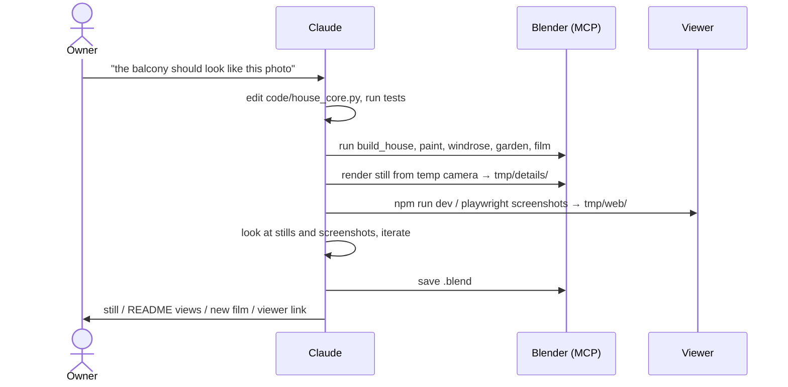
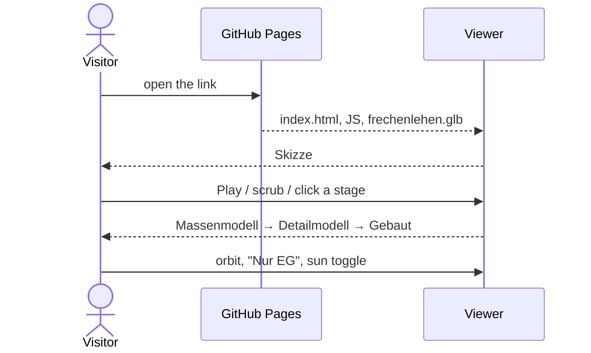

# Functional: Frechenlehen house model

## Features

### House model (`house_core.py`, built by both backends)

- **Shell:**
  - EG and OG walls with all openings from the plans
  - slabs and the stairwell
  - roof with rafters, purlins and soffit boards
  - eaves and gable overhangs
- **Exterior details from photos:**
  - round-arched entrance door, back door with an oval window
  - windows with larch frames and glazing bars
  - blue shutters with white cross boards
  - larch terrace doors; tall OG west windows with a fixed light below
  - larch cladding of the whole west side and the east gable, cut around the openings; spaced
    slats over the gable windows
  - sliding door between Bad and WC Großeltern
  - larch balconies with cut-out balusters
  - outside lamps
- **Interior:**
  - panelled interior doors (opened)
  - glazed Windfang double door
  - Stube niche with a segmental arch
  - open stair with turned railing, also around the OG stairwell
  - floors: limestone in the EG corridor, oak planks elsewhere
  - Kachelofen with bench and fire
  - big dining table with 14 chairs
  - bathrooms and WCs: shower, basin, wall-hung WC
- **Annex** (SW corner): Elektroraum and Heizung, larch-clad timber walls, flat roof, plank
  door outside, panel door between the rooms.
- **Surroundings:** granite terrace with gravel strip and soil beds, ground.
- **Garden layout:** no-grass areas, grass density, clump shape and shrub placements in the
  beds.

### Blender only

- `build_house.py`: room names on the floors, the plan PNGs as hidden reference planes,
  sun/world/README camera.
- `paint.py`: RAL colours for facade, windows, shutters and stove tiles.
- `garden.py`: meadow grass (Geometry Nodes) and leafy shrubs.
- `windrose.py`: compass rose to the SW.
- **Film** (`film.py`): a walkthrough of 139 s, 3480 frames at 1280×720, 25 fps:
  1. orbit outside
  2. enter at the east door, which swings open
  3. EG rooms
  4. up the stairs
  5. OG rooms with peeks into the bathrooms

### Web viewer (`web/`)

- "Frechenlehen — Vom Strich zum Haus", German UI, desktop browsers. It is live at
  `https://tillg.github.io/frechen_blender/` once `main` carries the viewer and the Pages
  source is set to "GitHub Actions".
- **Four stages** on a timeline (play/pause, scrubber, stage names). It opens at Skizze.
  - **Skizze:** hidden-line ink on paper.
  - **Massenmodell:** clay with soft sun shadows.
  - **Detailmodell:** procedural materials after `MAT_DEF`, daylight, grass and leafy shrubs.
  - **Gebaut:** dusk sky, low sun, warm light in the rooms.
- **Orbit** with the mouse (drag, scroll). It starts from the README view in the south-east.
- **Cutaway:** "Ganzes Haus", "Ohne Dach", "Nur EG".
- **Sun toggle:** day or dusk, from Detailmodell on.
- Local: `cd web && npm install && npm run dev`. The `.glb` is regenerated from the core first.

## User journeys

## Inputs and outputs

| In | Out |
|---|---|
| `input/*.pdf`, `grundriss_*.png` (plans) | `frechenlehen.blend` |
| `input/*.png/jpg` detail photos, named after their component | `frechenlehen_rundgang.mp4` |
| `input/farben_*.png` colour references | `docs/images/ansicht_*.png` (README views) |
| | `tmp/details/*.png` check stills, `tmp/web/*.png` viewer screenshots |
| | `web/public/frechenlehen.glb` (generated), `web/dist/` → GitHub Pages |

## States and transitions

The model has no runtime state. In Blender the one animated part is the entrance door
(`EG_Haustuer`), which `film.py` rotates 90° around its pivot during the film. In the viewer,
the state is the timeline progress `p` (0–3), the cutaway (all / noroof / eg) and a forced
dusk value from the sun toggle (cleared by any timeline move).

## Permissions and visibility

No accounts. The repo is public on GitHub (raw MP4 link in `docs/autonomous-decisions.md`).
The viewer page is public and may be indexed. It shows no room names. The `window.__fl` test
hook exists only in dev and test builds.

## Edge cases and known limitations

- The viewer is desktop-only, has no walkthrough, and shows no room names, windrose or
  reference plans.
- The garden in the viewer is like Blender's, not identical: 25 % grass density, within 30 m,
  grass where the windrose would be.
- Headless e2e tests run the WebGL2 fallback; the WebGPU path is checked by hand.
- Bathrooms have oak floors, not tiles (open point).
- `film.py` adds new `Innenlicht_*` lights with rising suffixes on each run (cosmetic).
- Plan accuracy is about ±5 cm. The stair is longer than drawn ("Treppe wird verschoben").
