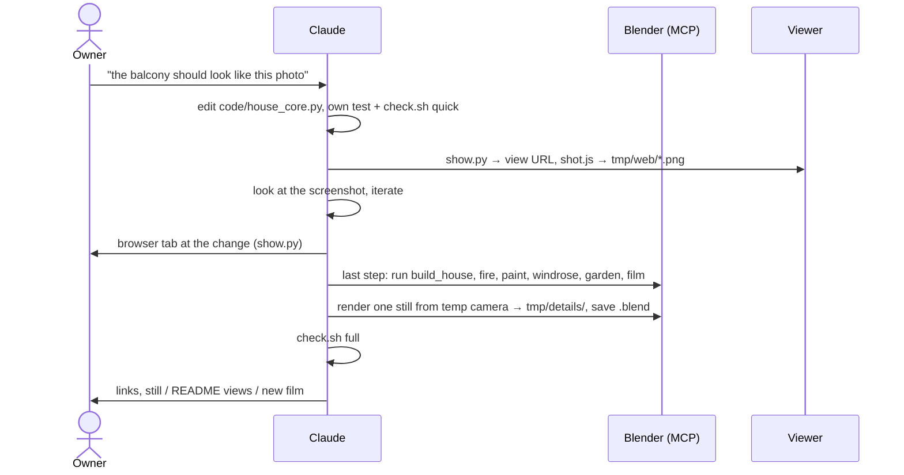
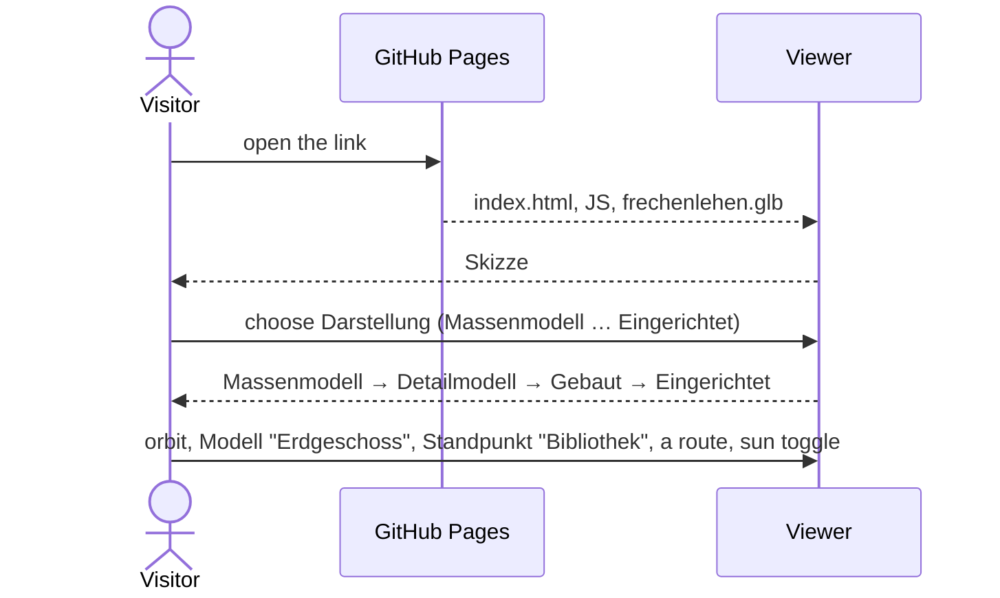

# Functional: Frechenlehen house model

## Features

### House model (`house_core.py`, built by every backend)

- **Shell:**
  - EG and OG walls with all openings from the plans
  - slabs and the stairwell
  - roof with rafters, purlins and soffit boards
  - eaves and gable overhangs
- **Exterior details from photos:**
  - round-arched entrance door, back door with an oval window and black lever handles inside and
    outside (hinged north, opening into the back hall; part of the Gäste-WC sub-model)
  - windows with larch frames and glazing bars
  - blue shutters with white cross boards
  - larch terrace doors; tall OG west windows (Yoga, Bad): wall below up to a 0.75 m sill, glazed up to the ceiling
  - larch cladding of the whole west side and the east gable, cut around the openings; spaced
    slats over the gable windows
  - larch balconies with cut-out balusters
  - outside lamps
- **Interior:**
  - panelled interior doors (opened; flat ones 7.5 cm off the wall), every door with handles: black
    levers on both faces of hinged leaves, flush pulls on sliding leaves, a room-side handle on each
    french / terrace door leaf
  - glazed Windfang double door; the door to the back Windfang glazed the same way (one leaf,
    hinged north, opened 90° into the back hall, so it lies along the back hall's north wall)
  - Stube niche with a segmental arch
  - open stair with turned railing, also around the OG stairwell
  - floors: limestone in the EG corridor (running through the door to the back Windfang, no
    threshold), the Bäder (OG Bad NW with its shower alcove, Bad S) and
    all four WCs (and the Garderobe beside the Gäste-WC); in the Bad Großeltern a limestone strip as wide as its WC along the west wall
    (WC, shower), oak planks elsewhere (also in the Bad Großeltern east of the strip and in its
    niche's Schrank)
  - Ofenbett in the Stube: plastered stove with the fire behind a glass door, bench, bed above
    with a thin cream mattress and a red-white checked blanket, one corner turned back;
    a fire window in the Flur wall shows the fire from the corridor too
  - small black workshop stove after `input/2026-11-03 input/werkstattofen.jpeg` (40 × 40 × 105 cm,
    fire behind glass), three times, each in a room corner 10 cm off both walls and turned 45° to
    face the room: Bibliothek (Flur wall × wall stub), Oma & Opa (north wall × the 14 cm stub north
    of the Bad opening), Schlafen SE in the OG (Bad wall × WC wall)
  - Küche after `input/2026-11-09 input/speis_kueche_v6.svg` (also a sub-model page): the door
    to the Flur where it really is (clear 81 cm, hinged west, opened 90° into the Küche); behind
    it a Besenschrank 51 × 55 × 2.20 m; the Spülzeile (~150 cm, steel sink and tap at the water connection)
    from the door frame into the NE corner, under the Abzug (plastered flue box from 1.80 m, depth
    assumed); on the east wall the 60 cm Ostzeile from the Halbinsel, then the Wamsler wood cooker
    after wamsler.jpeg (stainless steel, fire burning behind the glass, flue pipe into the east wall)
    under an old-form steel hood (skirt with rail, canopy, stack to the ceiling); the Halbinsel
    with the induction cooktop towards the dining table; no wall cabinets; east of the sink,
    where the Herd stands in front of the Spülzeile, a blind cabinet (no drawers) and the granite
    top runs up to the Herd, as the Ostzeile's does south of it; all cabinets in the style of
    `input/2026-11-10 input/kueche_mallnitz.png` (frame fronts with a recessed panel, a chrome cup
    pull on every drawer and door), painted RAL 5014 Taubenblau; under the cooktop drawers towards
    the kitchen and towards the dining table
  - Speis (no wall to the Essen): from the Flur wall open shelf A (60 cm), the aisle (91.9 cm,
    west end free), open shelf B (60 cm) and, back to back with it, cabinet C towards the Essen
    (60 cm), all to the ceiling; the shelves spruce, stocked for illustration (food cartons,
    flour, jars of tomato sauce and pickles, cans, now and then a grey plastic crate with a lid);
    C with the kitchen's painted Mallnitz fronts and cup pulls, four leaf columns, each a top
    door, a door over the upper half and three drawers below; the wall to the Küche ends at C's
    front and is open
    over the aisle, where a sliding door on the Küche side stands slid open to the south
  - dining table after tisch-briol.png, one table 2.00 m long: board top, legs splayed on a flat
    foot frame with corner blocks; 8 chairs (3 per long side, one at each end)
  - Büro desk in the Bibliothek between the two north french doors: two LG UltraFine 6K 32"
    monitors at 170° showing the screenshots `screen_a12` (left) and `screen_pilcrow` (right),
    a closed MacBook Pro partly under the left one with a softly lit logo, white Magic Keyboard
    and Magic Trackpad
  - all chairs (dining table, Bibliothek desk) are board chairs after stuhl.png: thick plank
    seat on battens, four splayed stick legs without stretchers, one tall backrest board leaning
    back with a pointed heart cut out
  - Stube seating corner between the two big windows: round pedestal side table, two small
    bouclé cocktail armchairs either side of it
  - Stube sofa after sofa.tiff: linen three-seater, 3/4 of the way from the corner pier between
    the big windows to the Ofen, facing the pier
  - Bad Großeltern after `input/2026-11-08 input/grosseltern_v4.svg` (also a sub-model page),
    open to the bedroom: walk-in shower 0.80 m in the NW corner with limestone cladding to 2.0 m
    and a rain head; east of it a 1.20 m wall 1.00 m high and one L-shaped clear glass pane on
    its shower edge, flush with the north french door's jamb, on the wall to the ceiling and 35 cm
    from the north wall down to the floor;
    on the wall's east face a Waschbecken doppelt 100 × 47; in the south a 1.20 m niche
    split by a 12 cm wall into WC and an open white Schrank (cabinet 60 cm deep over the full
    width, nothing in front of it), closed by two interlocking sliding doors (the WC leaf open,
    slid behind the Schrank leaf); 96.7 cm passage between the front leaf and the wall's end;
    floor: limestone strip 96.4 cm wide (the WC's width) from the south wall to the north wall,
    oak elsewhere, part of the sub-model. The sliding doors show how they work: every 4 s one
    leaf, picked at random, rolls to the other end of its track in 2 s, on the sub-model page
    and in the house in stage Eingerichtet; the Rundgang sees them as built (WC leaf open)
  - Gäste-WC by the back hall after `input/2026-11-10 input/gaeste_wc_v3.svg` (also a sub-model
    page): a 10 cm partition splits the old WC into the WC (101 cm, west) and the Garderobe (94 cm,
    east). The WC has a new 76 cm door in the north wall, its leaf opening outward into the back
    hall, hinged at the partition, standing open at 90°; the toilet centred on the south wall,
    40 cm free in front of it; Taubenblau tiles in the WC only. The Garderobe is open through the
    old 80 cm opening: a spruce bench 35 × 110 cm at 45 cm from wall to wall with scrolled arms,
    a hook board with six iron hooks at 1.65 m and a hat shelf at 1.85 m on three brackets, after
    `garderobe mallnitz.jpeg`. The WC's hand basin, a Waschbecken einzeln 40/28, stands outside, centred on the back
    hall's east wall between the WC wall and the Windfang door (top 85 cm), Taubenblau tiles
    behind it up to the door's architrave and a mirror 40 × 60 cm in a 7 cm pine frame from
    1.20 m. Back door, WC door and Windfang door swing to show where they get in each other's
    way: every 3 s one, picked at random, opens or closes in 3 s, on the sub-model page and in
    the house in stage Eingerichtet; the film and the Rundgang see them as built (WC and Windfang
    door open, back door closed)
  - Schrank im Büro after `input/2026-11-11 input/buero_regal_v2.svg` (also a sub-model page): the
    Tegernsee bookcase (2.38 m high, dark wood, books) around the Bibliothek's east window: a 94
    column on each side, the middle 94 split into a base up to 95 cm (5 cm under the sill, 48 deep)
    and a bridge from 2.02 m over the window, one cornice over all three; 42 deep; 30 cm free to the
    north wall, 48 cm to the Flur wall. It replaces the former bookcase on the Flur wall. The set's
    narrow element, a 52 vitrine (glazed door, glass shelves, wine glasses), stands opposite in the
    NW corner behind the piano (house only). The Büro
    door moved 50 cm west (106 wide, hinged east, open 90°): its leaf stands 10.5 cm in front of
    the south column; it shows how: it swings shut in 2 s, rests 4 s, swings open, rests 4 s, on
    the sub-model page and in the house in stage Eingerichtet (the film and the Rundgang see it
    open). Depths and shelf heights estimated from the photo
  - the six washbasins, all one design after `input/2026-11-12 input/`: a rectangular, bright
    white ceramic Waschbecken (top 85 cm) on a chrome Waschbeckenständer (front legs, rail at
    52 cm, side rails to balls on wall rosettes, bottle trap); doppelt in the Bad Großeltern
    (100 × 47) and the OG Bäder (120 × 47 in the Bad at the end of the Flur, 100 × 47 in Nadine &
    Till's, each under a plain mirror as wide as the basin), einzeln in the back hall (40 × 28),
    the OG WC 2,30 (50 × 40) and the OG Flur (60 × 47)
  - OG bathrooms: shower, Waschbecken doppelt with mirror
  - the four WCs (also the WC in the Bad Großeltern's niche and the Gäste-WC), after
    `input/2026-11-08 input/bad_mallnitz.jpeg`: subway tiles in RAL 5014 Taubenblau about 1.1 m high with a cap
    row, floor-standing toilet with a close-coupled cistern; in the WC 2,30 (next to the
    Waschküche) a Waschbecken einzeln 50 × 40 under a mirror in a black frame, clear of the open
    door leaf
  - OG Flur, exactly midway between the doors to Saschi and the Waschküche: a Waschbecken einzeln
    60 × 47 on Taubenblau WC tiles
    reaching 15 cm beyond it on either side, above them a mirror 110 × 95 in a 10 cm wooden frame
    (`wood_mirror()`, as the back hall's 54 × 74 with 7 cm)
  - Waschküche: two front loaders at the east wall, a dryer stacked on the north one; a table
    0.80 m deep the full width of the back (south) wall, with two stacks of folded clothes; on the
    right wall from the door (west) an open spruce cupboard, 2.0 m high, continuous shelves
    without dividers, three coarsely woven wicker laundry baskets (stakes and weavers) per shelf
- **Annex** (SW corner): Elektroraum and Heizung, larch-clad timber walls, flat roof, plank
  door outside, panel door between the rooms.
- **Surroundings:** granite terrace with gravel strip and soil beds, ground.
- **Garden layout:** no-grass areas, grass density, clump shape and shrub placements in the
  beds.

### Plan sheets (`export_plans.py`, for the architect)

`python3 code/export_plans.py plans/` writes six A3 sheets at 1:100 as SVG (true scale when
printed at 100 %; ≤ 30 s, each ≤ 2 MB), committed in `plans/` and re-exported after every core
change; the same model always gives byte-identical files.

- **Grundriss EG / OG:** section at 1.80 m (EG) / 1.55 m (OG) above the floor, above every sill
  and below every head. Walls hatched inside one heavy outline, the west larch cladding cut thin,
  the built-ins below the cut in thin lines (kitchen, sanitary, stoves, Speis, cabinets); loose
  furniture left out. Doors with the conventional swing (leaf at 90° and quarter arc). The stair
  as in the architect's plan in both storeys: all 15 risers, walking line from a circle at the
  bottom step to an arrow up, in EG "15 STG 18.0/25.5". Every room labelled with the architect's
  name and its net area computed from the model (Musikraum and Büro are one room, "Bibliothek";
  the Bad Großeltern's WC niche is "WC Großeltern"). Dimension chains on all four sides in the
  architect's style (ticks, cm below 1 m, superscript 5 for half centimetres): openings, walls
  and rooms, overall.
- **Ansicht Nord / Ost / Süd / West:** hidden-line elevation of the facade (walls, windows,
  shutters, cladding, roof, balconies, annex, terrace, lamps), grey ground band, level marks
  ±0,00, OK FFB OG, eaves and ridge, and the overall width.
- **Title block:** Frechenlehen, sheet name, M 1:100, the model state (hash); scale bar; north
  arrow on the floor plans. The viewer shows the same sheets under Darstellung › Pläne.

### Blender only

- `build_house.py`: room names on the floors, the plan PNGs as hidden reference planes,
  sun/world/README camera.
- `paint.py`: RAL colours for facade, windows, shutters and stove tiles.
- `garden.py`: meadow grass (Geometry Nodes) and leafy shrubs.
- `windrose.py`: compass rose to the SW.
- **Film** (`film.py`, route in `tour.py`): a walkthrough of 305 s, 7632 frames at 1280×720,
  25 fps. Slow turns on the spot (`TURN` °/s), pauses (`PAUSE` s) and the camera height
  (`EYE`, 1.60 m above the floor) are one variable each:
  1. orbit outside, enter at the east door, which swings open
  2. EG: Stube round the sofa to the seating corner (turn, pause at the sofa and Ofen), Essen at the end of the table (turn,
     pause), Küche: look down the Speis aisle, out through the Küche door, Großeltern: into their Bad (look into the shower and
     the WC, pause at each), then turn at the wall beside the balcony door,
     back door (turn, pause), Bibliothek back corner (turn, pause at the piano)
  3. up the stairs; OG: peeks into the first room on the right and the Waschküche, Schlafen SE
     back corner (turn, pause at the Kamin), peeks into its Bad, the NE room opposite, the SW room
     and the end Bad, Yoga back corner (turn)
  4. down the stairs, out to the start point, turn to face the house, pause; the route is closed

### Web viewer (`web/`)

- "Frechenlehen — Vom Strich zum Haus", German UI, desktop browsers. It is live at
  `https://tillg.github.io/frechen_blender/` once `main` carries the viewer and the Pages
  source is set to "GitHub Actions".
- **Navigation panel** at the top right of every page (house and the five sub-models), the same
  place everywhere: three drop-downs that open below and a Reset button (house: plus the sun
  toggle). There is no timeline bar and no Play.
  - **Modell:** Ganzes Haus, Erdgeschoss, 1. Stock (the cutaway: the whole house, without roof,
    only the EG; the ground stays), a separator, then Ofen, Schreibtisch, Bad Oma & Opa, Küche,
    Gäste-WC, Schrank im Büro. A house entry switches in place, a sub-model entry opens its page; the current one is
    selected.
  - **Darstellung:** house: the five stages below; sub-model: Drahtmodell, Masse, Gerendert. On
    Ganzes Haus a group **Pläne** follows the stages: the six plan sheets of `plans/` (Grundriss EG,
    Grundriss OG, Ansicht Nord, Ost, Süd, West; `npm run blueprint` copies them to the viewer's
    files). Choosing one shows the sheet over the 3D view on white paper, fitted below the toolbar;
    the wheel zooms at the pointer, dragging moves it, "SVG herunterladen" downloads it; Standpunkt
    is disabled and the 3D view is not drawn meanwhile. The URL keeps the sheet (`?plan=eg`, which
    also opens Ganzes Haus). A stage, another Modell, Reset or a route returns to the 3D view.
  - **Standpunkt:** named camera poses in groups. House: Außen (Von Südosten = the README view and
    the standard, Südwesten, Nordosten, Nordwesten), Übersicht (Von oben, Schräg von Südosten; EG
    and 1. Stock), Erdgeschoss (Stube, Küche, Speis, Bibliothek, Oma & Opa) and 1. Stock (Nadine &
    Till, Waschküche, Saschi, Bichlach, Jugend, Yoga), each inside group at eye height (1.6 m) in
    the room, listed in Ganzes Haus and its own storey. Sub-models list their own views (Schräg,
    Von oben, …). A group Routen (Ganzes Haus only) lists "Um und durch das Haus" and "Durch die
    Stube & Küche". After the user moves the camera the drop-down shows "Eigene Ansicht".
  - **Reset:** forgets the entry's saved view; lowest Darstellung (Skizze / Drahtmodell) and the
    entry's standard Standpunkt.
  - **Each model entry remembers** its Darstellung and camera in the browser (`localStorage`), so
    reopening shows the same view; a bare house URL opens the last-used house entry. A URL with a
    view (`?cam=…`) wins over the stored one. A malformed view in a URL (cam/at not three numbers,
    p not a number, fov outside 10…90) is ignored, never shown and never stored.
- **Five stages** (house Darstellung). It opens at Skizze unless a view is saved.
  - **Skizze:** hidden-line ink on paper.
  - **Massenmodell:** clay with soft sun shadows.
  - **Detailmodell:** procedural materials after `MAT_DEF`, daylight, grass and leafy shrubs.
  - **Gebaut:** dusk sky, low sun, warm light in the rooms and outside lamps nearest the camera
    (6 rooms, 2 lamps; inside the house the own storey first). By day all of them are off.
  - **Eingerichtet:** like Gebaut, plus the furniture (nodes with `extras.furniture`), which no
    other stage shows. The cutaway still applies: Erdgeschoss hides the OG furniture.
- **Orbit** with the mouse (drag, scroll) around an outside Standpunkt. At an inside Standpunkt
  the mouse looks around in place instead (no orbit, zoom or pan).
- **Sun toggle:** day or dusk, from Detailmodell on.
- **Rundgang** (a route chosen in the Standpunkt drop-down): plays the route live from the camera
  keys in the `.glb`, at 0.75× the film speed, in stage Eingerichtet with the whole house and the
  entrance door open. "Um und durch das Haus" is the film's route; "Durch die Stube & Küche" is a
  shorter one. Play/pause, a scrubber (the one bar left on the page), "Endlos" (loop; every route
  ends where it starts) and "Beenden", which closes the door and restores the previous camera and
  the Darstellung the route started from (unless it was changed during the route). Choosing
  another Standpunkt or Modell ends the route. While paused, the user looks around with the
  mouse; the page draws at most 30 frames per second. A playing route is neither saved nor
  written to the URL.
- **The view lives in the URL** (and in the saved view), written as it changes: house `?cam=x,y,z&at=x,y,z&p=…&cut=…`
  (model coordinates; optional `&fov=…`, vertical field of view in degrees, default 28, and
  `&hires=on`, full quality), sub-model
  pages `?cam=…&at=…&look=wire|mass|full`. A reload or a shared link opens the same view.
- **Light on the GPU:** a frame is drawn only when something changes (camera, stage, cutaway,
  sun, window size); a burning fire in view is redrawn at most 30 times a second. In fast mode
  (the default, Rundgang included) the pixel ratio is capped at 1.5, only the light pool lights
  the dusk, and the meadow grass is not drawn while the camera is inside the main house; the
  dusk lighting is compiled once at load, so the first dusk doesn't stall. `?hires=on` (the
  film capture, `tmp/threejs_film.mjs`, always sets it) switches all of these shortcuts off.
- Local: `cd web && npm install && npm run dev` (one server, port 5377). The `.glb` is regenerated
  from the core first, and again whenever a `code/*.py` file is saved; then open pages reload at
  the same view.

### Checks and Show (development)

- **Two check tiers**, run and timed by `scripts/check.sh` (log `tmp/check-<ts>.log`, a table of
  seconds per part, non-zero exit on any failure):
  - `quick` — `pytest -m "not slow"` and Vitest, about 15 s (warns above 60 s); after every
    change, together with the change's own new test run alone.
  - `full` — all pytest incl. the `slow` Blender parity tests, `npm test`, all Playwright
    projects, about 6–7 min; once at the end of a change, at archive, on request.
- Python tests run in a repo-local `.venv` (`requirements-dev.txt`).
- The Playwright `@eye` test (stills along the Rundgang, for a human to look at) is not in the
  default run: `npx playwright test --grep @eye`.
- **Show**: `.venv/bin/python code/show.py <object…>` opens the user's browser on the dev server
  at a view URL that frames the named objects (prefix match) — outside objects from the nearest
  facade, 20° up, whole house; inside objects from the SE diagonal, 55° up, with the storeys above
  cut away; sub-model pages (`--page ofen|desk|bad|kueche|gaeste_wc|regal`) from the SE (Küche from the open south, Gäste-WC from the back hall in the north, Schrank im Büro from the room in the west), 30° up, Gerendert. Options:
  `--from n|e|s|w|top`, `--at x,y,z`, `--p 0…4` (house only), `--print` (only print the URL). It
  refuses (exit 2) when the server on 5377 runs from another clone.
- `cd web && node shot.js '<url>' <png>`: one headless 1280×720 screenshot of a view URL after the
  page is ready (on the desk page also its two screen images), so the agent looks before the
  link goes to the user.

## User journeys

## Inputs and outputs

| In | Out |
|---|---|
| `input/*.pdf`, `grundriss_*.png` (plans) | `frechenlehen.blend` |
| `input/*.png/jpg` detail photos, named after their component | `YYYY-MM-DD_frechen_rundgang_threejs.mp4` (the two newest films) |
| | `plans/*.svg` plan sheets for the architect (committed) |
| `input/farben_*.png` colour references | `docs/images/ansicht_*.png` (README views) |
| | `tmp/details/*.png` check stills, `tmp/web/*.png` viewer screenshots, `tmp/check-*.log` check logs |
| | `web/public/frechenlehen.glb` (generated), `web/dist/` → GitHub Pages |

## States and transitions

The model has no runtime state. In Blender the one animated part is the entrance door
(`EG_Haustuer`), which `film.py` rotates 90° around its pivot during the film. In the viewer,
the Bad's sliding leaves, the back hall's three doors and the Büro door move on their own clocks (each one at its
built or its other state, or on the way); otherwise the state is the model entry (cutaway all / noroof / eg or a sub-model), the Darstellung
(house progress `p` 0–4), the Standpunkt (or Eigene Ansicht), a forced dusk value from the sun
toggle (cleared by any stage change), the saved view per entry, the Rundgang
(off / playing / paused, its time and the loop flag; `body.dataset.tour`) and the `hires` mode
(fixed per page load).

## Permissions and visibility

No accounts. The repo is public on GitHub (raw MP4 link in `docs/autonomous-decisions.md`).
The viewer page is public and may be indexed. It names the rooms (the Standpunkte). The `window.__fl` test
hook exists only in dev and test builds.

## Edge cases and known limitations

- The viewer is desktop-only, has no free first-person walk (only the fixed routes and the
  inside Standpunkte), and shows no windrose or reference plans.
- The garden in the viewer is like Blender's, not identical: 25 % grass density, within 30 m,
  grass where the windrose would be.
- Headless e2e tests run the WebGL2 fallback; the WebGPU path is checked by hand.
- `show.py` frames turned objects (front door, screen panes) in their unturned pose, and cuts the
  storeys for an inside object by the height of its box centre, not by its collection.
- `film.py` adds new `Innenlicht_*` lights with rising suffixes on each run (cosmetic).
- Plan accuracy is about ±5 cm. The stair is longer than drawn ("Treppe wird verschoben").
